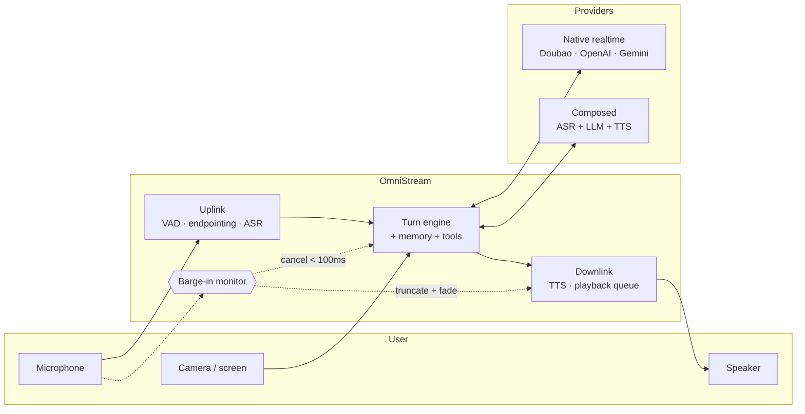
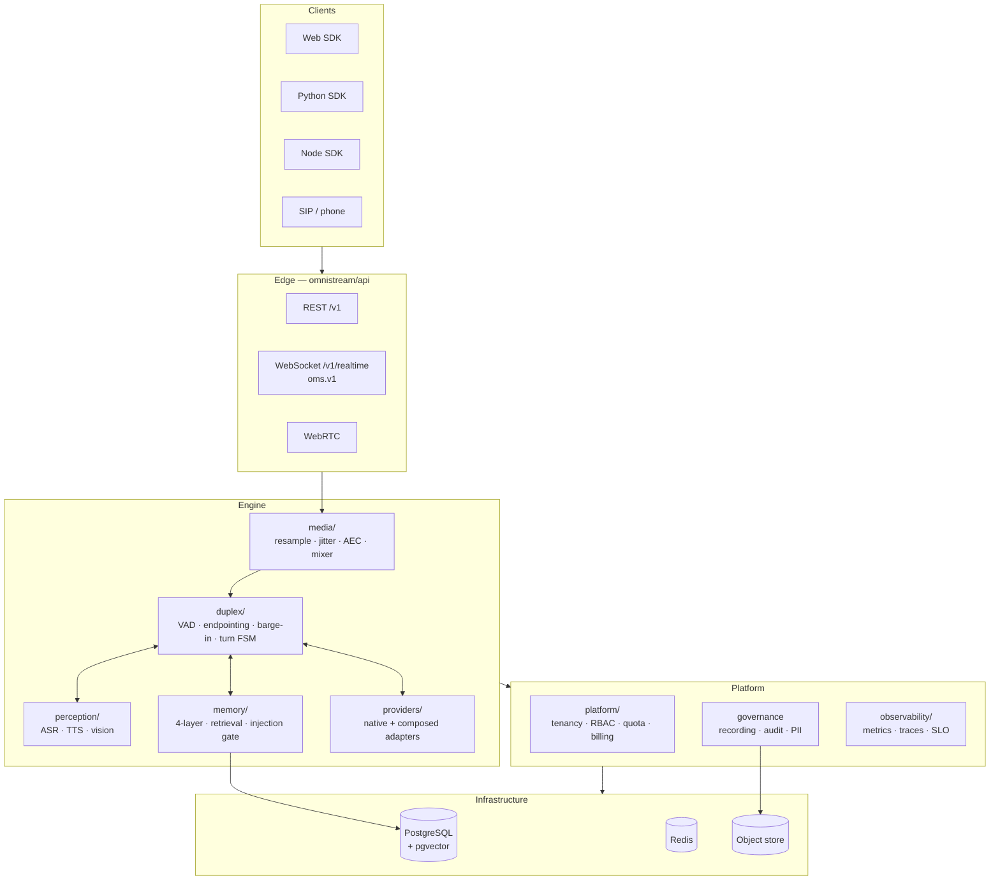
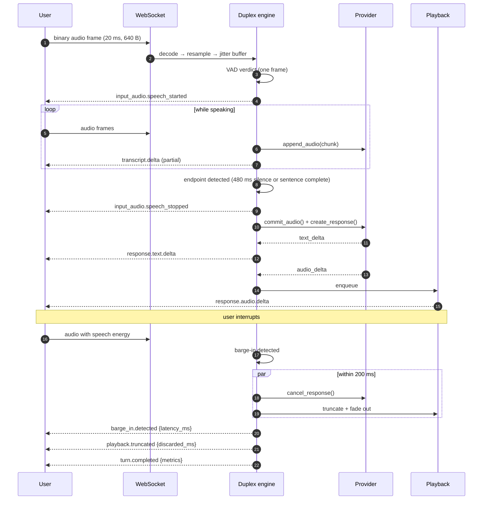

<div align="center">

# OmniStream

**Enterprise-grade realtime full-duplex omni-modal interaction platform**

*See, hear and speak — at the same time.*

[](LICENSE)
[](pyproject.toml)
[](https://fastapi.tiangolo.com/)
[](https://docs.pydantic.dev/)
[](https://github.com/omnistream/omnistream/actions/workflows/ci-backend.yml)
[](https://github.com/omnistream/omnistream/actions/workflows/codeql.yml)
[](https://omnistream.github.io/omnistream/)
[](docker-compose.yml)
[](docs/protocol-spec.md)
[](https://github.com/astral-sh/ruff)

[Documentation](docs/index.md) ·
[Protocol spec](docs/protocol-spec.md) ·
[Configuration](docs/configuration.md) ·
[Error codes](docs/error-codes.md) ·
[中文文档](README.zh-CN.md)

</div>

---

## Table of contents

- [What is OmniStream](#what-is-omnistream)
- [Why it exists](#why-it-exists)
- [Feature matrix](#feature-matrix)
- [Quick start](#quick-start)
- [Architecture](#architecture)
- [The realtime loop](#the-realtime-loop)
- [Provider support](#provider-support)
- [Using the API](#using-the-api)
- [Configuration](#configuration)
- [Observability & SLOs](#observability--slos)
- [Enterprise features](#enterprise-features)
- [Deployment](#deployment)
- [Repository layout](#repository-layout)
- [Development](#development)
- [Roadmap](#roadmap)
- [FAQ](#faq)
- [Contributing](#contributing)
- [License](#license)

---

## What is OmniStream

OmniStream is a self-hostable platform for building **realtime, full-duplex,
multimodal AI interactions** — the interaction model behind ByteDance **SeedRealtime**
and the **OpenAI Realtime API**, but as infrastructure you own.

"Full duplex" is not marketing here. It means:

- the user can **interrupt mid-sentence** and playback stops within **200 ms**;
- uplink audio, downlink audio and video sampling run **concurrently**, never in a
  request/response lockstep;
- the model **sees** the camera or screen share *while* it is listening and speaking;
- every turn produces measurable latency metrics — TTFT, TTFA, barge-in latency — that
  you can alert on.



---

## Why it exists

| Problem with the status quo | What OmniStream does about it |
| --- | --- |
| **Half-duplex feels robotic.** Record → upload → wait → play means the user cannot interrupt, and every pause feels like lag. | True concurrent duplex with a hard 200 ms barge-in budget, enforced and measured per turn. |
| **Vendor lock-in.** Each realtime API has its own event names, its own VAD semantics, its own cancellation quirks. | One `BaseRealtimeProvider` port. Swap Doubao for OpenAI with one environment variable; the engine cannot tell the difference. |
| **Composed pipelines are second-class.** Most frameworks support *either* a realtime API *or* ASR+LLM+TTS glue. | Composed providers implement the *same* port, so barge-in, metrics and recording work identically. |
| **Demos don't survive production.** No tenants, no quotas, no audit trail, no PII policy. | Multi-tenancy, RBAC, quota & rate limiting, billing records, recording + replay, hash-chained audit log, PII redaction — in the core, not a plugin. |
| **Realtime bugs are invisible.** "It felt slow yesterday" is not a bug report. | Per-turn `TurnMetrics`, structured logs correlated by `request_id`/`session_id`, Prometheus metrics, OTLP traces, replayable recordings. |
| **You need keys and GPUs just to look at it.** | `OMS_MOCK_MODE=true` runs the entire pipeline with a deterministic, zero-dependency mock provider. `docker compose up` and you're in. |

---

## Feature matrix

### Realtime duplex

| Capability | Status | Notes |
| --- | :---: | --- |
| Streaming uplink audio (20 ms frames) | ✅ | pcm16 / Opus / μ-law |
| Streaming downlink audio | ✅ | pcm16 @ 24 kHz default |
| Barge-in (interruption) | ✅ | 200 ms budget, measured every time |
| Confirmed cancellation | ✅ | Provider must go silent in 100 ms |
| VAD backends | ✅ | energy · WebRTC · Silero · ensemble |
| Semantic endpointing | ✅ | Sentence completeness, not just silence |
| Playback truncation with fade-out | ✅ | No click artefacts on interruption |
| Speaker diarization & tracking | ✅ | Multi-party sessions |
| Acoustic echo cancellation | ✅ | Passthrough · reference · Speex |
| Jitter buffer & clock drift correction | ✅ | Adaptive playout |
| Proactive speech triggers | ✅ | Assistant may speak first |

### Multimodal

| Capability | Status | Notes |
| --- | :---: | --- |
| Live video frame sampling | ✅ | Adaptive fps, scene-change aware |
| Screen sharing | ✅ | ROI cropping, downscaling |
| Vision observations during speech | ✅ | `vision.observation` events |
| Text input alongside voice | ✅ | Bypasses ASR |
| Tool / function calling | ✅ | JSON Schema validated |

### Memory

| Capability | Status | Notes |
| --- | :---: | --- |
| 4-layer memory model | ✅ | session · private state · stable knowledge · procedural |
| Vector retrieval | ✅ | pgvector · SQLite · in-memory |
| **Silent** retrieval | ✅ | Retrieved ≠ injected; gated by relevance × novelty × budget |
| Right to be forgotten | ✅ | `memory.delete` + cascade |

### Platform

| Capability | Status | Notes |
| --- | :---: | --- |
| Multi-tenancy | ✅ | Row-level tenant isolation |
| RBAC | ✅ | owner · admin · developer · service · viewer |
| API keys & JWT | ✅ | scrypt / BLAKE2b keyed digests |
| Quota & rate limiting | ✅ | Per-tenant, per-endpoint, concurrency caps |
| Usage & billing records | ✅ | Per-turn token / audio-second accounting |
| Recording & replay | ✅ | Deterministic event replay |
| Audit log with hash chain | ✅ | Tamper-evident |
| PII detection & redaction | ✅ | Configurable kinds |

---

## Quick start

### Option 1 — Docker (recommended, ~60 seconds)

```bash
git clone https://github.com/omnistream/omnistream.git
cd omnistream
docker compose up -d
```

That's it. **No API key. No GPU. No model download. No database setup.**
Compose starts in mock mode with SQLite and an in-process event bus.

```bash
curl -s localhost:8080/healthz
# {"status":"ok","version":"1.0.0","env":"dev"}

curl -s localhost:8080/version
# {"version":"1.0.0","protocol_version":"oms.v1","env":"dev",
#  "mock_mode":true,"default_provider":"mock"}
```

| Service | URL | Purpose |
| --- | --- | --- |
| API | <http://localhost:8080> | REST + WebSocket |
| Interactive docs | <http://localhost:8080/docs> | Swagger UI |
| Console | <http://localhost:5173> | Web console (dev profile) |
| Metrics | <http://localhost:8080/metrics> | Prometheus |

### Option 2 — Local Python

```bash
./scripts/bootstrap.sh           # venv + deps + .env + migrations + verification
source .venv/bin/activate
uvicorn omnistream.api.app:app --port 8080 --reload
```

Or manually:

```bash
python -m venv .venv && source .venv/bin/activate
pip install -r requirements.txt
cp .env.example .env
uvicorn omnistream.api.app:app --port 8080
```

### What mock mode actually runs

Mock mode is **not** a stub that returns canned strings. It exercises the real pipeline:

| Component | Mock behaviour | Real? |
| --- | --- | --- |
| VAD | Energy-based, pure numpy | **Real algorithm** |
| Endpointing | Silence + sentence completeness | **Real algorithm** |
| Barge-in | Full detect → cancel → truncate path | **Real, and timed** |
| Turn state machine | Full FSM with illegal-transition guards | **Real** |
| ASR | Deterministic transcript from audio length & hash | Simulated |
| LLM | `ScriptEngine` — intent rules + hash-stable replies | Simulated |
| TTS | Formant synthesis (glottal pulse + resonators) in numpy | **Real audio**, synthetic voice |
| Latency | Log-normal TTFT/TTFA sampling | Simulated, realistic |
| Metrics / recording / audit | Fully exercised | **Real** |

Because the mock is deterministic, it is also the conformance yardstick every new
provider adapter is tested against.

### Going live with a real provider

```bash
# .env
OMS_MOCK_MODE=false
OMS_PROVIDERS_DEFAULT=doubao
OMS_PROVIDERS_DOUBAO_API_KEY=your-key-here
OMS_PROVIDERS_FALLBACK_CHAIN=["doubao","openai","mock"]
```

Restart. Nothing else changes — same protocol, same events, same metrics.

---

## Architecture

A **modular monolith** with hexagonal boundaries: one process to operate, hard internal
seams so packages can be extracted later. Rationale in
[ADR 0001](docs/adr/0001-python-first-monolith.md).



### Layering rules (enforced in CI)

```
core        →  nothing            # vocabulary layer: errors, ids, clock, logging, streams
protocol    →  core
schemas     →  core
utils       →  core
config      →  core
providers   →  core, protocol, schemas, config, utils
media       →  + utils
perception  →  + media
duplex      →  + perception, providers
memory      →  + db
platform    →  + db
api / cli   →  everything
```

`core` importing anything from `omnistream` is a build failure, not a code review nit.

---

## The realtime loop



### Latency budget

| Stage | Budget | Constant |
| --- | ---: | --- |
| Frame ingest → VAD verdict | 20 ms | `DEFAULT_FRAME_MS` |
| Speech end → commit | 480 ms | `DEFAULT_MIN_SILENCE_MS` |
| **Barge-in → playback stopped** | **200 ms** | `BARGE_IN_BUDGET_MS` |
| **cancel() → provider silent** | **100 ms** | `CANCEL_BUDGET_MS` |
| User stops → first audio (TTFA) | 800 ms SLO | `slo_ttfa_ms` |

Every one of these is measured per turn and exported. Violations increment an SLO
counter rather than being quietly absorbed.

---

## Provider support

| Provider | Kind | Audio in/out | Video in | Native VAD | Tools | Status |
| --- | --- | :---: | :---: | :---: | :---: | --- |
| `mock` | built-in | ✅ | ✅ | ✅ | ✅ | **Stable** — zero deps, deterministic |
| `doubao` | native realtime | ✅ | ✅ | ✅ | ✅ | Beta |
| `openai` | native realtime | ✅ | ➖ | ✅ | ✅ | Beta |
| `gemini` | native realtime | ✅ | ✅ | ✅ | ✅ | Beta |
| `qwen` | native realtime | ✅ | ✅ | ✅ | ✅ | Beta |
| `stepfun` | native realtime | ✅ | ✅ | ✅ | ✅ | Alpha |
| `minimax` | native realtime | ✅ | ➖ | ➖ | ✅ | Alpha |
| `composed` | ASR + LLM + TTS | ✅ | ✅ | ➖ (uses ours) | ✅ | **Stable** |

Adding one is a single class:

```python
from omnistream.providers import register_provider
from omnistream.providers.base import BaseRealtimeProvider, ProviderEvent

@register_provider
class MyProvider(BaseRealtimeProvider):
    name = "my-provider"

    async def connect(self, session): ...
    async def append_audio(self, chunk): ...
    async def create_response(self, params): ...
    async def cancel_response(self): ...          # must be effective in < 100 ms
    def events(self) -> AsyncIterator[ProviderEvent]: ...
```

No central registry file to edit — see
[ADR 0002](docs/adr/0002-provider-abstraction.md) and the conformance checklist there.

---

## Using the API

### Python SDK

```python
import asyncio
from omnistream_sdk import OmniStreamClient

async def main() -> None:
    async with OmniStreamClient("ws://localhost:8080/v1/realtime",
                                api_key="oms_live_...") as client:
        session = await client.create_session(
            provider="mock",
            voice="alloy",
            language="zh-CN",
            barge_in=True,
        )

        async for event in session.events():
            match event.type:
                case "transcript.delta":
                    print("user:", event.payload["text"], end="\r")
                case "response.text.delta":
                    print("assistant:", event.payload["delta"], end="")
                case "response.audio.delta":
                    speaker.write(event.audio)          # raw pcm16
                case "barge_in.detected":
                    print(f"\n[interrupted in {event.payload['latency_ms']} ms]")
                case "turn.completed":
                    m = event.payload["metrics"]
                    print(f"\nTTFT {m['ttft_ms']} ms · TTFA {m['ttfa_ms']} ms")

asyncio.run(main())
```

### Browser

```javascript
const ws = new WebSocket("ws://localhost:8080/v1/realtime?protocol=oms.v1");
ws.binaryType = "arraybuffer";

ws.onmessage = (ev) => {
  if (typeof ev.data === "string") {
    const envelope = JSON.parse(ev.data);           // control plane
    handleEvent(envelope);
  } else {
    const { header, payload } = decodeBinaryFrame(ev.data);  // media plane
    if (header.enc === "pcm16") playbackQueue.push(payload);
  }
};

// 20 ms of 16 kHz mono pcm16 = 640 bytes
function sendAudio(pcm16) {
  ws.send(encodeBinaryFrame(1, { sid, pts: now(), sr: 16000, ch: 1, enc: "pcm16" }, pcm16));
}
```

Binary layout is fully specified in [protocol-spec.md §5](docs/protocol-spec.md).

### REST

```bash
# create a session
curl -X POST localhost:8080/v1/sessions \
  -H "X-API-Key: oms_live_..." -H "Content-Type: application/json" \
  -d '{"provider":"mock","language":"zh-CN","barge_in":{"enabled":true}}'

# inspect a turn's metrics
curl localhost:8080/v1/sessions/ses_.../turns -H "X-API-Key: oms_live_..."

# provider health
curl localhost:8080/v1/providers/health -H "X-API-Key: oms_live_..."
```

Every error uses the same body:

```json
{"code":"OMS-6003","message":"provider timed out after 60s",
 "detail":{"provider":"doubao"},"request_id":"req_01J8Z…","retryable":true}
```

---

## Configuration

Everything is environment-driven and validated at startup — an invalid value fails fast
with `OMS-1100` rather than producing a half-configured process.

```bash
OMS_ENV=prod
OMS_MOCK_MODE=false

OMS_PROVIDERS_DEFAULT=doubao
OMS_PROVIDERS_DOUBAO_API_KEY=***
OMS_PROVIDERS_FALLBACK_CHAIN=["doubao","openai","mock"]

OMS_DUPLEX_VAD_BACKEND=silero
OMS_DUPLEX_BARGE_IN_BUDGET_MS=200
OMS_DUPLEX_MIN_SILENCE_MS=480

OMS_STORAGE_DATABASE_URL=postgresql+asyncpg://oms:***@db:5432/omnistream
OMS_STORAGE_REDIS_URL=redis://redis:6379/0
OMS_STORAGE_EVENT_BUS=redis

OMS_SECURITY_JWT_SECRET=***
OMS_SECURITY_API_KEY_SALT=***
OMS_SECURITY_CREDENTIAL_ENCRYPTION_KEY=***

OMS_OBSERVABILITY_LOG_FORMAT=json
OMS_OBSERVABILITY_TRACING_ENABLED=true
```

Full reference: [docs/configuration.md](docs/configuration.md).
Start from [.env.example](.env.example) — it boots without a single edit.

---

## Observability & SLOs

### Per-turn metrics

| Metric | Meaning |
| --- | --- |
| `ttft_ms` | Time to first token from the provider |
| `ttfa_ms` | **Time to first audio** — what the user actually perceives |
| `barge_in_latency_ms` | Interruption detected → playback stopped |
| `cancel_latency_ms` | `cancel_response()` → provider silent |
| `asr_partial_ms` | First partial transcript |
| `rtf` | Realtime factor of synthesis |
| `queue_depth` | Playback backlog, in frames |

### Structured logs

```json
{"event":"turn_completed","level":"info","timestamp":"2026-07-13T09:12:44.831Z",
 "request_id":"req_01J8Z…","session_id":"ses_01J8Z…","tenant_id":"tnt_acme",
 "turn_id":"trn_01J8Z…","provider":"doubao","ttfa_ms":612,"barge_in":false,
 "stop_reason":"completed"}
```

`request_id`, `session_id` and `tenant_id` are injected from contextvars into **every**
log line — no manual threading through call stacks.

### Endpoints

| Endpoint | Purpose |
| --- | --- |
| `/healthz` | Liveness — never touches a dependency |
| `/readyz` | Readiness — 503 until all lifecycle hooks completed |
| `/metrics` | Prometheus exposition |
| `/version` | Build, protocol version, active provider |

---

## Enterprise features

<details>
<summary><b>Multi-tenancy & RBAC</b></summary>

Five roles with a strict ordering — `viewer < service < developer < admin < owner` —
plus fine-grained permissions. Tenant isolation is enforced at the repository layer, not
by convention: every query is scoped by `tenant_id` from the authenticated `Principal`.

```python
@router.delete(
    "/sessions/{session_id}",
    dependencies=[Depends(require_perm(Permission.SESSION_WRITE))],
)
async def delete_session(session_id: str, tenant_id: CurrentTenantId): ...
```
</details>

<details>
<summary><b>Quota, rate limiting & billing</b></summary>

Per-tenant policies cover requests/minute, concurrent sessions, audio-seconds/day and
tokens/month. Usage records are written per turn and priced against a `PriceBook`,
producing invoice lines you can reconcile.

Exceeding a quota returns `OMS-2100` (402) with the reset time; rate limits return
`OMS-2101` (429) with `Retry-After`.
</details>

<details>
<summary><b>Recording, replay & audit</b></summary>

Sessions can be recorded as an ordered event log plus media segments. Replay is
deterministic: feeding the manifest back through the engine reproduces the same turn
boundaries and metrics — invaluable for debugging "it was slow yesterday".

Audit events are hash-chained (`prev_hash → hash`), so any tampering breaks the chain
and `verify_chain()` reports exactly where.
</details>

<details>
<summary><b>PII handling</b></summary>

Configurable detectors for phone numbers, emails, ID numbers, bank cards and addresses.
Redaction applies to logs, recordings and audit payloads. Transcript logging is **off by
default** (`OMS_SECURITY_LOG_TRANSCRIPTS=false`) because transcripts are user content,
not telemetry.
</details>

<details>
<summary><b>Memory that knows when to stay quiet</b></summary>

Four layers with distinct write policies and TTLs. Crucially, retrieval is *silent*:
a hit does not become a prompt injection unless it clears relevance **and** novelty
thresholds and fits the per-turn budget — capped at **one injection per turn**.
Nothing tanks a voice product faster than an assistant that keeps reciting what it
remembers.
</details>

---

## Deployment

### Docker Compose (single node)

```bash
docker compose up -d                                    # mock mode, SQLite
docker compose -f docker-compose.yml -f docker-compose.dev.yml up   # + hot reload
```

Production compose adds Postgres + pgvector, Redis, a Celery worker and the console.

### Kubernetes / Helm

```bash
helm repo add omnistream https://omnistream.github.io/charts
helm install omnistream omnistream/omnistream \
  --set image.tag=1.0.0 \
  --set config.mockMode=false \
  --set-string config.providers.default=doubao \
  --set existingSecret=omnistream-secrets
```

Replicas are stateless with respect to sessions once `OMS_STORAGE_EVENT_BUS=redis`.
Run migrations from a `Job`, not from every pod (`OMS_STORAGE_AUTO_MIGRATE=false`).

### Sizing rule of thumb

| Concurrent sessions | Replicas | CPU / replica | Memory / replica |
| ---: | ---: | --- | --- |
| ≤ 20 | 1 | 2 vCPU | 2 GiB |
| ≤ 100 | 3 | 4 vCPU | 4 GiB |
| ≤ 500 | 8–12 | 4 vCPU | 6 GiB |

Local ASR/TTS models add substantial CPU or a GPU; provider-hosted perception does not.

---

## Repository layout

```
omnistream/
├── core/           # error codes, errors, ids, clock, logging, registry, streams,
│                   # ring buffer, event bus, lifecycle, retry, circuit breaker
├── protocol/       # oms.v1: envelope, enums, binary frames, codec, versioning
├── schemas/        # pydantic domain models (audio, session, turn, memory, …)
├── config/         # pydantic-settings, one class per subsystem
├── utils/          # audio math, text norm, hashing, crypto, asyncio, validators, fileio
├── media/          # audio & video pipelines
├── duplex/         # VAD, endpointing, barge-in, turn FSM, speaker tracking
├── perception/     # ASR / TTS / vision engines
├── providers/      # BaseRealtimeProvider + adapters (mock ships in-tree)
├── memory/         # 4-layer memory, retrieval, injection gate
├── db/             # SQLAlchemy models & repositories
├── platform/       # tenancy, auth, RBAC, quota, billing
├── observability/  # metrics, tracing, SLO evaluation
├── api/            # FastAPI app, auto-discovered routers, middleware, deps
└── cli/            # typer CLI

docs/               # documentation + ADRs (mkdocs-material)
scripts/            # bootstrap, OpenAPI & JSON Schema generators
deploy/             # container entrypoints, Helm chart
migrations/         # alembic
```

### Adding an endpoint without touching shared files

Drop a module into `omnistream/api/routers/` that exports `router`:

```python
# omnistream/api/routers/my_feature.py
from fastapi import APIRouter

router = APIRouter(prefix="/my-feature", tags=["my-feature"])
ROUTER_ORDER = 50          # optional; lower mounts earlier

@router.get("/")
async def list_things() -> dict[str, list[str]]:
    return {"things": []}
```

It is discovered and mounted automatically at startup. This convention exists so that
parallel workstreams never contend for the same file.

---

## Development

```bash
./scripts/bootstrap.sh --all      # venv + core + dev + local model deps

make run          # uvicorn with reload
make lint         # ruff check + ruff format --check
make typecheck    # mypy
make fmt          # ruff format
make openapi      # regenerate docs/openapi.json
make schema       # regenerate protocol JSON Schema
make docs         # serve docs on :8000
make migrate      # alembic upgrade head
make docker       # build images
```

### Code standards

- Python 3.11+, `from __future__ import annotations` everywhere.
- Full type annotations; `mypy` runs in strict-ish mode.
- `ruff` for linting *and* formatting — line length 100.
- Google-style docstrings on public classes and functions.
- **No** `TODO`, `pass`-as-placeholder, or unimplemented branches on `main`.
- Errors carry an `ErrorCode`; log messages are events (`turn_completed`), not sentences.

---

## Roadmap

| Milestone | Content | Status |
| --- | --- | --- |
| **v1.0** | Duplex core, mock provider, protocol `oms.v1`, tenancy, quotas, recording | ✅ Shipped |
| **v1.1** | WebRTC transport GA, SIP gateway, speaker diarization improvements | 🚧 In progress |
| **v1.2** | Agent graph orchestration, multi-agent handoff | 📋 Planned |
| **v1.3** | On-device edge runtime, WASM VAD | 📋 Planned |
| **v2.0** | Distributed session mesh, cross-region failover | 💭 Exploring |

---

## FAQ

<details>
<summary><b>Do I need a GPU?</b></summary>

No. Mock mode and provider-hosted perception are CPU-only. A GPU helps only if you run
local ASR/TTS/vision models (`requirements-local-models.txt`).
</details>

<details>
<summary><b>Can I use it without any external API?</b></summary>

Yes — that is exactly what `OMS_MOCK_MODE=true` is for, and it is the default in
`docker compose up`. The duplex machinery is real; only the model content is synthesised.
</details>

<details>
<summary><b>How is this different from LiveKit Agents or Pipecat?</b></summary>

They are excellent frameworks for *building* an agent. OmniStream is a *platform*: it
adds multi-tenancy, RBAC, quotas, billing records, recording/replay, hash-chained audit,
PII policy and a provider abstraction with a measured cancellation contract. If you need
one agent, use a framework. If you need to run many agents for many customers with an
SLA, you need the platform layer.
</details>

<details>
<summary><b>Why Python, given the latency requirements?</b></summary>

Because the AI ecosystem is Python and the dominant latency term is network + model
inference, not interpreter overhead. The frame granularity is 20 ms; Python comfortably
fits inside that when CPU-bound work is pushed off the loop. Full reasoning and the
revisit criteria are in [ADR 0001](docs/adr/0001-python-first-monolith.md).
</details>

<details>
<summary><b>Is the protocol stable?</b></summary>

`oms.v1` is stable within its major version: additive changes only. Clients must ignore
unknown event types and fields. See [protocol-spec.md §1](docs/protocol-spec.md).
</details>

<details>
<summary><b>How do I migrate from the OpenAI Realtime API?</b></summary>

Set `OMS_PROVIDERS_DEFAULT=openai` and point your client at OmniStream's WebSocket. Event
names differ (`response.audio.delta` vs OpenAI's naming), but the SDKs provide a
compatibility shim, and you gain barge-in metrics, recording and fallback for free.
</details>

---

## Contributing

Contributions are very welcome — especially provider adapters, VAD/ASR/TTS backends and
SDKs.

1. Read [CONTRIBUTING.md](CONTRIBUTING.md) and [CODE_OF_CONDUCT.md](CODE_OF_CONDUCT.md).
2. Open an issue first for anything larger than a bug fix
   (there is a [provider request template](.github/ISSUE_TEMPLATE/provider_request.yml)).
3. `make lint typecheck` must pass; CI enforces it.
4. New provider adapters must satisfy the conformance checklist in
   [ADR 0002](docs/adr/0002-provider-abstraction.md).

Security issues: **do not** open a public issue — see [SECURITY.md](SECURITY.md).

Project governance and decision-making: [GOVERNANCE.md](GOVERNANCE.md).

---

## License

[Apache License 2.0](LICENSE) © 2026 OmniStream contributors.

Apache-2.0 includes an explicit patent grant, which matters for a platform enterprises
are expected to self-host and extend.

<div align="center">
<sub>Built for people who think a 200 ms interruption budget is a requirement, not a nice-to-have.</sub>
</div>
