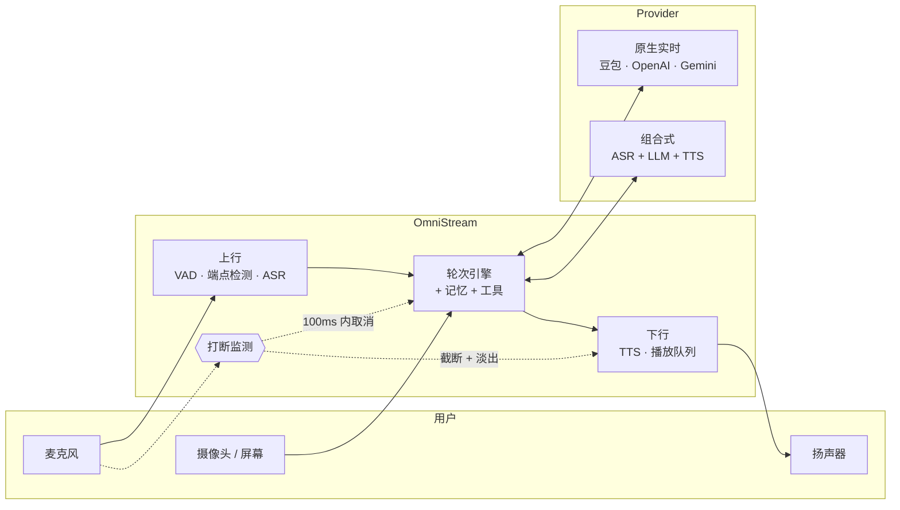
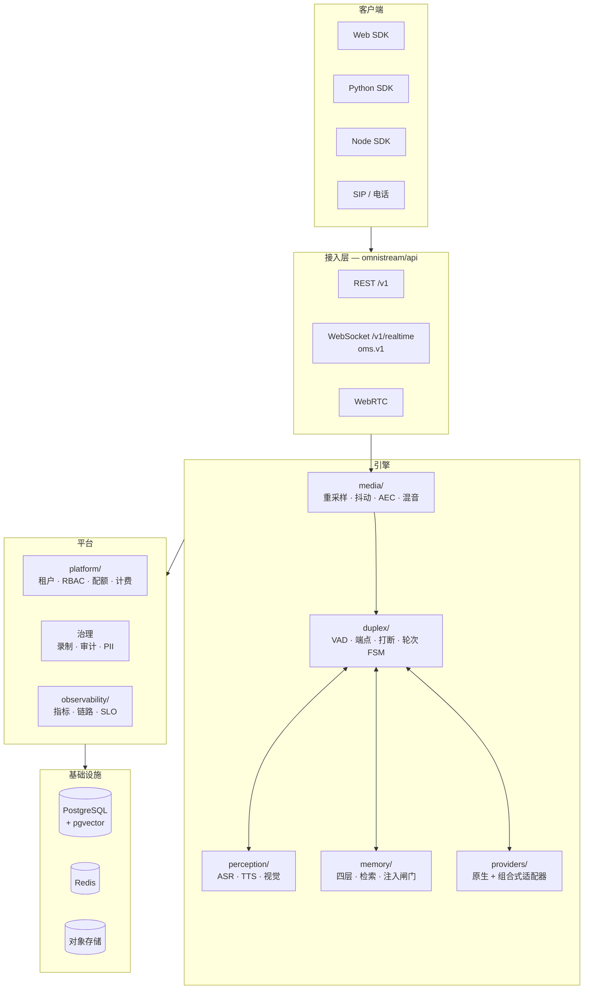
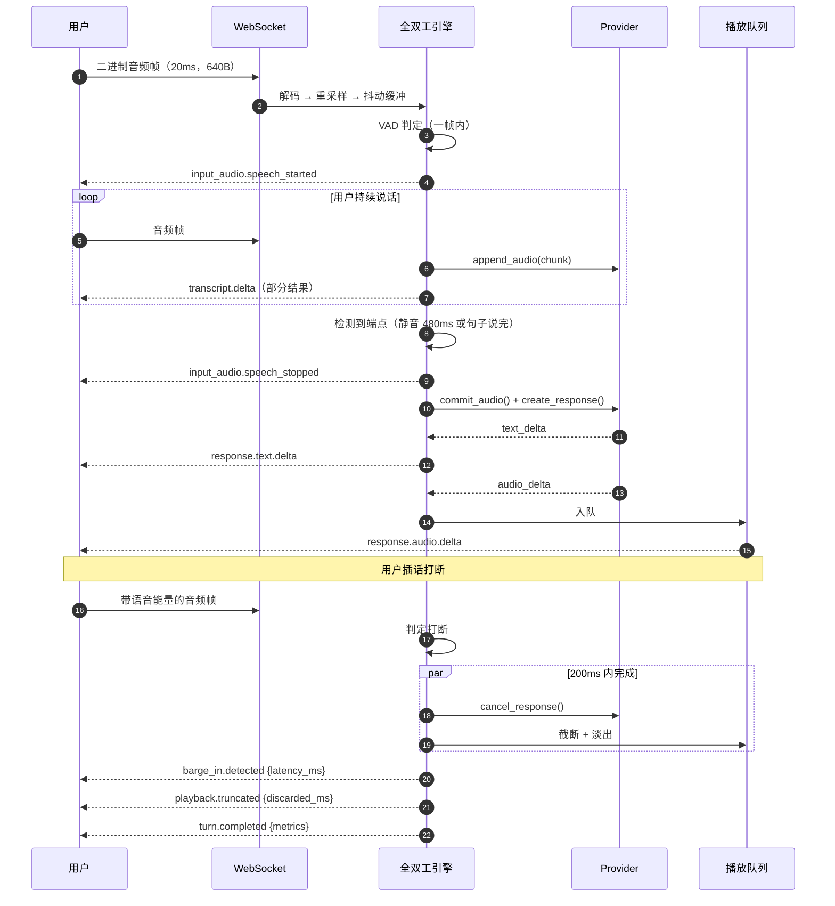

<div align="center">

# OmniStream

**企业级实时全双工音视频多模态交互平台**

*边看、边听、边说 —— 同时进行。*

[](LICENSE)
[](pyproject.toml)
[](https://fastapi.tiangolo.com/)
[](https://docs.pydantic.dev/)
[](https://github.com/omnistream/omnistream/actions/workflows/ci-backend.yml)
[](docker-compose.yml)
[](docs/protocol-spec.md)

[文档](docs/index.md) ·
[协议规范](docs/protocol-spec.md) ·
[配置说明](docs/configuration.md) ·
[错误码](docs/error-codes.md) ·
[English](README.md)

</div>

---

## 目录

- [这是什么](#这是什么)
- [为什么需要它](#为什么需要它)
- [能力矩阵](#能力矩阵)
- [快速开始](#快速开始)
- [架构](#架构)
- [实时闭环](#实时闭环)
- [Provider 支持](#provider-支持)
- [接口用法](#接口用法)
- [配置](#配置)
- [可观测性与 SLO](#可观测性与-slo)
- [企业能力](#企业能力)
- [部署](#部署)
- [仓库结构](#仓库结构)
- [本地开发](#本地开发)
- [路线图](#路线图)
- [常见问题](#常见问题)
- [参与贡献](#参与贡献)
- [许可证](#许可证)

---

## 这是什么

OmniStream 是一个**可自托管**的实时全双工多模态交互平台 —— 对标字节 **SeedRealtime**
与 **OpenAI Realtime API** 的交互范式，但基础设施完全由你掌控。

这里说的"全双工"不是营销词，它有硬指标：

- 用户可以**说到一半打断**，播放在 **200ms** 内真正停止；
- 上行音频、下行音频、视频采样**并发进行**，不是一问一答的锁步；
- 模型在**听和说的同时看**着摄像头或屏幕共享画面；
- 每一轮对话都产出可告警的延迟指标 —— TTFT、TTFA、打断延迟。



---

## 为什么需要它

| 现状的问题 | OmniStream 的做法 |
| --- | --- |
| **半双工像机器人。** 录音 → 上传 → 等待 → 播放，用户没法打断，每个停顿都像卡顿。 | 真并发全双工，200ms 打断预算是硬约束，且每轮都实测。 |
| **被单一厂商绑死。** 每家实时 API 的事件名、VAD 语义、取消行为都不一样。 | 一个 `BaseRealtimeProvider` 端口。改一个环境变量就能从豆包切到 OpenAI，引擎无感。 |
| **组合式管线是二等公民。** 多数框架只支持实时 API *或* ASR+LLM+TTS 拼装，二选一。 | 组合式 Provider 实现**同一个**端口，打断、指标、录制行为完全一致。 |
| **Demo 撑不到生产。** 没有租户、没有配额、没有审计、没有 PII 策略。 | 多租户、RBAC、配额限流、计费记录、录制回放、哈希链审计、PII 脱敏 —— 都在内核里，不是插件。 |
| **实时问题看不见。** "昨天感觉有点慢"不是一份可用的缺陷报告。 | 每轮 `TurnMetrics`、按 `request_id`/`session_id` 串联的结构化日志、Prometheus 指标、OTLP 链路、可回放录制。 |
| **想看一眼还得先搞密钥和显卡。** | `OMS_MOCK_MODE=true` 用零依赖的确定性 mock provider 跑通整条链路。`docker compose up` 即可。 |

---

## 能力矩阵

### 实时全双工

| 能力 | 状态 | 说明 |
| --- | :---: | --- |
| 上行流式音频（20ms 帧） | ✅ | pcm16 / Opus / μ-law |
| 下行流式音频 | ✅ | 默认 pcm16 @ 24kHz |
| 打断（barge-in） | ✅ | 200ms 预算，每次实测 |
| 可确认的取消 | ✅ | Provider 必须 100ms 内静音 |
| VAD 后端 | ✅ | 能量 · WebRTC · Silero · 集成 |
| 语义端点检测 | ✅ | 看句子是否说完，不只是看静音 |
| 播放截断 + 淡出 | ✅ | 打断时不产生爆音 |
| 说话人分离与跟踪 | ✅ | 多人会话 |
| 回声消除 AEC | ✅ | 直通 · 参考 · Speex |
| 抖动缓冲与时钟漂移校正 | ✅ | 自适应播出 |
| 主动开口触发 | ✅ | 助手可以先说话 |

### 多模态

| 能力 | 状态 | 说明 |
| --- | :---: | --- |
| 实时视频抽帧 | ✅ | 自适应帧率、感知场景切换 |
| 屏幕共享 | ✅ | ROI 裁剪、降分辨率 |
| 说话过程中的视觉观察 | ✅ | `vision.observation` 事件 |
| 文字输入与语音并存 | ✅ | 跳过 ASR |
| 工具 / 函数调用 | ✅ | JSON Schema 校验 |

### 记忆

| 能力 | 状态 | 说明 |
| --- | :---: | --- |
| 四层记忆模型 | ✅ | 会话 · 私有状态 · 稳定知识 · 程序性 |
| 向量检索 | ✅ | pgvector · SQLite · 内存 |
| **静默**检索 | ✅ | 检索到 ≠ 会注入；由相关性 × 新颖度 × 预算共同裁决 |
| 被遗忘权 | ✅ | `memory.delete` + 级联清理 |

### 平台

| 能力 | 状态 | 说明 |
| --- | :---: | --- |
| 多租户 | ✅ | 行级租户隔离 |
| RBAC | ✅ | owner · admin · developer · service · viewer |
| API Key 与 JWT | ✅ | scrypt / BLAKE2b 带密钥摘要 |
| 配额与限流 | ✅ | 按租户、按接口、并发上限 |
| 用量与计费记录 | ✅ | 按轮计 token / 音频秒数 |
| 录制与回放 | ✅ | 确定性事件回放 |
| 哈希链审计日志 | ✅ | 防篡改可验证 |
| PII 识别与脱敏 | ✅ | 类型可配置 |

---

## 快速开始

### 方式一 —— Docker（推荐，约 60 秒）

```bash
git clone https://github.com/omnistream/omnistream.git
cd omnistream
docker compose up -d
```

就这样。**不需要 API Key、不需要显卡、不需要下载模型、不需要建数据库。**
Compose 默认以 mock 模式启动，用 SQLite 与进程内事件总线。

```bash
curl -s localhost:8080/healthz
# {"status":"ok","version":"1.0.0","env":"dev"}

curl -s localhost:8080/version
# {"version":"1.0.0","protocol_version":"oms.v1","env":"dev",
#  "mock_mode":true,"default_provider":"mock"}
```

| 服务 | 地址 | 用途 |
| --- | --- | --- |
| API | <http://localhost:8080> | REST + WebSocket |
| 交互式文档 | <http://localhost:8080/docs> | Swagger UI |
| 控制台 | <http://localhost:5173> | Web 控制台（dev profile） |
| 指标 | <http://localhost:8080/metrics> | Prometheus |

### 方式二 —— 本地 Python

```bash
./scripts/bootstrap.sh           # 建虚拟环境 + 装依赖 + 生成 .env + 迁移 + 自检
source .venv/bin/activate
uvicorn omnistream.api.app:app --port 8080 --reload
```

或手工执行：

```bash
python -m venv .venv && source .venv/bin/activate
pip install -r requirements.txt
cp .env.example .env
uvicorn omnistream.api.app:app --port 8080
```

### mock 模式究竟跑了什么

mock 模式**不是**返回罐头字符串的桩，它跑的是真实管线：

| 组件 | mock 行为 | 是否真实 |
| --- | --- | --- |
| VAD | 基于能量，纯 numpy | **真算法** |
| 端点检测 | 静音时长 + 句子完整度 | **真算法** |
| 打断 | 完整的检测 → 取消 → 截断链路 | **真实，且计时** |
| 轮次状态机 | 完整 FSM，含非法迁移守卫 | **真实** |
| ASR | 由音频长度与哈希确定性生成转写 | 模拟 |
| LLM | `ScriptEngine` —— 意图规则 + 哈希稳定回复 | 模拟 |
| TTS | numpy 共振峰合成（声门脉冲 + 共振器） | **真音频**，合成音色 |
| 延迟 | 对数正态采样 TTFT/TTFA | 模拟，但贴近真实分布 |
| 指标 / 录制 / 审计 | 完整走通 | **真实** |

正因为 mock 是确定性的，它同时也是新 Provider 适配器的一致性基准。

### 接入真实 Provider

```bash
# .env
OMS_MOCK_MODE=false
OMS_PROVIDERS_DEFAULT=doubao
OMS_PROVIDERS_DOUBAO_API_KEY=你的密钥
OMS_PROVIDERS_FALLBACK_CHAIN=["doubao","openai","mock"]
```

重启即可。其他什么都不用改 —— 协议一样、事件一样、指标一样。

---

## 架构

**模块化单体 + 六边形边界**：只有一个进程要运维，但内部接缝是硬的，将来可以按需拆服务。
理由见 [ADR 0001](docs/adr/0001-python-first-monolith.md)。



### 分层纪律（CI 强制）

```
core        →  无依赖              # 词汇层：错误、ID、时钟、日志、流
protocol    →  core
schemas     →  core
utils       →  core
config      →  core
providers   →  core, protocol, schemas, config, utils
media       →  + utils
perception  →  + media
duplex      →  + perception, providers
memory      →  + db
platform    →  + db
api / cli   →  全部
```

`core` 里出现 `from omnistream.xxx` 会直接构建失败，不是 code review 时的口头提醒。

---

## 实时闭环



### 延迟预算

| 阶段 | 预算 | 常量 |
| --- | ---: | --- |
| 帧到达 → VAD 判定 | 20ms | `DEFAULT_FRAME_MS` |
| 说话结束 → commit | 480ms | `DEFAULT_MIN_SILENCE_MS` |
| **打断 → 播放停止** | **200ms** | `BARGE_IN_BUDGET_MS` |
| **cancel() → Provider 静音** | **100ms** | `CANCEL_BUDGET_MS` |
| 用户说完 → 首个音频（TTFA） | 800ms SLO | `slo_ttfa_ms` |

每一项都按轮实测并导出。超标会计入 SLO 违约计数，而不是被悄悄咽下去。

---

## Provider 支持

| Provider | 类型 | 音频进/出 | 视频进 | 原生 VAD | 工具 | 状态 |
| --- | --- | :---: | :---: | :---: | :---: | --- |
| `mock` | 内置 | ✅ | ✅ | ✅ | ✅ | **稳定** —— 零依赖、确定性 |
| `doubao` | 原生实时 | ✅ | ✅ | ✅ | ✅ | Beta |
| `openai` | 原生实时 | ✅ | ➖ | ✅ | ✅ | Beta |
| `gemini` | 原生实时 | ✅ | ✅ | ✅ | ✅ | Beta |
| `qwen` | 原生实时 | ✅ | ✅ | ✅ | ✅ | Beta |
| `stepfun` | 原生实时 | ✅ | ✅ | ✅ | ✅ | Alpha |
| `minimax` | 原生实时 | ✅ | ➖ | ➖ | ✅ | Alpha |
| `composed` | ASR + LLM + TTS | ✅ | ✅ | ➖（用平台的） | ✅ | **稳定** |

新增一个只需一个类：

```python
from omnistream.providers import register_provider
from omnistream.providers.base import BaseRealtimeProvider, ProviderEvent

@register_provider
class MyProvider(BaseRealtimeProvider):
    name = "my-provider"

    async def connect(self, session): ...
    async def append_audio(self, chunk): ...
    async def create_response(self, params): ...
    async def cancel_response(self): ...          # 必须 100ms 内生效
    def events(self) -> AsyncIterator[ProviderEvent]: ...
```

不需要改任何公共注册表文件 —— 见 [ADR 0002](docs/adr/0002-provider-abstraction.md)
里的一致性检查清单。

---

## 接口用法

### Python SDK

```python
import asyncio
from omnistream_sdk import OmniStreamClient

async def main() -> None:
    async with OmniStreamClient("ws://localhost:8080/v1/realtime",
                                api_key="oms_live_...") as client:
        session = await client.create_session(
            provider="mock",
            voice="alloy",
            language="zh-CN",
            barge_in=True,
        )

        async for event in session.events():
            match event.type:
                case "transcript.delta":
                    print("用户：", event.payload["text"], end="\r")
                case "response.text.delta":
                    print(event.payload["delta"], end="")
                case "response.audio.delta":
                    speaker.write(event.audio)          # 裸 pcm16
                case "barge_in.detected":
                    print(f"\n[被打断，耗时 {event.payload['latency_ms']}ms]")
                case "turn.completed":
                    m = event.payload["metrics"]
                    print(f"\nTTFT {m['ttft_ms']}ms · TTFA {m['ttfa_ms']}ms")

asyncio.run(main())
```

### 浏览器

```javascript
const ws = new WebSocket("ws://localhost:8080/v1/realtime?protocol=oms.v1");
ws.binaryType = "arraybuffer";

ws.onmessage = (ev) => {
  if (typeof ev.data === "string") {
    handleEvent(JSON.parse(ev.data));                        // 控制面
  } else {
    const { header, payload } = decodeBinaryFrame(ev.data);  // 媒体面
    if (header.enc === "pcm16") playbackQueue.push(payload);
  }
};

// 20ms 的 16kHz 单声道 pcm16 = 640 字节
function sendAudio(pcm16) {
  ws.send(encodeBinaryFrame(1, { sid, pts: now(), sr: 16000, ch: 1, enc: "pcm16" }, pcm16));
}
```

二进制帧布局见 [protocol-spec.md §5](docs/protocol-spec.md)。

### REST

```bash
# 创建会话
curl -X POST localhost:8080/v1/sessions \
  -H "X-API-Key: oms_live_..." -H "Content-Type: application/json" \
  -d '{"provider":"mock","language":"zh-CN","barge_in":{"enabled":true}}'

# 查看某轮指标
curl localhost:8080/v1/sessions/ses_.../turns -H "X-API-Key: oms_live_..."

# Provider 健康度
curl localhost:8080/v1/providers/health -H "X-API-Key: oms_live_..."
```

所有错误统一结构：

```json
{"code":"OMS-6003","message":"provider timed out after 60s",
 "detail":{"provider":"doubao"},"request_id":"req_01J8Z…","retryable":true}
```

---

## 配置

全部走环境变量，启动时校验 —— 值非法就直接以 `OMS-1100` 失败退出，绝不带着半吊子配置跑起来。

```bash
OMS_ENV=prod
OMS_MOCK_MODE=false

OMS_PROVIDERS_DEFAULT=doubao
OMS_PROVIDERS_DOUBAO_API_KEY=***
OMS_PROVIDERS_FALLBACK_CHAIN=["doubao","openai","mock"]

OMS_DUPLEX_VAD_BACKEND=silero
OMS_DUPLEX_BARGE_IN_BUDGET_MS=200
OMS_DUPLEX_MIN_SILENCE_MS=480

OMS_STORAGE_DATABASE_URL=postgresql+asyncpg://oms:***@db:5432/omnistream
OMS_STORAGE_REDIS_URL=redis://redis:6379/0
OMS_STORAGE_EVENT_BUS=redis

OMS_SECURITY_JWT_SECRET=***
OMS_SECURITY_API_KEY_SALT=***
OMS_SECURITY_CREDENTIAL_ENCRYPTION_KEY=***

OMS_OBSERVABILITY_LOG_FORMAT=json
OMS_OBSERVABILITY_TRACING_ENABLED=true
```

完整清单见 [docs/configuration.md](docs/configuration.md)。
可以直接从 [.env.example](.env.example) 起步 —— 一个字不改也能跑起来。

---

## 可观测性与 SLO

### 每轮指标

| 指标 | 含义 |
| --- | --- |
| `ttft_ms` | Provider 首个 token 的时间 |
| `ttfa_ms` | **首个音频的时间** —— 这才是用户真实感知到的 |
| `barge_in_latency_ms` | 检测到打断 → 播放停止 |
| `cancel_latency_ms` | `cancel_response()` → Provider 静音 |
| `asr_partial_ms` | 首个部分转写 |
| `rtf` | 合成的实时率 |
| `queue_depth` | 播放积压帧数 |

### 结构化日志

```json
{"event":"turn_completed","level":"info","timestamp":"2026-07-13T09:12:44.831Z",
 "request_id":"req_01J8Z…","session_id":"ses_01J8Z…","tenant_id":"tnt_acme",
 "turn_id":"trn_01J8Z…","provider":"doubao","ttfa_ms":612,"barge_in":false,
 "stop_reason":"completed"}
```

`request_id`、`session_id`、`tenant_id` 通过 contextvars 自动注入**每一条**日志 ——
不需要在调用链里手工层层传递。

### 端点

| 端点 | 用途 |
| --- | --- |
| `/healthz` | 存活探针 —— 不碰任何外部依赖 |
| `/readyz` | 就绪探针 —— 生命周期钩子全部完成前返回 503 |
| `/metrics` | Prometheus 指标 |
| `/version` | 版本、协议版本、当前 Provider |

---

## 企业能力

<details>
<summary><b>多租户与 RBAC</b></summary>

五种角色，严格有序：`viewer < service < developer < admin < owner`，另有细粒度权限。
租户隔离在仓储层强制执行，不靠自觉：每个查询都用鉴权得到的 `Principal.tenant_id` 收窄。

```python
@router.delete(
    "/sessions/{session_id}",
    dependencies=[Depends(require_perm(Permission.SESSION_WRITE))],
)
async def delete_session(session_id: str, tenant_id: CurrentTenantId): ...
```
</details>

<details>
<summary><b>配额、限流与计费</b></summary>

按租户配置每分钟请求数、并发会话数、每日音频秒数、每月 token 数。用量按轮落库，
依据 `PriceBook` 定价并生成可对账的账单行。

超配额返回 `OMS-2100`（402）并给出重置时间；触发限流返回 `OMS-2101`（429）并带
`Retry-After`。
</details>

<details>
<summary><b>录制、回放与审计</b></summary>

会话可录制为有序事件日志 + 媒体分片。回放是确定性的：把清单喂回引擎能复现出相同的
轮次边界与指标 —— 排查"昨天感觉有点慢"时极其有用。

审计事件带哈希链（`prev_hash → hash`），任何篡改都会断链，`verify_chain()`
会精确指出断在哪一条。
</details>

<details>
<summary><b>PII 处理</b></summary>

内置手机号、邮箱、身份证号、银行卡号、地址等检测器，脱敏同时作用于日志、录制与审计负载。
转写日志**默认关闭**（`OMS_SECURITY_LOG_TRANSCRIPTS=false`），因为转写是用户内容，
不是遥测数据。
</details>

<details>
<summary><b>知道什么时候该闭嘴的记忆</b></summary>

四层记忆，各有各的写入策略与 TTL。关键在于检索是**静默**的：命中不等于会被注入 Prompt，
必须同时越过相关性与新颖度阈值、并且装得下每轮预算 —— 上限是**每轮 1 条**。
没有什么比一个反复复述"我记得你说过"的助手更快毁掉一个语音产品。
</details>

---

## 部署

### Docker Compose（单机）

```bash
docker compose up -d                                                 # mock 模式 + SQLite
docker compose -f docker-compose.yml -f docker-compose.dev.yml up    # + 热重载
```

生产 compose 会额外拉起 Postgres + pgvector、Redis、Celery worker 与控制台。

### Kubernetes / Helm

```bash
helm repo add omnistream https://omnistream.github.io/charts
helm install omnistream omnistream/omnistream \
  --set image.tag=1.0.0 \
  --set config.mockMode=false \
  --set-string config.providers.default=doubao \
  --set existingSecret=omnistream-secrets
```

只要 `OMS_STORAGE_EVENT_BUS=redis`，副本对会话就是无状态的。
迁移请用 `Job` 跑一次，而不是每个 Pod 都跑（设 `OMS_STORAGE_AUTO_MIGRATE=false`）。

### 容量估算经验值

| 并发会话 | 副本数 | 每副本 CPU | 每副本内存 |
| ---: | ---: | --- | --- |
| ≤ 20 | 1 | 2 vCPU | 2 GiB |
| ≤ 100 | 3 | 4 vCPU | 4 GiB |
| ≤ 500 | 8–12 | 4 vCPU | 6 GiB |

本地 ASR/TTS 模型会显著增加 CPU 或需要 GPU；用 Provider 托管的感知能力则不会。

---

## 仓库结构

```
omnistream/
├── core/           # 错误码、异常、ID、时钟、日志、注册表、流、
│                   # 环形缓冲、事件总线、生命周期、重试、熔断
├── protocol/       # oms.v1：信封、枚举、二进制帧、编解码、版本协商
├── schemas/        # pydantic 领域模型（音频、会话、轮次、记忆……）
├── config/         # pydantic-settings，一个子系统一个类
├── utils/          # 音频数学、文本归一化、哈希、加密、异步、校验、文件 IO
├── media/          # 音视频管线
├── duplex/         # VAD、端点检测、打断、轮次 FSM、说话人跟踪
├── perception/     # ASR / TTS / 视觉引擎
├── providers/      # BaseRealtimeProvider + 适配器（mock 随仓库提供）
├── memory/         # 四层记忆、检索、注入闸门
├── db/             # SQLAlchemy 模型与仓储
├── platform/       # 租户、鉴权、RBAC、配额、计费
├── observability/  # 指标、链路、SLO 评估
├── api/            # FastAPI 应用、自动发现的路由、中间件、依赖
└── cli/            # typer 命令行

docs/               # 文档与 ADR（mkdocs-material）
scripts/            # 引导脚本、OpenAPI 与 JSON Schema 生成器
deploy/             # 容器入口脚本、Helm chart
migrations/         # alembic
```

### 新增接口而不碰任何公共文件

往 `omnistream/api/routers/` 丢一个导出 `router` 的模块即可：

```python
# omnistream/api/routers/my_feature.py
from fastapi import APIRouter

router = APIRouter(prefix="/my-feature", tags=["my-feature"])
ROUTER_ORDER = 50          # 可选，越小越早挂载

@router.get("/")
async def list_things() -> dict[str, list[str]]:
    return {"things": []}
```

启动时自动发现并挂载。这个约定就是为了让多个并行工作包永远不会争抢同一个文件。

---

## 本地开发

```bash
./scripts/bootstrap.sh --all      # 虚拟环境 + 核心 + 开发 + 本地模型依赖

make run          # uvicorn 热重载
make lint         # ruff check + ruff format --check
make typecheck    # mypy
make fmt          # ruff format
make openapi      # 重新生成 docs/openapi.json
make schema       # 重新生成协议 JSON Schema
make docs         # 本地起文档站（:8000）
make migrate      # alembic upgrade head
make docker       # 构建镜像
```

### 代码规范

- Python 3.11+，一律 `from __future__ import annotations`。
- 全量类型标注，`mypy` 以接近 strict 的档位运行。
- `ruff` 同时负责 lint 与格式化 —— 行宽 100。
- 公开类与函数写 Google 风格 docstring。
- `main` 分支上**不允许**出现 `TODO`、占位 `pass`、未实现分支。
- 错误必须带 `ErrorCode`；日志消息是事件名（`turn_completed`），不是句子。

---

## 路线图

| 里程碑 | 内容 | 状态 |
| --- | --- | --- |
| **v1.0** | 全双工内核、mock provider、`oms.v1` 协议、多租户、配额、录制 | ✅ 已交付 |
| **v1.1** | WebRTC 传输 GA、SIP 网关、说话人分离增强 | 🚧 进行中 |
| **v1.2** | Agent 图编排、多 Agent 交接 | 📋 规划中 |
| **v1.3** | 端侧运行时、WASM VAD | 📋 规划中 |
| **v2.0** | 分布式会话网格、跨区域容灾 | 💭 探索中 |

---

## 常见问题

<details>
<summary><b>必须要有 GPU 吗？</b></summary>

不需要。mock 模式和使用 Provider 托管感知能力时都是纯 CPU。只有跑本地 ASR/TTS/视觉模型
（`requirements-local-models.txt`）时 GPU 才有意义。
</details>

<details>
<summary><b>能完全不连外部 API 使用吗？</b></summary>

可以，这正是 `OMS_MOCK_MODE=true` 的用途，也是 `docker compose up` 的默认值。
全双工机制是真的，只有模型产出的内容是合成的。
</details>

<details>
<summary><b>和 LiveKit Agents、Pipecat 有什么不同？</b></summary>

它们是很优秀的 Agent **构建框架**。OmniStream 是**平台**：多了多租户、RBAC、配额、
计费记录、录制回放、哈希链审计、PII 策略，以及一套带有可测量取消契约的 Provider 抽象。
如果你只要做一个 Agent，用框架就够了；如果你要为很多客户跑很多 Agent 并承诺 SLA，
你迟早需要这一层。
</details>

<details>
<summary><b>延迟要求这么严，为什么还用 Python？</b></summary>

因为 AI 生态在 Python，而延迟的大头是网络与模型推理，不是解释器开销。帧粒度是 20ms，
只要把 CPU 密集工作挪出事件循环，Python 完全塞得进这个预算。完整论证与"何时该重新评估"
的判据见 [ADR 0001](docs/adr/0001-python-first-monolith.md)。
</details>

<details>
<summary><b>协议稳定吗？</b></summary>

`oms.v1` 在主版本内稳定：只做加法。客户端必须忽略未知事件类型与未知字段。
见 [protocol-spec.md §1](docs/protocol-spec.md)。
</details>

<details>
<summary><b>怎么从 OpenAI Realtime API 迁过来？</b></summary>

设 `OMS_PROVIDERS_DEFAULT=openai`，把客户端指向 OmniStream 的 WebSocket 即可。
事件名有差异（比如 `response.audio.delta`），SDK 提供了兼容层；同时你会白拿到
打断指标、录制与故障转移。
</details>

---

## 参与贡献

非常欢迎贡献 —— 尤其是 Provider 适配器、VAD/ASR/TTS 后端与各语言 SDK。

1. 先读 [CONTRIBUTING.md](CONTRIBUTING.md) 与 [CODE_OF_CONDUCT.md](CODE_OF_CONDUCT.md)。
2. 比 bug 修复更大的改动请先开 issue
   （有专门的 [Provider 申请模板](.github/ISSUE_TEMPLATE/provider_request.yml)）。
3. `make lint typecheck` 必须通过，CI 会卡。
4. 新 Provider 适配器必须满足 [ADR 0002](docs/adr/0002-provider-abstraction.md)
   中的一致性清单。

安全问题请**不要**开公开 issue —— 见 [SECURITY.md](SECURITY.md)。

项目治理与决策机制见 [GOVERNANCE.md](GOVERNANCE.md)。

---

## 许可证

[Apache License 2.0](LICENSE) © 2026 OmniStream contributors.

选择 Apache-2.0 是因为它带明确的专利授权条款 —— 对一个被期望自托管并二次开发的
企业级平台来说，这一点很重要。

<div align="center">
<sub>写给那些认为"200ms 打断预算"是硬需求而不是加分项的人。</sub>
</div>
