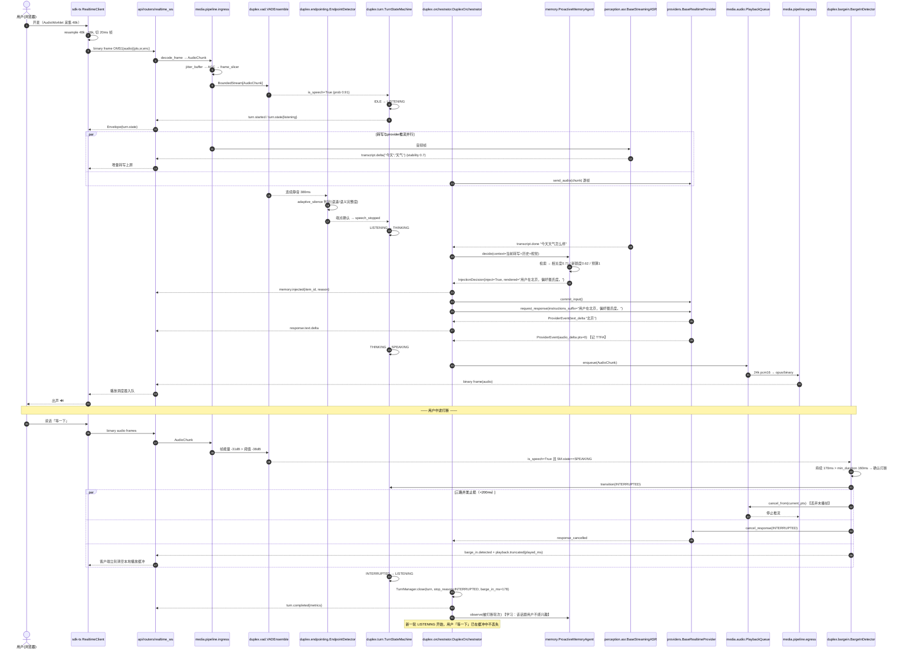
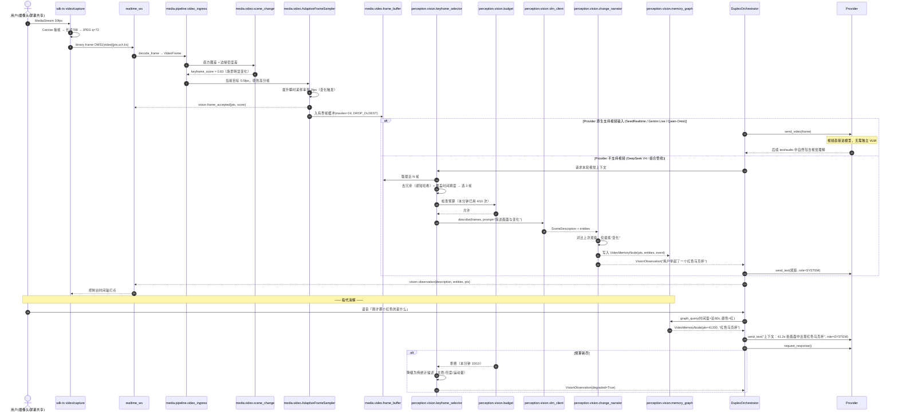
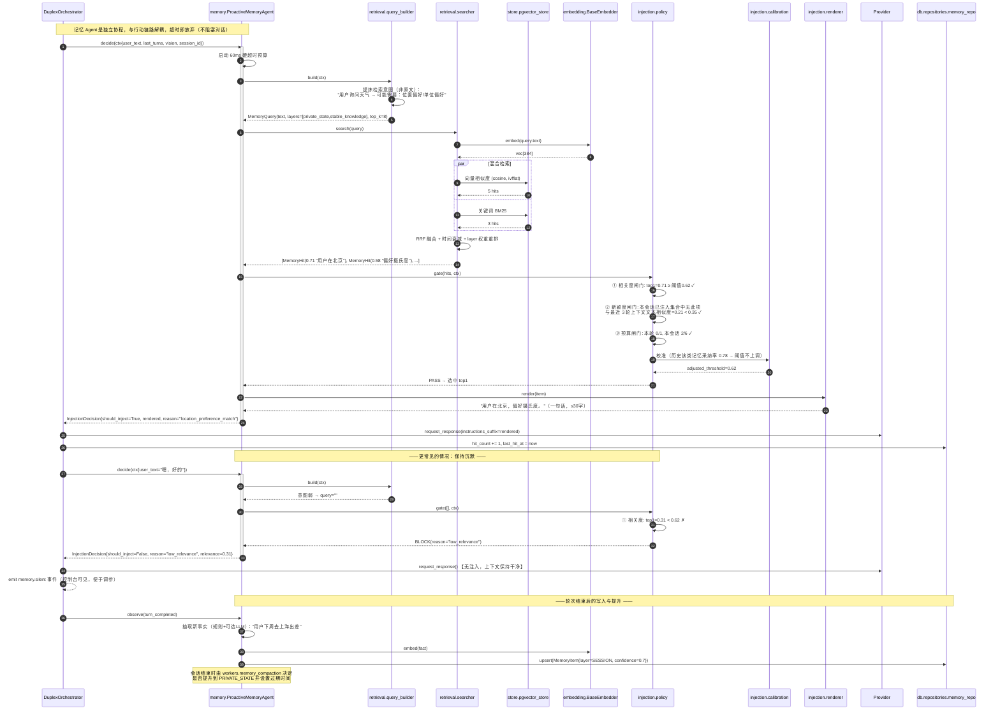
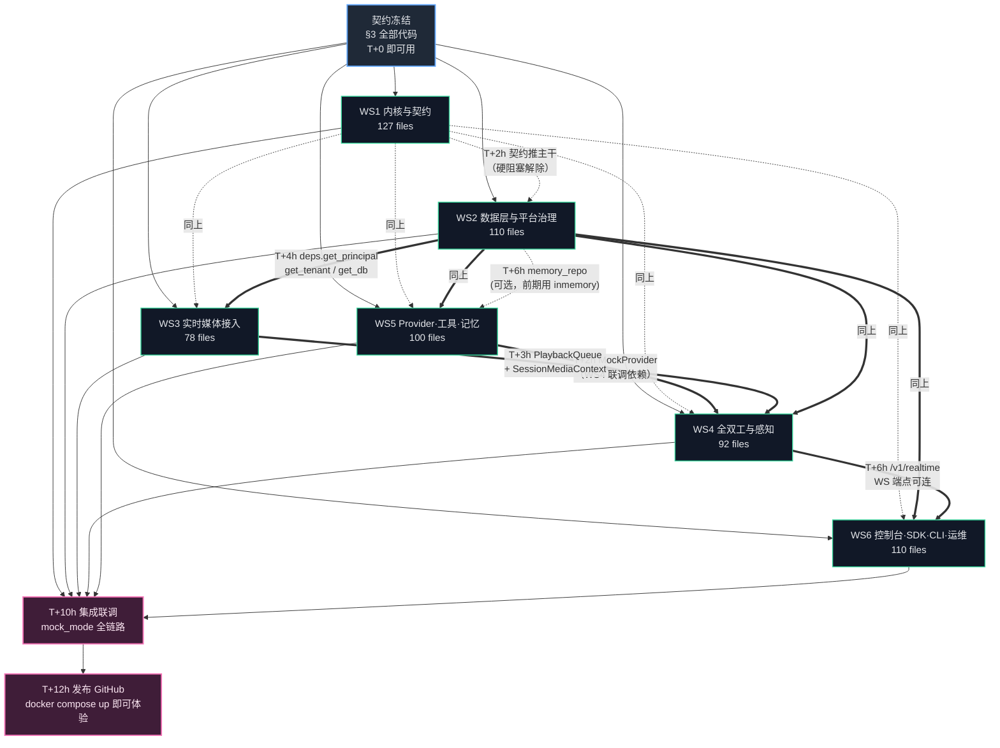

# omnistream — 企业级实时全双工音视频多模态交互平台

> **架构设计与工程包切分说明书（施工蓝图）**
> 架构师：高见远　|　日期：2026-08-06　|　版本：v1.0.0（Day-0 Release Blueprint）
> 目标：当日由 6 名工程师并行实现 → 直接发布 GitHub

**一句话定位**：把"边看、边听、边说"的实时全双工多模态 AI 交互能力，从各家私有 App 里解耦出来，做成任何企业都能自托管、可插拔多 Provider、可观测可治理的开放中台。

**总文件数：约 590 个** · **6 个并行工程包（WS1~WS6）** · **零文件重叠** · **无单元测试（按需求跳过）** · **Mock Provider 保证零 API Key 端到端跑通**

---

## 目录

1. [实现方案与框架选型](#1-实现方案与框架选型)
2. [完整目录树与文件清单](#2-完整目录树与文件清单)
3. [核心数据结构与接口契约](#3-核心数据结构与接口契约)
4. [程序调用流程（时序图）](#4-程序调用流程时序图)
5. [6 个并行工程包划分](#5-6-个并行工程包划分)
6. [依赖清单](#6-依赖清单)
7. [共享知识与跨文件约定](#7-共享知识与跨文件约定)
8. [待明确事项](#8-待明确事项)

---

## 1. 实现方案与框架选型

### 1.1 核心技术难点

| # | 难点 | 后果 | 解法 |
|---|---|---|---|
| D1 | **全双工语义**：用户说话与模型说话在时间轴上重叠，需要 <200ms 内识别打断意图并停止 TTS 播放 | 打断不及时=体验灾难 | 独立 `TurnStateMachine` + 抢占式 `BargeInDetector`，播放侧走可撤销的 `PlaybackQueue`，撤销粒度=20ms 帧 |
| D2 | **异构 Provider 能力差异极大**：SeedRealtime/OpenAI Realtime 是原生端到端 duplex；DeepSeek/Qwen 只有文本或半流式 | 抽象泄漏 | 双层抽象：`BaseRealtimeProvider`（统一事件流契约）+ `CompositePipelineProvider`（用 ASR+LLM+TTS 组合出伪原生 duplex），能力用 `ProviderCapabilities` 位标声明，编排层按能力降级 |
| D3 | **音视频时钟对齐**：WebRTC 抖动 + ASR 分片 + 视频关键帧，三条流时间基不同 | 视觉与语音错配 | 统一 `MediaClock`（单调纳秒 + RTP timestamp 映射），所有 chunk/frame 强制携带 `pts_ms` 与 `capture_ts_ns` |
| D4 | **背压**：模型吐字比网络快、视频帧比 VLM 快 | OOM / 延迟雪崩 | 全链路 `BoundedStream`（有界异步队列 + 丢弃策略），视频侧自适应采样（`AdaptiveFrameSampler`），音频侧永不丢（`RingBuffer` 覆盖告警） |
| D5 | **记忆的"选择性沉默"**：Meta proactive memory agent 的关键不是检索，是"多数时候不注入" | 噪声污染上下文 | `InjectionPolicy` 三闸门：相关度阈值 + 新颖度（去重已注入）+ 预算（每轮 ≤1 条 / 每会话 ≤N 条），并做置信度校准 |
| D6 | **无 API Key 可跑通** | 开源项目 5 分钟体验失败 = 死 | `MockRealtimeProvider` 用确定性 DSP 合成语音（正弦包络 + 音素级时长模型）+ 规则式 ASR（音量-音节反推）+ 脚本化对话，纯 stdlib+numpy |
| D7 | **多租户隔离与计费计量** | 企业不敢上生产 | 租户级 Redis 命名空间 + Postgres RLS 风格的 `tenant_id` 强制过滤（`TenantScopedRepository` 基类）+ 秒级 usage 打点落 `usage_records` |

### 1.2 框架选型与取舍

| 领域 | 选型 | 理由 / 被否决方案 |
|---|---|---|
| Web 框架 | **FastAPI 0.115** | 原生 ASGI WebSocket、Pydantic v2 深度集成、自动 OpenAPI。否决 Starlette 裸写（管理 API 样板太多） |
| 校验/序列化 | **Pydantic v2.9** + `orjson` | v2 的 Rust core 在每秒数千事件的序列化上比 v1 快 5-20x |
| WebRTC | **aiortc 1.9** | 唯一成熟的纯 Python asyncio WebRTC。否决 mediasoup/LiveKit（引入 Node/Go 运行时，破坏"单语言自托管"简洁性），但保留 `LiveKitBridgeTransport` 作为可选适配 |
| 音频重采样 | **soxr**（首选）+ `audioop`（stdlib 兜底） | soxr 质量/性能俱佳且纯 wheel；兜底保证无编译环境也能跑 |
| Opus 编解码 | **PyAV**（libopus） | aiortc 已依赖 av，零新增系统依赖 |
| VAD | **webrtcvad**（轻量兜底）+ **Silero VAD**（ONNX Runtime，默认） | 双实现：webrtcvad CPU 0.1% 但误报高；Silero ONNX CPU 单帧 <1ms 且准确。用 `VADEnsemble` 做二取一或投票 |
| ASR | **faster-whisper**（CTranslate2）本地 + 云端流式适配 | faster-whisper CPU int8 可实时；否决 openai-whisper（慢 4x） |
| TTS | **piper-tts** 本地 + 云端流式 | piper ONNX，CPU 实时率 >10x，模型 ~60MB |
| 向量检索 | **pgvector**（默认，与主库同源，零运维）+ 可选 Qdrant | 否决 FAISS 单机文件（多副本部署一致性差） |
| ORM | **SQLAlchemy 2.0 async** + Alembic | 2.0 typed ORM 与 Pydantic v2 配合良好 |
| 任务队列 | **Celery 5.4** + Redis broker | 离线任务（转写归档、质检、记忆压缩、计费结算）。实时链路**不走 Celery**，走进程内 asyncio |
| 事件总线 | **Redis Streams**（跨进程）+ 进程内 `asyncio` 分发 | 否决 Kafka（对自托管中小企业过重），但抽象 `EventBus` 保留 Kafka 后端位 |
| 指标 | **prometheus-client** | 直采 `/metrics` |
| 追踪 | **OpenTelemetry SDK** + OTLP exporter | 跨 provider 调用链 |
| 日志 | **structlog** JSON | 与 OTel trace_id 关联 |
| 前端 | **Vite 5 + React 18 + TypeScript 5.6 + Tailwind 3.4 + Radix UI + Zustand + TanStack Query** | 否决 MUI：控制台需要大量自定义实时波形/时间轴组件，Tailwind+Radix 更可控、包更小 |
| 图表 | **Recharts** + 自研 Canvas 波形/频谱 | Recharts 够用；波形必须 Canvas（60fps） |
| 配置 | **pydantic-settings 2.x** + `.env` + YAML overlay | 环境变量为主，YAML 做 profile 覆盖 |

### 1.3 架构模式

- **整体**：分层 + 端口适配器（Hexagonal）。`providers/` `media/` `perception/` 均为可替换适配器，核心编排层只依赖抽象。
- **实时链路**：Actor-ish —— 每个 `Session` 是一个独立的 `asyncio.TaskGroup`，内部若干长驻协程（ingress / vad / asr / provider / tts / egress）通过 `BoundedStream` 串联，任一环失败整组取消。
- **控制链路**：经典 CRUD（FastAPI Router → Service → Repository → SQLAlchemy）。
- **前端**：MVVM（Zustand store = ViewModel，组件纯渲染）。
- **API 路由自动发现**：`omnistream/api/registry.py` 扫描 `omnistream/api/routers/*.py` 中的 `router` 对象自动挂载 —— **这是 6 个 WS 能并行写 API 而不冲突的关键机制**（不存在需要多人同时编辑的 `main.py` 路由注册表）。

---

## 2. 完整目录树与文件清单

> 标注格式：`路径` — 职责（**WSn**）
> 包根名：`omnistream`。仓库根即包根同级（非 src-layout，降低新手门槛）。

### 2.0 顶层目录树

```
omnistream/
├── .github/                  CI/CD、Issue 模板                          [WS1]
├── omnistream/               后端主包
│   ├── core/                 内核原语：错误/ID/时钟/日志/总线/背压        [WS1]
│   ├── config/               pydantic-settings 配置体系                  [WS1]
│   ├── protocol/             实时事件协议（WS 双向消息 schema）           [WS1]
│   ├── schemas/              Pydantic 领域模型（契约）                    [WS1]
│   ├── utils/                纯函数工具                                  [WS1]
│   ├── api/                  FastAPI 应用骨架 + 自动发现路由             [WS1 骨架 / 各 WS 提供 router]
│   ├── db/                   SQLAlchemy 模型与仓储                       [WS2]
│   ├── platform/             多租户/鉴权/RBAC/配额/计费/Webhook          [WS2]
│   ├── workers/              Celery 应用与离线任务                       [WS2]
│   ├── governance/           录制/回放/归档/质检/PII/审计                [WS2]
│   ├── media/                WebRTC/WS 传输、音视频编解码与自适应         [WS3]
│   ├── duplex/               全双工内核：VAD/端点/打断/轮次状态机         [WS4]
│   ├── perception/           流式 ASR/TTS/视觉理解                       [WS4]
│   ├── observability/        指标/追踪/日志/延迟看板数据源                [WS4]
│   ├── providers/            Provider 适配层（7 个实现）                 [WS5]
│   ├── tools/                实时工具调用编排                            [WS5]
│   └── memory/               主动记忆治理层                              [WS5]
├── migrations/               Alembic                                    [WS2]
├── frontend/                 React 控制台                                [WS6]
├── sdk-python/               Python 客户端 SDK                           [WS6]
├── sdk-ts/                   TypeScript 客户端 SDK                       [WS6]
├── deploy/                   k8s / helm / prometheus / grafana / coturn  [WS2/WS3/WS6]
├── docs/                     文档站（mkdocs）                            [各 WS 分片]
├── examples/                 可运行示例                                  [各 WS 分片]
└── scripts/                  开发与运维脚本                              [WS1/WS3/WS6]
```

---

### 2.1 仓库根（WS1 · 22 个）

| 文件 | 职责 |
|---|---|
| `README.md` | 英文主 README：定位、架构图、5 分钟 Mock 跑通、Provider 矩阵、路线图 |
| `README.zh-CN.md` | 中文主 README，内容对齐英文版 |
| `LICENSE` | Apache-2.0 |
| `CONTRIBUTING.md` | 贡献指南：分支策略、commit 规范、本地起服务 |
| `CODE_OF_CONDUCT.md` | Contributor Covenant 2.1 |
| `SECURITY.md` | 漏洞披露流程与支持版本表 |
| `CHANGELOG.md` | Keep-a-Changelog 格式，v1.0.0 首条 |
| `GOVERNANCE.md` | 项目治理：Maintainer 职责、决策流程、ADR 机制 |
| `.gitignore` | Python/Node/IDE/模型权重/录制文件忽略规则 |
| `.dockerignore` | 排除 frontend/node_modules、.venv、data/ |
| `.env.example` | 全量环境变量样例（含注释），复制即可用 Mock Provider 启动 |
| `.editorconfig` | 统一缩进：py=4、ts/tsx/json/yaml=2 |
| `pyproject.toml` | 项目元数据、`[project.scripts] oms=omnistream.cli.main:app`、ruff/mypy/pytest 段 |
| `requirements.txt` | 后端运行时依赖（全部钉版本） |
| `requirements-dev.txt` | 开发依赖（lint/type/构建） |
| `requirements-local-models.txt` | 可选：faster-whisper / piper / onnxruntime / silero 权重下载器 |
| `Makefile` | `make dev/api/worker/console/lint/fmt/migrate/docker/seed/mock` |
| `alembic.ini` | Alembic 配置，指向 `migrations/`，URL 从环境变量读 |
| `ruff.toml` | ruff lint+format 规则（line-length=120，select E,F,I,UP,B,ASYNC,RUF） |
| `mypy.ini` | mypy 严格度分级：core/schemas/protocol=strict，其余 normal |
| `docker-compose.yml` | 生产型编排：api / worker / console / postgres+pgvector / redis / coturn / prometheus / grafana / otel-collector |
| `docker-compose.dev.yml` | 开发型：仅 postgres+redis，代码挂载热重载 |

### 2.2 容器构建（WS1 · 5 个）

| 文件 | 职责 |
|---|---|
| `Dockerfile` | 后端 API 多阶段镜像：builder 装依赖 → slim runtime，非 root 用户 |
| `Dockerfile.worker` | Celery worker 镜像（复用 base stage，入口改 celery） |
| `Dockerfile.console` | 前端多阶段：node build → nginx alpine 托管静态资源 |
| `deploy/docker/entrypoint.sh` | API 启动脚本：等待 DB → 跑 alembic upgrade → 启 uvicorn |
| `deploy/docker/entrypoint-worker.sh` | Worker 启动脚本：等待 broker → 启 celery worker + beat |

### 2.3 `.github/`（WS1 · 12 个）

| 文件 | 职责 |
|---|---|
| `.github/workflows/ci-backend.yml` | ruff check + ruff format --check + mypy + `python -c "import omnistream"` 冒烟 |
| `.github/workflows/ci-frontend.yml` | pnpm install → eslint → tsc --noEmit → vite build |
| `.github/workflows/ci-sdk-ts.yml` | sdk-ts 的 tsc 构建与 tsup 打包校验 |
| `.github/workflows/docker-publish.yml` | 打 tag 时构建三镜像并推 GHCR（linux/amd64+arm64） |
| `.github/workflows/docs.yml` | mkdocs build --strict 并部署 GitHub Pages |
| `.github/workflows/helm-lint.yml` | helm lint + kubeconform 校验 k8s manifests |
| `.github/workflows/codeql.yml` | CodeQL 扫描 python+javascript |
| `.github/workflows/release.yml` | 生成 Release Notes、构建 sdist/wheel 与 npm 包 |
| `.github/ISSUE_TEMPLATE/bug_report.yml` | Bug 模板（含 provider/部署方式字段） |
| `.github/ISSUE_TEMPLATE/provider_request.yml` | 新 Provider 接入申请模板 |
| `.github/PULL_REQUEST_TEMPLATE.md` | PR 检查清单 |
| `.github/dependabot.yml` | pip/npm/github-actions 每周更新 |

### 2.4 `omnistream/core/` — 内核原语（WS1 · 18 个）

| 文件 | 职责 |
|---|---|
| `omnistream/__init__.py` | 包入口，导出 `__version__` 与顶层便捷 API |
| `omnistream/__version__.py` | 单一版本号真源 `__version__ = "1.0.0"` |
| `omnistream/core/__init__.py` | 内核公共导出 |
| `omnistream/core/errors.py` | 异常树：`OmniError` → `ConfigError/ProtocolError/MediaError/ProviderError/AuthError/QuotaError/MemoryError/ToolError` |
| `omnistream/core/error_codes.py` | 错误码枚举 `ErrorCode`（`OMS-XXNN`）与 HTTP 状态映射表 |
| `omnistream/core/ids.py` | ULID 生成器 + 带类型前缀 ID（`sess_`/`turn_`/`ten_`/`ak_`/`mem_`） |
| `omnistream/core/clock.py` | `MediaClock`：单调纳秒、UTC ISO8601、RTP timestamp ↔ pts_ms 映射 |
| `omnistream/core/logging.py` | structlog 初始化：JSON/console 双模式、注入 trace_id/session_id |
| `omnistream/core/context.py` | contextvars：`current_tenant` / `current_session` / `current_request_id` |
| `omnistream/core/eventbus.py` | `EventBus` 抽象 + `InProcEventBus` + `RedisStreamEventBus` 实现 |
| `omnistream/core/registry.py` | 泛型 `Registry[T]`：按 name 注册/发现（provider、tool、asr 引擎共用） |
| `omnistream/core/lifecycle.py` | `LifecycleManager`：有序 startup/shutdown 钩子，支持超时强杀 |
| `omnistream/core/retry.py` | `retry_async` 装饰器：指数退避 + 抖动 + 可重试异常白名单 |
| `omnistream/core/circuit_breaker.py` | 三态熔断器（closed/open/half-open），供 provider 调用包裹 |
| `omnistream/core/streams.py` | `BoundedStream[T]`：有界异步队列，溢出策略 block/drop_oldest/drop_newest |
| `omnistream/core/ring_buffer.py` | `AudioRingBuffer`：定长 int16 环形缓冲，覆盖计数告警 |
| `omnistream/core/serialization.py` | orjson 编解码 + msgpack 可选 + Pydantic 快路径 |
| `omnistream/core/constants.py` | 全局常量：采样率 16000、帧长 20ms、协议版本、默认超时 |

### 2.5 `omnistream/config/` — 配置体系（WS1 · 11 个）

| 文件 | 职责 |
|---|---|
| `omnistream/config/__init__.py` | 导出 `get_settings()` 单例 |
| `omnistream/config/settings.py` | 根 `Settings(BaseSettings)`，聚合所有子配置，`env_nested_delimiter="__"` |
| `omnistream/config/app.py` | 应用级：env、debug、host/port、cors、根路径 |
| `omnistream/config/media.py` | 媒体：采样率、帧长、抖动缓冲、ICE/TURN、视频采样率、码率区间 |
| `omnistream/config/duplex.py` | 全双工：VAD 后端与阈值、静音超时、打断灵敏度、最大轮次时长 |
| `omnistream/config/perception.py` | ASR/TTS/VLM 引擎选择与模型路径、语言、并发度 |
| `omnistream/config/providers.py` | Provider 注册表配置：默认 provider、各家 endpoint/key/模型名/超时 |
| `omnistream/config/memory.py` | 记忆：向量后端、维度、注入预算、相关度阈值、遗忘窗口 |
| `omnistream/config/storage.py` | Postgres/Redis/对象存储（S3 兼容）连接串与池参数 |
| `omnistream/config/security.py` | JWT 密钥与算法、API Key 哈希盐、CORS 白名单、PII 开关 |
| `omnistream/config/observability.py` | Prometheus/OTel/日志级别与采样率 |

### 2.6 `omnistream/protocol/` — 实时事件协议（WS1 · 10 个）

| 文件 | 职责 |
|---|---|
| `omnistream/protocol/__init__.py` | 导出全部事件类型与 `parse_client_event` / `dump_server_event` |
| `omnistream/protocol/version.py` | 协议版本常量 `PROTOCOL_VERSION = "oms.v1"` 与兼容性检查 |
| `omnistream/protocol/enums.py` | `ClientEventType` / `ServerEventType` / `TurnState` / `Modality` / `StopReason` 枚举 |
| `omnistream/protocol/envelope.py` | `Envelope`：所有消息统一外壳（type/id/ts/session_id/seq/payload） |
| `omnistream/protocol/client_events.py` | 全部上行事件模型（session.update / input_audio.append / input_video.frame / response.cancel / tool.result …） |
| `omnistream/protocol/server_events.py` | 全部下行事件模型（session.created / turn.state / transcript.delta / audio.delta / tool.call / memory.injected / error …） |
| `omnistream/protocol/binary.py` | 二进制帧格式：4B magic + 1B kind + 2B header_len + header(json) + payload，用于音频/视频高效上下行 |
| `omnistream/protocol/codec.py` | `ProtocolCodec`：文本 JSON 与二进制帧的统一编解码入口 |
| `omnistream/protocol/errors.py` | 协议级错误 → `error` 事件的转换 |
| `omnistream/protocol/schema_export.py` | 导出 JSON Schema 到 `docs/schemas/`，供 TS SDK 生成类型 |

### 2.7 `omnistream/schemas/` — 领域模型契约（WS1 · 19 个）

| 文件 | 职责 |
|---|---|
| `omnistream/schemas/__init__.py` | 统一导出所有领域模型 |
| `omnistream/schemas/base.py` | `OmniModel` 基类：orjson dumps、`model_config` 统一（from_attributes、populate_by_name） |
| `omnistream/schemas/common.py` | `Page[T]`、`Ok[T]`、`ErrorBody`、`TimeRange`、`Cursor` |
| `omnistream/schemas/session.py` | `SessionConfig`（模态/voice/provider/工具/记忆开关）、`Session`、`SessionStats` |
| `omnistream/schemas/turn.py` | `Turn`、`TurnRole`、`TurnMetrics`（ttft/ttfa/e2e/barge_in_latency） |
| `omnistream/schemas/audio.py` | `AudioFormat`、`AudioChunk`（pts_ms/samples/sr/channels）、`AudioStats` |
| `omnistream/schemas/video.py` | `VideoFrame`（pts_ms/w/h/jpeg_bytes/keyframe_score）、`VideoSamplingPolicy` |
| `omnistream/schemas/transcript.py` | `TranscriptDelta`、`TranscriptSegment`、`WordTiming`、`Transcript` |
| `omnistream/schemas/vision.py` | `SceneDescription`、`VisualEntity`、`VisionObservation`、`VideoMemoryNode` |
| `omnistream/schemas/memory.py` | `MemoryLayer` 枚举、`MemoryItem`、`MemoryQuery`、`MemoryHit`、`InjectionDecision` |
| `omnistream/schemas/tool.py` | `ToolSpec`（JSON Schema 参数）、`ToolCall`、`ToolResult`、`ToolPolicy` |
| `omnistream/schemas/provider.py` | `ProviderCapabilities`、`ProviderInfo`、`ProviderHealth`、`GenerationParams` |
| `omnistream/schemas/tenant.py` | `Tenant`、`TenantSettings`、`TenantCreate/Update` |
| `omnistream/schemas/auth.py` | `ApiKey`、`ApiKeyCreate`、`JWTClaims`、`Principal`、`Role`、`Permission` |
| `omnistream/schemas/quota.py` | `QuotaPolicy`、`QuotaUsage`、`RateLimitRule` |
| `omnistream/schemas/billing.py` | `UsageRecord`、`PriceBook`、`Invoice`、`BillingSummary` |
| `omnistream/schemas/recording.py` | `Recording`、`RecordingSegment`、`ReplayManifest` |
| `omnistream/schemas/quality.py` | `QualityScore`（相关性/礼貌/合规/打断得体度）、`QualityRubric` |
| `omnistream/schemas/audit.py` | `AuditEvent`、`AuditAction` 枚举、`PIIRedactionReport` |

### 2.8 `omnistream/utils/`（WS1 · 8 个）

| 文件 | 职责 |
|---|---|
| `omnistream/utils/__init__.py` | 导出常用工具 |
| `omnistream/utils/audio_math.py` | RMS/dBFS、峰值归一化、int16↔float32、简单 AGC 增益计算 |
| `omnistream/utils/text_norm.py` | 中英文文本归一化：数字读法、标点分句、TTS 友好切分 |
| `omnistream/utils/hashing.py` | 稳定哈希（blake2b）、内容指纹、API Key 哈希与校验 |
| `omnistream/utils/crypto.py` | Fernet 对称加密（provider 密钥落库加密）、随机 token 生成 |
| `omnistream/utils/asyncio_utils.py` | `gather_with_limit`、`with_timeout`、`aiter_to_list`、优雅取消 |
| `omnistream/utils/validators.py` | 邮箱/域名/语言码/采样率等校验函数 |
| `omnistream/utils/fileio.py` | 异步文件读写、原子写入、S3 兼容对象存储客户端封装 |

### 2.9 `omnistream/api/` — 应用骨架（WS1 · 10 个）

| 文件 | 职责 |
|---|---|
| `omnistream/api/__init__.py` | 导出 `create_app()` |
| `omnistream/api/app.py` | FastAPI 工厂：中间件装配、lifespan、异常处理器、自动挂载 routers |
| `omnistream/api/registry.py` | **路由自动发现**：扫描 `api/routers/*.py` 收集 `router`，按 `ROUTER_ORDER` 排序挂载 |
| `omnistream/api/deps.py` | 通用依赖：`get_db` / `get_principal` / `get_tenant` / `get_settings_dep` / `require_perm` |
| `omnistream/api/errors.py` | 全局异常处理器：`OmniError` → `{code,message,detail,request_id}` |
| `omnistream/api/middleware/__init__.py` | 中间件包导出 |
| `omnistream/api/middleware/request_id.py` | 生成/透传 `X-Request-Id` 并注入 contextvar |
| `omnistream/api/middleware/logging.py` | 访问日志中间件（结构化，含耗时与租户） |
| `omnistream/api/middleware/cors.py` | 基于配置的 CORS 装配 |
| `omnistream/api/routers/__init__.py` | 空包标记（各 WS 往此目录投放各自 router 文件，互不冲突） |

### 2.10 WS1 文档与脚本（WS1 · 12 个）

| 文件 | 职责 |
|---|---|
| `docs/index.md` | 文档站首页与导航 |
| `docs/architecture.md` | 系统架构总览（分层图、数据流、部署拓扑） |
| `docs/protocol-spec.md` | 实时事件协议规范（全部事件表 + JSON 示例 + 二进制帧格式） |
| `docs/configuration.md` | 全部配置项说明表（环境变量名、默认值、取值范围） |
| `docs/error-codes.md` | 错误码全表与处理建议 |
| `docs/adr/0001-python-first-monolith.md` | ADR：为何单语言单体而非微服务 |
| `docs/adr/0002-provider-abstraction.md` | ADR：双层 Provider 抽象取舍 |
| `docs/adr/0003-binary-ws-frame.md` | ADR：为何自定义二进制帧而非纯 base64 JSON |
| `mkdocs.yml` | mkdocs-material 配置与导航树 |
| `scripts/bootstrap.sh` | 一键初始化：venv、装依赖、建库、跑迁移、灌种子 |
| `scripts/gen_protocol_schema.py` | 由 Pydantic 生成协议 JSON Schema 到 `docs/schemas/` |
| `scripts/gen_openapi.py` | 导出 OpenAPI 3.1 到 `docs/openapi.json` |

**WS1 小计：22+5+12+18+11+10+19+8+10+12 = 127 个文件**

---

### 2.11 `omnistream/db/` — 数据持久层（WS2 · 26 个）

| 文件 | 职责 |
|---|---|
| `omnistream/db/__init__.py` | 导出 engine/session/Base |
| `omnistream/db/base.py` | `Base = DeclarativeBase`，命名约定（约束命名模板，供 alembic autogenerate 稳定） |
| `omnistream/db/engine.py` | async engine 构建，连接池参数、pgvector 扩展注册、SQLite 兼容开关 |
| `omnistream/db/session.py` | `async_session_factory`、`session_scope()` 上下文管理器 |
| `omnistream/db/mixins.py` | `TimestampMixin` / `TenantMixin` / `SoftDeleteMixin` / `ULIDPkMixin` |
| `omnistream/db/types.py` | 自定义类型：`Vector`（pgvector）、`JSONB`（跨 PG/SQLite）、`ULIDType` |
| `omnistream/db/models/__init__.py` | 汇总导入所有 ORM 模型（供 alembic 发现） |
| `omnistream/db/models/tenant.py` | `tenants` 表：名称、slug、状态、settings JSONB |
| `omnistream/db/models/user.py` | `users` 表：邮箱、密码哈希、租户归属、角色 |
| `omnistream/db/models/api_key.py` | `api_keys` 表：前缀、哈希、scopes、过期、最后使用时间 |
| `omnistream/db/models/session.py` | `sessions` 表：租户、provider、模态、起止时间、状态、config JSONB |
| `omnistream/db/models/turn.py` | `turns` 表：会话、序号、角色、状态、各项延迟指标 |
| `omnistream/db/models/transcript.py` | `transcripts` 表：轮次、说话人、文本、词级时间戳 JSONB、语言 |
| `omnistream/db/models/vision_event.py` | `vision_events` 表：会话、pts、场景描述、实体、关键帧对象存储 key |
| `omnistream/db/models/memory_item.py` | `memory_items` 表：层级、内容、embedding(vector)、置信度、命中次数、过期 |
| `omnistream/db/models/tool_call.py` | `tool_calls` 表：轮次、工具名、参数、结果、耗时、状态 |
| `omnistream/db/models/recording.py` | `recordings` 表：会话、音视频对象 key、时长、大小、保留策略 |
| `omnistream/db/models/usage_record.py` | `usage_records` 表：租户、会话、计量项、数量、单价、金额、时间桶 |
| `omnistream/db/models/quota.py` | `quotas` 表：租户级配额策略与当前周期用量快照 |
| `omnistream/db/models/audit_log.py` | `audit_logs` 表：主体、动作、资源、IP、UA、diff JSONB |
| `omnistream/db/models/quality_score.py` | `quality_scores` 表：会话/轮次维度质检分与理由 |
| `omnistream/db/models/provider_config.py` | `provider_configs` 表：租户自定义 provider 凭据（加密存储） |
| `omnistream/db/repositories/__init__.py` | 仓储导出 |
| `omnistream/db/repositories/base.py` | `TenantScopedRepository`：所有查询强制注入 `tenant_id`，防越权 |
| `omnistream/db/repositories/session_repo.py` | 会话/轮次/转写的读写与分页查询 |
| `omnistream/db/repositories/memory_repo.py` | 记忆项 CRUD + pgvector 相似度检索 + 衰减更新 |

### 2.12 `migrations/`（WS2 · 6 个）

| 文件 | 职责 |
|---|---|
| `migrations/env.py` | Alembic 环境：async engine、target_metadata、离线/在线模式 |
| `migrations/script.py.mako` | 迁移脚本模板 |
| `migrations/versions/0001_initial_schema.py` | 租户/用户/API Key/会话/轮次/转写基础表 |
| `migrations/versions/0002_memory_and_vector.py` | 启用 pgvector 扩展、`memory_items` 表与 ivfflat 索引 |
| `migrations/versions/0003_governance_tables.py` | 录制/质检/审计/PII 报告表 |
| `migrations/versions/0004_billing_quota.py` | 用量/配额/价目表与时间桶索引 |

### 2.13 `omnistream/platform/` — 平台能力（WS2 · 22 个）

| 文件 | 职责 |
|---|---|
| `omnistream/platform/__init__.py` | 平台服务导出 |
| `omnistream/platform/tenancy.py` | 租户解析（Header/子域名/API Key）、租户上下文注入、Redis 命名空间隔离 |
| `omnistream/platform/auth/__init__.py` | 鉴权包导出 |
| `omnistream/platform/auth/api_key.py` | API Key 生成（`oms_live_xxx`）、哈希校验、scope 检查、最后使用时间更新 |
| `omnistream/platform/auth/jwt.py` | JWT 签发/校验（HS256/RS256 可选）、刷新令牌、黑名单 |
| `omnistream/platform/auth/password.py` | argon2 密码哈希与校验、强度检查 |
| `omnistream/platform/auth/principal.py` | `Principal` 构建：从 API Key 或 JWT 统一出主体+权限集 |
| `omnistream/platform/rbac/__init__.py` | RBAC 导出 |
| `omnistream/platform/rbac/permissions.py` | 权限枚举全表（`session:create`、`memory:read`、`tenant:admin`…） |
| `omnistream/platform/rbac/roles.py` | 内置角色（owner/admin/developer/analyst/viewer）与权限映射 |
| `omnistream/platform/rbac/enforcer.py` | `require(permission)` 判定器 + 资源级 owner 检查 |
| `omnistream/platform/quota/__init__.py` | 配额导出 |
| `omnistream/platform/quota/policy.py` | 配额策略解析：并发会话数、月度分钟数、日 token 数 |
| `omnistream/platform/quota/enforcer.py` | 会话创建前置检查 + 运行中超额熔断 |
| `omnistream/platform/quota/rate_limiter.py` | Redis 滑动窗口 + 令牌桶限流（按租户/Key/IP 多维） |
| `omnistream/platform/billing/__init__.py` | 计费导出 |
| `omnistream/platform/billing/meter.py` | 计量打点：音频分钟、ASR 秒、TTS 字符、LLM token、视频帧、存储 GB |
| `omnistream/platform/billing/pricing.py` | 价目表加载与金额计算（支持租户级折扣） |
| `omnistream/platform/billing/aggregator.py` | 按小时/日聚合 usage_records，生成账单摘要 |
| `omnistream/platform/webhooks/__init__.py` | Webhook 导出 |
| `omnistream/platform/webhooks/dispatcher.py` | 事件订阅与投递（HMAC 签名、指数退避重试、死信） |
| `omnistream/platform/webhooks/events.py` | 可订阅平台事件枚举与 payload 定义 |

### 2.14 `omnistream/governance/` — 会话治理（WS2 · 17 个）

| 文件 | 职责 |
|---|---|
| `omnistream/governance/__init__.py` | 治理服务导出 |
| `omnistream/governance/recording/__init__.py` | 录制包导出 |
| `omnistream/governance/recording/recorder.py` | 会话录制器：音频 WAV/Opus 分段落盘、视频关键帧 JPEG 序列、事件 JSONL |
| `omnistream/governance/recording/storage.py` | 录制文件生命周期：本地/S3 上传、保留期、加密、清理 |
| `omnistream/governance/recording/manifest.py` | 生成回放清单（时间轴 + 分段索引 + 事件锚点） |
| `omnistream/governance/replay/__init__.py` | 回放包导出 |
| `omnistream/governance/replay/player.py` | 服务端回放：按时间轴重放事件流（供控制台时间轴组件消费） |
| `omnistream/governance/replay/exporter.py` | 导出为 MP4/WAV/SRT/JSON 归档包 |
| `omnistream/governance/transcript/__init__.py` | 转写归档导出 |
| `omnistream/governance/transcript/archiver.py` | 轮次转写合并、说话人分离标注、落库与对象存储 |
| `omnistream/governance/transcript/srt.py` | 生成 SRT/VTT 字幕文件 |
| `omnistream/governance/privacy/__init__.py` | 隐私包导出 |
| `omnistream/governance/privacy/pii.py` | PII 检测与脱敏：手机号/身份证/银行卡/邮箱/地址（正则+上下文规则） |
| `omnistream/governance/privacy/sensitive_words.py` | 敏感词库加载与 Aho-Corasick 多模匹配，支持租户自定义词表 |
| `omnistream/governance/privacy/redactor.py` | 统一脱敏管道：文本替换、音频段静音、日志字段掩码 |
| `omnistream/governance/quality/scorer.py` | 质检打分：规则维度（打断得体度、静默率、合规命中）+ 可选 LLM 评审 |
| `omnistream/governance/audit/logger.py` | 合规审计日志写入（不可变追加、哈希链防篡改） |

### 2.15 `omnistream/workers/` — 离线任务（WS2 · 11 个）

| 文件 | 职责 |
|---|---|
| `omnistream/workers/__init__.py` | Worker 包导出 |
| `omnistream/workers/celery_app.py` | Celery 应用工厂：Redis broker/backend、序列化、时区、路由 |
| `omnistream/workers/beat_schedule.py` | 定时任务表：计费聚合(每小时)、记忆压缩(每日)、录制清理(每日)、健康巡检(5min) |
| `omnistream/workers/tasks/__init__.py` | 任务导出 |
| `omnistream/workers/tasks/transcription.py` | 离线高精度重转写（补齐实时 ASR 的低置信段） |
| `omnistream/workers/tasks/memory_compaction.py` | 记忆压缩：聚类去重、摘要提升层级、过期遗忘 |
| `omnistream/workers/tasks/quality_review.py` | 批量质检打分任务 |
| `omnistream/workers/tasks/billing_rollup.py` | 用量聚合与账单生成 |
| `omnistream/workers/tasks/recording_pipeline.py` | 录制后处理：转码 MP4、生成字幕、上传对象存储 |
| `omnistream/workers/tasks/webhook_retry.py` | Webhook 死信重投 |
| `omnistream/workers/tasks/maintenance.py` | 清理过期会话、孤儿文件、索引重建 |

### 2.16 WS2 的 API 路由（WS2 · 9 个）

| 文件 | 职责 |
|---|---|
| `omnistream/api/routers/auth.py` | 登录/刷新/登出、当前用户信息 |
| `omnistream/api/routers/tenants.py` | 租户 CRUD、设置更新（需 tenant:admin） |
| `omnistream/api/routers/users.py` | 成员管理、角色分配 |
| `omnistream/api/routers/api_keys.py` | API Key 签发/列举/吊销（明文仅返回一次） |
| `omnistream/api/routers/quotas.py` | 配额查询与调整 |
| `omnistream/api/routers/billing.py` | 用量明细、账单摘要、价目表 |
| `omnistream/api/routers/recordings.py` | 录制列表、下载签名 URL、回放清单、导出 |
| `omnistream/api/routers/audit.py` | 审计日志查询（分页 + 过滤） |
| `omnistream/api/routers/webhooks.py` | Webhook 端点注册与投递记录 |

### 2.17 WS2 的部署清单与文档（WS2 · 19 个）

| 文件 | 职责 |
|---|---|
| `deploy/k8s/namespace.yaml` | 命名空间 |
| `deploy/k8s/configmap.yaml` | 非敏感配置 |
| `deploy/k8s/secret.example.yaml` | 敏感配置样例（含各 Provider Key 占位） |
| `deploy/k8s/deployment-api.yaml` | API Deployment（含 readiness/liveness、资源限额） |
| `deploy/k8s/deployment-worker.yaml` | Celery worker + beat |
| `deploy/k8s/deployment-console.yaml` | 控制台静态站 |
| `deploy/k8s/service.yaml` | 三个 Service（api/console/metrics） |
| `deploy/k8s/ingress.yaml` | Ingress（WebSocket annotation、TLS） |
| `deploy/k8s/hpa.yaml` | 基于并发会话数自定义指标扩缩容 |
| `deploy/k8s/pdb.yaml` | PodDisruptionBudget |
| `deploy/k8s/statefulset-postgres.yaml` | 自带 Postgres+pgvector（生产建议外接） |
| `deploy/k8s/deployment-redis.yaml` | Redis |
| `docs/data-model.md` | 数据模型说明与 ER 图 |
| `docs/multi-tenancy.md` | 多租户隔离模型与实践 |
| `docs/security.md` | 鉴权、RBAC、密钥管理、威胁模型 |
| `docs/compliance.md` | PII 脱敏、审计、数据保留与合规清单 |
| `docs/billing.md` | 计量口径与计费公式 |
| `docs/adr/0004-postgres-pgvector.md` | ADR：为何 pgvector 而非独立向量库 |
| `docs/adr/0005-tenant-scoped-repo.md` | ADR：仓储层强制租户隔离 |

**WS2 小计：26+6+22+17+11+9+19 = 110 个文件**
---

### 2.18 `omnistream/media/` — 实时媒体接入层（WS3 · 56 个）

#### 2.18.1 传输抽象与实现

| 文件 | 职责 |
|---|---|
| `omnistream/media/__init__.py` | 媒体层导出 |
| `omnistream/media/transport/__init__.py` | 传输包导出与工厂 `create_transport(kind)` |
| `omnistream/media/transport/base.py` | `BaseTransport` 抽象：`start/stop`、`recv_audio()/recv_video()` 异步生成器、`send_audio/send_event` |
| `omnistream/media/transport/websocket.py` | `WebSocketTransport`：文本事件 + 二进制音视频帧，心跳与重连语义 |
| `omnistream/media/transport/webrtc.py` | `WebRTCTransport`：aiortc peer 生命周期、轨道订阅、DataChannel 事件通道 |
| `omnistream/media/transport/webrtc_signaling.py` | SDP offer/answer 与 ICE candidate 交换（走 REST + WS 两种通道） |
| `omnistream/media/transport/ice.py` | ICE/STUN/TURN 服务器配置构建与凭据签发（coturn REST 认证） |
| `omnistream/media/transport/datachannel.py` | DataChannel 消息分片与重组（超过 16KB 自动分片） |
| `omnistream/media/transport/loopback.py` | `LoopbackTransport`：进程内回环，供示例/CLI/无网络场景端到端跑通 |
| `omnistream/media/transport/stats.py` | 传输统计采集：RTT、丢包、抖动、码率，周期上报指标 |

#### 2.18.2 音频

| 文件 | 职责 |
|---|---|
| `omnistream/media/audio/__init__.py` | 音频子包导出 |
| `omnistream/media/audio/format.py` | 音频格式描述与转换矩阵（pcm16/pcm_f32/opus/mulaw × 8k/16k/24k/48k） |
| `omnistream/media/audio/resampler.py` | `Resampler`：soxr 优先、audioop 兜底，保持相位连续（流式友好） |
| `omnistream/media/audio/opus_codec.py` | Opus 编解码器封装（PyAV），支持 FEC、DTX、可变码率 |
| `omnistream/media/audio/pcm.py` | PCM 工具：字节↔ndarray、声道混合、分帧、拼接 |
| `omnistream/media/audio/mulaw.py` | G.711 μ-law 编解码（电话侧接入） |
| `omnistream/media/audio/jitter_buffer.py` | 自适应抖动缓冲：目标延迟动态调整、丢包补偿（PLC）、乱序重排 |
| `omnistream/media/audio/frame_slicer.py` | 任意长度音频流 → 固定 20ms 帧的切片器（供 VAD/ASR 消费） |
| `omnistream/media/audio/gain.py` | 自动增益控制（AGC）与限幅，避免 ASR 输入过载 |
| `omnistream/media/audio/noise_gate.py` | 简易噪声门 + 谱减法降噪（可选启用） |
| `omnistream/media/audio/mixer.py` | 多路音频混音（多说话人/背景音场景） |
| `omnistream/media/audio/playback_queue.py` | **可撤销播放队列**：TTS 音频入队、支持 `cancel_from(pts)` 精确到帧的丢弃（barge-in 核心） |
| `omnistream/media/audio/wav_io.py` | WAV 读写（录制与示例音频加载） |
| `omnistream/media/audio/silence.py` | 静音检测与静音帧生成（保持时间轴连续） |
| `omnistream/media/audio/timeline.py` | 音频时间轴：pts 分配、漂移校正、与 `MediaClock` 对齐 |

#### 2.18.3 视频

| 文件 | 职责 |
|---|---|
| `omnistream/media/video/__init__.py` | 视频子包导出 |
| `omnistream/media/video/frame.py` | `RawVideoFrame` 容器与 ndarray/PIL/JPEG 互转 |
| `omnistream/media/video/decoder.py` | 视频轨道解码（PyAV），YUV→RGB，硬件加速探测 |
| `omnistream/media/video/encoder.py` | JPEG/WebP 编码（送 VLM）与 H.264 编码（录制） |
| `omnistream/media/video/sampler.py` | `AdaptiveFrameSampler`：按场景变化度 + VLM 负载动态调整采样率（0.2~5 fps） |
| `omnistream/media/video/scene_change.py` | 场景切换检测：直方图差 + 边缘密度差，输出 `keyframe_score` |
| `omnistream/media/video/downscaler.py` | 等比缩放到 VLM 友好分辨率（默认长边 768），保留宽高比元数据 |
| `omnistream/media/video/roi.py` | 感兴趣区域裁剪（人脸/屏幕共享区域优先） |
| `omnistream/media/video/frame_buffer.py` | 有界帧缓冲，溢出丢最旧帧并计数 |
| `omnistream/media/video/thumbnail.py` | 生成会话缩略图与关键帧雪碧图（控制台时间轴用） |
| `omnistream/media/video/timeline.py` | 视频时间轴与音频对齐（pts 归一到统一时基） |
| `omnistream/media/video/screenshare.py` | 屏幕共享轨道特化处理（低帧率高分辨率策略） |

#### 2.18.4 网络自适应与会话媒体编排

| 文件 | 职责 |
|---|---|
| `omnistream/media/adaptive/__init__.py` | 自适应子包导出 |
| `omnistream/media/adaptive/bandwidth_estimator.py` | 基于 RTCP/传输统计的可用带宽估计（GCC 简化版） |
| `omnistream/media/adaptive/bitrate_controller.py` | 码率决策：音频优先保底 24kbps，视频弹性让路 |
| `omnistream/media/adaptive/quality_ladder.py` | 质量档位表（分辨率/帧率/码率组合）与档位切换滞回 |
| `omnistream/media/adaptive/congestion.py` | 拥塞信号聚合（丢包率、RTT 上升趋势、缓冲深度） |
| `omnistream/media/adaptive/policy.py` | 自适应策略引擎：把拥塞信号翻译成采样率/码率/关闭视频的动作 |
| `omnistream/media/pipeline/__init__.py` | 媒体管线导出 |
| `omnistream/media/pipeline/ingress.py` | 入口管线：Transport → 解码 → 重采样 → 抖动缓冲 → 分帧 → `BoundedStream[AudioChunk]` |
| `omnistream/media/pipeline/egress.py` | 出口管线：TTS 音频 → 播放队列 → 编码 → Transport（支持中途 cancel） |
| `omnistream/media/pipeline/video_ingress.py` | 视频入口管线：解码 → 场景检测 → 自适应采样 → 缩放 → `BoundedStream[VideoFrame]` |
| `omnistream/media/pipeline/session_media.py` | `SessionMediaContext`：一个会话的全部媒体资源（管线、时钟、统计）的持有与生命周期 |
| `omnistream/media/pipeline/health.py` | 媒体链路健康探测（静默流检测、轨道断开检测、自动重协商触发） |

#### 2.18.5 设备/回环模拟与工具

| 文件 | 职责 |
|---|---|
| `omnistream/media/simulate/__init__.py` | 模拟子包导出 |
| `omnistream/media/simulate/audio_source.py` | 合成音频源：文本→确定性 DSP 语音（供 Mock 链路与压测，无需模型） |
| `omnistream/media/simulate/video_source.py` | 合成视频源：生成带时间戳/场景切换的测试图案帧 |
| `omnistream/media/simulate/network.py` | 网络损伤模拟器：注入延迟/抖动/丢包，用于自适应策略验证 |
| `omnistream/media/simulate/scripted_user.py` | 脚本化"用户"：按时间表说话/打断/沉默，端到端演示 barge-in |
| `omnistream/media/errors.py` | 媒体层异常定义（`TransportClosed`、`CodecError`、`ClockDriftError`） |
| `omnistream/media/metrics.py` | 媒体层 Prometheus 指标定义与埋点辅助 |
| `omnistream/media/constants.py` | 媒体常量：默认帧长、缓冲上限、码率区间、分辨率档位 |

#### 2.18.6 WS3 的路由、部署、文档与示例（WS3 · 14 个）

| 文件 | 职责 |
|---|---|
| `omnistream/api/routers/rtc.py` | WebRTC 信令 REST：`POST /v1/rtc/offer`、ICE 服务器下发、连接统计 |
| `omnistream/api/routers/media_stats.py` | 媒体质量指标查询（按会话返回 RTT/丢包/抖动时间序列） |
| `deploy/coturn/turnserver.conf` | coturn 配置（REST 认证、端口范围、TLS） |
| `deploy/coturn/README.md` | TURN 部署与防火墙端口说明 |
| `deploy/helm/Chart.yaml` | Helm Chart 元数据 |
| `deploy/helm/values.yaml` | 默认 values（镜像、副本、资源、Provider 开关、TURN） |
| `deploy/helm/values-prod.yaml` | 生产 values 覆盖（HPA、PDB、外接 PG/Redis） |
| `deploy/helm/templates/_helpers.tpl` | 命名与标签辅助模板 |
| `deploy/helm/templates/deployment-api.yaml` | API Deployment 模板 |
| `deploy/helm/templates/deployment-worker.yaml` | Worker Deployment 模板 |
| `deploy/helm/templates/deployment-console.yaml` | Console Deployment 模板 |
| `deploy/helm/templates/service-ingress.yaml` | Service + Ingress 模板（WebSocket 友好） |
| `deploy/helm/templates/configmap-secret.yaml` | ConfigMap 与 Secret 模板 |
| `deploy/helm/templates/hpa-pdb-sa.yaml` | HPA、PDB、ServiceAccount、ServiceMonitor 模板 |

| 文件 | 职责 |
|---|---|
| `docs/media-pipeline.md` | 媒体管线详解（时序、缓冲策略、时钟对齐） |
| `docs/webrtc-setup.md` | WebRTC/TURN 部署与排障指南 |
| `docs/network-tuning.md` | 弱网调优参数表与实测数据 |
| `docs/adr/0006-aiortc-choice.md` | ADR：aiortc vs LiveKit/mediasoup |
| `examples/media_loopback_demo.py` | 回环 Transport + 合成音频源，跑通入口→出口全链路 |
| `examples/network_impairment_demo.py` | 注入弱网，观察自适应码率与采样率变化 |
| `scripts/loadtest_ws.py` | WebSocket 并发压测：N 路会话，统计 TTFA/E2E 分位数 |
| `scripts/check_turn.py` | TURN 连通性自检工具 |

**WS3 小计：56 + 14 + 8 = 78 个文件**

---

### 2.19 `omnistream/duplex/` — 全双工对话内核（WS4 · 30 个）

| 文件 | 职责 |
|---|---|
| `omnistream/duplex/__init__.py` | 全双工内核导出 |
| `omnistream/duplex/vad/__init__.py` | VAD 子包导出与工厂 `create_vad(backend)` |
| `omnistream/duplex/vad/base.py` | `BaseVAD` 抽象：`process_frame(AudioChunk) -> VADResult(is_speech, prob)` |
| `omnistream/duplex/vad/webrtc_vad.py` | webrtcvad 实现（模式 0-3，10/20/30ms 帧） |
| `omnistream/duplex/vad/silero_vad.py` | Silero VAD ONNX 实现（状态化 RNN，逐帧概率），首次运行自动下载权重 |
| `omnistream/duplex/vad/energy_vad.py` | 纯能量阈值 VAD（零依赖兜底，Mock 链路默认） |
| `omnistream/duplex/vad/ensemble.py` | `VADEnsemble`：多后端加权投票 + 迟滞（hangover）平滑 |
| `omnistream/duplex/endpointing/__init__.py` | 端点检测导出 |
| `omnistream/duplex/endpointing/detector.py` | `EndpointDetector`：语音起点/终点判定（前置静音、尾部静音、最短语音时长） |
| `omnistream/duplex/endpointing/adaptive.py` | 自适应尾静音阈值：按语速、历史轮次、是否疑问句动态调整（300~1200ms） |
| `omnistream/duplex/endpointing/semantic.py` | 语义端点：结合 ASR 增量文本的完整度判断，避免半句被截断 |
| `omnistream/duplex/turn/__init__.py` | 轮次子包导出 |
| `omnistream/duplex/turn/state_machine.py` | `TurnStateMachine`：idle/listening/thinking/speaking/interrupted 状态与合法迁移表 |
| `omnistream/duplex/turn/turn_manager.py` | `TurnManager`：轮次创建、编号、指标采集、结束原因归因 |
| `omnistream/duplex/turn/transitions.py` | 迁移守卫与副作用（进入 speaking 时启动播放，离开时清队列） |
| `omnistream/duplex/turn/timers.py` | 各类超时定时器：静音超时、思考超时、单轮最长时长、会话空闲超时 |
| `omnistream/duplex/bargein/__init__.py` | 打断子包导出 |
| `omnistream/duplex/bargein/detector.py` | `BargeInDetector`：speaking 态下检测用户语音，双阈值（能量+持续时长）防误触 |
| `omnistream/duplex/bargein/policy.py` | 打断策略：立即停/说完当前句停/忽略（按业务配置），冷却窗口 |
| `omnistream/duplex/bargein/executor.py` | 执行打断：撤销播放队列、通知 provider cancel、状态机迁移、记录延迟 |
| `omnistream/duplex/aec/__init__.py` | 回声消除导出 |
| `omnistream/duplex/aec/base.py` | `BaseAEC` 接口：`process(mic_frame, ref_frame) -> clean_frame` |
| `omnistream/duplex/aec/passthrough.py` | 直通实现（浏览器端已做 AEC 时使用，默认） |
| `omnistream/duplex/aec/speex_aec.py` | speexdsp AEC 可选实现（服务端混音场景） |
| `omnistream/duplex/aec/reference.py` | 参考信号管理：把 TTS 输出对齐延迟后作为回声参考 |
| `omnistream/duplex/speaker/__init__.py` | 说话人子包导出 |
| `omnistream/duplex/speaker/diarization.py` | 轻量说话人切换检测（能量+谱特征聚类，非精确声纹） |
| `omnistream/duplex/speaker/tracker.py` | 说话人标签维护与轮次归属 |
| `omnistream/duplex/proactive/trigger.py` | **主动发起**：长静默/视觉事件/记忆提醒触发模型主动说话（对标 SeedRealtime 主动交互） |
| `omnistream/duplex/orchestrator.py` | **全双工编排器**：串联 ingress→VAD→端点→ASR→Provider→TTS→egress 的核心 TaskGroup |

### 2.20 `omnistream/perception/` — 流式感知管线（WS4 · 36 个）

#### ASR

| 文件 | 职责 |
|---|---|
| `omnistream/perception/__init__.py` | 感知层导出 |
| `omnistream/perception/asr/__init__.py` | ASR 导出与工厂 `create_asr(engine)` |
| `omnistream/perception/asr/base.py` | `BaseStreamingASR`：`async stream(chunks) -> AsyncIterator[TranscriptDelta]`、`reset()`、`finalize()` |
| `omnistream/perception/asr/faster_whisper_asr.py` | faster-whisper 本地流式：滑窗 + 增量解码 + 稳定前缀提交 |
| `omnistream/perception/asr/sensevoice_asr.py` | SenseVoice/FunASR 本地流式适配（中文优势场景） |
| `omnistream/perception/asr/cloud_stream_asr.py` | 通用云端流式 ASR 适配（WebSocket 协议模板，可配置厂商） |
| `omnistream/perception/asr/mock_asr.py` | **Mock ASR**：从合成音频的能量包络反推音节，输出确定性文本，零模型零 Key |
| `omnistream/perception/asr/stabilizer.py` | 增量结果稳定器：LocalAgreement-2 算法，避免文本反复跳变 |
| `omnistream/perception/asr/punctuation.py` | 轻量标点恢复（规则 + 可选小模型） |
| `omnistream/perception/asr/language_id.py` | 语种识别与中英混说处理 |
| `omnistream/perception/asr/hotwords.py` | 热词/术语偏置（租户自定义词表加权） |
| `omnistream/perception/asr/word_timing.py` | 词级时间戳对齐与导出 |
| `omnistream/perception/asr/router.py` | ASR 引擎路由：按语言/延迟预算/成本选择引擎，失败降级 |

#### TTS

| 文件 | 职责 |
|---|---|
| `omnistream/perception/tts/__init__.py` | TTS 导出与工厂 |
| `omnistream/perception/tts/base.py` | `BaseStreamingTTS`：`async synthesize(text_stream) -> AsyncIterator[AudioChunk]`、`cancel()` |
| `omnistream/perception/tts/piper_tts.py` | Piper 本地 TTS（ONNX），流式分句合成 |
| `omnistream/perception/tts/cloud_tts.py` | 云端流式 TTS 通用适配（HTTP chunked / WS） |
| `omnistream/perception/tts/mock_tts.py` | **Mock TTS**：音素时长模型 + 共振峰合成，产出可听的确定性语音，纯 numpy |
| `omnistream/perception/tts/sentencizer.py` | 流式分句器：从 LLM token 流中尽早切出可合成的短句（降低首音延迟） |
| `omnistream/perception/tts/ssml.py` | SSML 子集解析（停顿、语速、强调） |
| `omnistream/perception/tts/voice_registry.py` | 音色注册表：内置音色元数据与租户自定义音色映射 |
| `omnistream/perception/tts/cache.py` | 短语级音频缓存（问候语、确认语），命中即零延迟 |
| `omnistream/perception/tts/router.py` | TTS 引擎路由与降级 |

#### 视觉

| 文件 | 职责 |
|---|---|
| `omnistream/perception/vision/__init__.py` | 视觉导出与工厂 |
| `omnistream/perception/vision/base.py` | `BaseVisionUnderstanding`：`async describe(frames, prompt) -> VisionObservation` |
| `omnistream/perception/vision/vlm_client.py` | 通用 VLM 调用客户端（多图输入、超时、重试、并发闸门） |
| `omnistream/perception/vision/mock_vision.py` | **Mock 视觉**：基于图像统计（主色/亮度/边缘/运动）生成确定性场景描述 |
| `omnistream/perception/vision/keyframe_selector.py` | 从帧缓冲中挑选最具信息量的 N 帧送 VLM（去冗余 + 覆盖时间跨度） |
| `omnistream/perception/vision/change_narrator.py` | 变化叙述：对比前后观察，只把"发生了什么变化"注入上下文，节省 token |
| `omnistream/perception/vision/entity_tracker.py` | 视觉实体跟踪：跨帧维护人物/物体/文字实体的出现与消失 |
| `omnistream/perception/vision/ocr.py` | 可选 OCR（屏幕共享/文档场景），rapidocr 适配 |
| `omnistream/perception/vision/memory_graph.py` | **视频记忆图谱**：时间轴上的实体-事件图，支持"刚才那个红色的东西"类指代消解 |
| `omnistream/perception/vision/graph_query.py` | 图谱查询：按时间窗/实体/事件类型检索，输出紧凑上下文 |
| `omnistream/perception/vision/budget.py` | 视觉预算控制器：每分钟 VLM 调用次数与 token 上限，超限降级为纯统计描述 |
| `omnistream/perception/pipeline.py` | 感知管线装配：把 ASR/TTS/Vision 三条流接入编排器的统一入口 |
| `omnistream/perception/errors.py` | 感知层异常定义 |

### 2.21 `omnistream/observability/` — 可观测性（WS4 · 14 个）

| 文件 | 职责 |
|---|---|
| `omnistream/observability/__init__.py` | 可观测导出与 `setup_observability(app)` |
| `omnistream/observability/metrics/__init__.py` | 指标包导出 |
| `omnistream/observability/metrics/registry.py` | Prometheus registry 与多进程模式配置 |
| `omnistream/observability/metrics/realtime.py` | 实时链路指标：TTFT、TTFA（首音）、E2E RTT、barge-in 响应、VAD 触发率 |
| `omnistream/observability/metrics/provider.py` | Provider 指标：调用量、错误率、延迟分位、熔断状态、token 消耗 |
| `omnistream/observability/metrics/media.py` | 媒体指标：抖动、丢包、缓冲深度、码率、帧率 |
| `omnistream/observability/metrics/platform.py` | 平台指标：并发会话、租户 QPS、配额拒绝、队列长度 |
| `omnistream/observability/tracing/__init__.py` | 追踪导出 |
| `omnistream/observability/tracing/setup.py` | OTel TracerProvider、OTLP exporter、采样策略配置 |
| `omnistream/observability/tracing/instrument.py` | 自动埋点：FastAPI/SQLAlchemy/Redis/httpx + 自定义 span 装饰器 |
| `omnistream/observability/tracing/spans.py` | 领域 span 命名规范与属性常量（`oms.session.id` 等） |
| `omnistream/observability/latency/collector.py` | 延迟采集器：按会话记录各阶段时间戳，产出瀑布图数据 |
| `omnistream/observability/latency/dashboard_feed.py` | 实时看板数据源：WS 推送滚动窗口分位数给控制台 |
| `omnistream/observability/health.py` | 健康检查聚合：DB/Redis/Provider/模型文件/磁盘 |

### 2.22 WS4 的路由与文档（WS4 · 12 个）

| 文件 | 职责 |
|---|---|
| `omnistream/api/routers/realtime_ws.py` | **核心 WebSocket 端点** `/v1/realtime`：握手鉴权、协议协商、接入编排器 |
| `omnistream/api/routers/health.py` | `/healthz` `/readyz` 健康检查 |
| `omnistream/api/routers/metrics.py` | `/metrics` Prometheus 抓取端点 |
| `omnistream/api/routers/latency.py` | 延迟看板数据查询与 WS 推送订阅 |
| `omnistream/api/routers/transcripts.py` | 转写查询与导出 |
| `docs/duplex-core.md` | 全双工内核详解：状态机图、打断时序、参数调优 |
| `docs/vad-tuning.md` | VAD 后端对比与阈值调优实践 |
| `docs/asr-tts.md` | ASR/TTS 引擎接入与本地模型准备 |
| `docs/vision.md` | 视觉理解与视频记忆图谱设计 |
| `docs/observability.md` | 指标全表、Grafana 看板说明、告警规则 |
| `docs/latency-budget.md` | 端到端延迟预算分解表（各环节目标值与实测） |
| `docs/adr/0007-duplex-state-machine.md` | ADR：为何独立状态机而非 provider 内建轮次 |

**WS4 小计：30 + 36 + 14 + 12 = 92 个文件**
---

### 2.23 `omnistream/providers/` — Provider 适配层（WS5 · 44 个）

#### 抽象与公共设施

| 文件 | 职责 |
|---|---|
| `omnistream/providers/__init__.py` | Provider 导出与全局注册表初始化 |
| `omnistream/providers/base.py` | **`BaseRealtimeProvider` 抽象基类**（契约文件，见 §3.3） |
| `omnistream/providers/capabilities.py` | `ProviderCapabilities` 位标定义与能力协商（`negotiate(requested, actual)`） |
| `omnistream/providers/events.py` | Provider 层内部事件类型（`ProviderEvent` 联合类型，独立于 WS 协议） |
| `omnistream/providers/registry.py` | Provider 注册与实例化，支持租户级凭据覆盖 |
| `omnistream/providers/router.py` | **Provider 路由器**：按能力/成本/延迟/健康度选择，主备自动切换 |
| `omnistream/providers/fallback.py` | 降级链：原生 duplex 失败 → 组合式 pipeline → Mock，保证会话不中断 |
| `omnistream/providers/health.py` | Provider 健康探测（周期性 ping + 熔断器联动） |
| `omnistream/providers/credentials.py` | 凭据解析：环境变量 → 租户配置（解密）→ 请求级覆盖 |
| `omnistream/providers/errors.py` | Provider 异常映射：各家 HTTP/WS 错误 → 统一 `ProviderError` 子类 |
| `omnistream/providers/rate_guard.py` | Provider 侧速率保护（避免触发上游 429），令牌桶 + 排队 |
| `omnistream/providers/usage.py` | 各 Provider 用量归一化（token/字符/秒 → 统一计量项） |
| `omnistream/providers/transcoding.py` | Provider 音频格式适配（各家要求 pcm16 24k / opus / g711 不同） |
| `omnistream/providers/session_bridge.py` | Provider 会话与平台 Session 的双向桥接（事件翻译层） |

#### 原生全双工适配器

| 文件 | 职责 |
|---|---|
| `omnistream/providers/doubao/__init__.py` | 豆包包导出 |
| `omnistream/providers/doubao/seedrealtime.py` | **SeedRealtime 适配器**：原生音视频全双工 WS 协议，支持视频流入、主动交互事件、抗干扰标志 |
| `omnistream/providers/doubao/protocol.py` | 豆包实时协议消息编解码与鉴权签名 |
| `omnistream/providers/doubao/mapping.py` | 豆包事件 ↔ `ProviderEvent` 映射表 |
| `omnistream/providers/openai/__init__.py` | OpenAI 包导出 |
| `omnistream/providers/openai/realtime.py` | **OpenAI Realtime API 适配器**：WS 会话、server VAD/手动模式、function calling |
| `omnistream/providers/openai/protocol.py` | OpenAI Realtime 事件类型与序列化 |
| `omnistream/providers/openai/mapping.py` | OpenAI 事件映射 |
| `omnistream/providers/gemini/__init__.py` | Gemini 包导出 |
| `omnistream/providers/gemini/live.py` | **Gemini Live 适配器**：BidiGenerateContent 双向流、视频帧输入、工具调用 |
| `omnistream/providers/gemini/protocol.py` | Gemini Live 消息构造与解析 |
| `omnistream/providers/gemini/mapping.py` | Gemini 事件映射 |
| `omnistream/providers/qwen/__init__.py` | 通义包导出 |
| `omnistream/providers/qwen/omni_realtime.py` | **Qwen-Omni / Qwen3.8-Max 适配器**：原生多模态、1M 上下文、长视频流 |
| `omnistream/providers/qwen/protocol.py` | DashScope 实时协议封装与签名 |
| `omnistream/providers/qwen/mapping.py` | Qwen 事件映射 |

#### 半流式 / 文本模型适配器

| 文件 | 职责 |
|---|---|
| `omnistream/providers/deepseek/__init__.py` | DeepSeek 包导出 |
| `omnistream/providers/deepseek/v4_flash.py` | **DeepSeek V4-Flash 适配器**：文本流式 + 工具调用，经组合管线补齐语音 |
| `omnistream/providers/deepseek/protocol.py` | OpenAI 兼容协议客户端（SSE 流解析） |
| `omnistream/providers/openai_compat/__init__.py` | OpenAI 兼容通用包导出 |
| `omnistream/providers/openai_compat/chat_provider.py` | 任意 OpenAI 兼容端点（vLLM/Ollama/SGLang/一云多模）通用文本适配器 |
| `omnistream/providers/openai_compat/tool_adapter.py` | 兼容端点的 function calling 适配与 JSON 修复 |

#### 组合式与 Mock

| 文件 | 职责 |
|---|---|
| `omnistream/providers/composite/__init__.py` | 组合式包导出 |
| `omnistream/providers/composite/pipeline_provider.py` | **`CompositePipelineProvider`**：ASR→LLM→TTS 拼装出伪原生全双工，含并发流水与提前合成 |
| `omnistream/providers/composite/llm_client.py` | 组合管线内的 LLM 流式客户端抽象（复用 openai_compat） |
| `omnistream/providers/composite/context_builder.py` | 上下文组装：历史轮次 + 视觉观察 + 记忆注入 + 系统提示 |
| `omnistream/providers/composite/interrupt.py` | 组合管线的打断实现（取消 LLM 流 + 取消 TTS + 回滚未播文本） |
| `omnistream/providers/mock/__init__.py` | Mock 包导出 |
| `omnistream/providers/mock/mock_provider.py` | **`MockRealtimeProvider`**：零依赖零 Key 全双工实现（契约文件，见 §3.4） |
| `omnistream/providers/mock/scripts.py` | 内置对话脚本库（中英各若干场景：客服/导览/陪练/演示） |
| `omnistream/providers/mock/dsp_voice.py` | 确定性语音合成 DSP（共振峰 + 包络，纯 numpy），保证"能听见" |
| `omnistream/providers/mock/fake_tools.py` | Mock 工具集（天气/时间/计算/搜索），演示 function calling 全流程 |
| `omnistream/providers/mock/latency_model.py` | 可配置的拟真延迟模型（模拟真实 provider 的 TTFT/TTFA 分布） |
| `omnistream/providers/local/__init__.py` | 本地组合包导出 |
| `omnistream/providers/local/local_stack.py` | 全本地栈：faster-whisper + 本地 LLM + Piper，一键离线运行 |
| `omnistream/providers/local/model_manager.py` | 本地模型下载/校验/缓存管理（HuggingFace 镜像可配置） |

### 2.24 `omnistream/tools/` — 实时工具调用编排（WS5 · 16 个）

| 文件 | 职责 |
|---|---|
| `omnistream/tools/__init__.py` | 工具层导出 |
| `omnistream/tools/spec.py` | `ToolSpec` 构建：从 Python 函数签名/Pydantic 模型自动生成 JSON Schema |
| `omnistream/tools/registry.py` | 工具注册表：全局 + 租户级 + 会话级三层作用域 |
| `omnistream/tools/decorator.py` | `@tool` 装饰器：声明名称、描述、超时、是否可并行、是否需确认 |
| `omnistream/tools/executor.py` | 执行器：参数校验、超时、异常捕获、结果归一化 |
| `omnistream/tools/parallel.py` | 并行工具调度：同轮多工具并发执行，聚合结果，任一失败不阻塞其余 |
| `omnistream/tools/streaming.py` | **流式中途调用**：模型生成过程中触发工具，结果回注继续生成（不中断语音） |
| `omnistream/tools/timeout.py` | 分级超时：快工具 2s、慢工具 15s，超时后向用户播报"还在查" |
| `omnistream/tools/fallback.py` | 工具失败降级：返回结构化错误让模型自然表述，而非中断会话 |
| `omnistream/tools/confirmation.py` | 高风险工具的语音二次确认流程（下单/删除类） |
| `omnistream/tools/http_tool.py` | 通用 HTTP 工具：由 OpenAPI 描述自动生成可调用工具 |
| `omnistream/tools/mcp_client.py` | MCP（Model Context Protocol）客户端，接入外部 MCP Server 工具 |
| `omnistream/tools/builtin/__init__.py` | 内置工具导出 |
| `omnistream/tools/builtin/datetime_tool.py` | 时间日期工具（时区感知） |
| `omnistream/tools/builtin/knowledge_tool.py` | 内部知识检索工具（对接记忆层 stable_knowledge） |
| `omnistream/tools/builtin/session_tool.py` | 会话控制工具（切换音色、调整语速、结束会话、转人工） |

### 2.25 `omnistream/memory/` — 主动记忆治理层（WS5 · 24 个）

> 对标 Meta *Proactive Memory Agent*：记忆 Agent 独立于行动 Agent，**默认沉默**，仅在高价值时刻注入**一条**定向提醒。

| 文件 | 职责 |
|---|---|
| `omnistream/memory/__init__.py` | 记忆层导出 |
| `omnistream/memory/agent.py` | **`ProactiveMemoryAgent`**：独立协程，观察对话流，产出 `InjectionDecision`（含"保持沉默"） |
| `omnistream/memory/layers/__init__.py` | 分层导出 |
| `omnistream/memory/layers/session_memory.py` | 会话记忆：当前会话内的短期事实，会话结束后择优提升 |
| `omnistream/memory/layers/private_state.py` | 私有状态：用户偏好/称呼/禁忌/设备环境等可变状态，键值化，写覆盖 |
| `omnistream/memory/layers/stable_knowledge.py` | 稳定知识：长期不变事实（公司政策、产品参数），支持外部导入 |
| `omnistream/memory/layers/procedural.py` | 程序性记忆：成功的操作序列/话术模板，按场景召回复用 |
| `omnistream/memory/store/__init__.py` | 存储导出与工厂 |
| `omnistream/memory/store/base.py` | `BaseMemoryStore`：upsert/search/delete/decay 接口 |
| `omnistream/memory/store/pgvector_store.py` | pgvector 实现（默认），HNSW/IVFFlat 索引，租户隔离 |
| `omnistream/memory/store/qdrant_store.py` | Qdrant 实现（可选，大规模场景） |
| `omnistream/memory/store/inmemory_store.py` | 纯内存实现（Mock/演示/无数据库场景，零依赖） |
| `omnistream/memory/embedding/__init__.py` | 向量化导出与工厂 |
| `omnistream/memory/embedding/base.py` | `BaseEmbedder`：`async embed(texts) -> list[list[float]]` |
| `omnistream/memory/embedding/local_embedder.py` | 本地 embedding（sentence-transformers ONNX，384 维） |
| `omnistream/memory/embedding/api_embedder.py` | 云端 embedding（OpenAI 兼容接口） |
| `omnistream/memory/embedding/hash_embedder.py` | **确定性哈希向量**（零模型零 Key 兜底，Mock 链路默认，保证检索可运行） |
| `omnistream/memory/retrieval/query_builder.py` | 检索查询构建：从当前轮上下文提炼检索意图（不是简单原文检索） |
| `omnistream/memory/retrieval/searcher.py` | 混合检索：向量 + 关键词 BM25 + 层级过滤 + 时间衰减重排 |
| `omnistream/memory/injection/policy.py` | **注入策略三闸门**：相关度阈值 / 新颖度去重 / 预算控制，默认沉默 |
| `omnistream/memory/injection/calibration.py` | 置信度校准：历史注入的采纳率反馈，动态调阈值（避免话痨或失忆） |
| `omnistream/memory/injection/renderer.py` | 把选中记忆渲染成**一句**定向提醒文本，注入系统提示尾部 |
| `omnistream/memory/lifecycle/forgetting.py` | 遗忘：时间衰减 + 低命中淘汰 + 显式删除（GDPR 被遗忘权） |
| `omnistream/memory/lifecycle/compaction.py` | 压缩：相似记忆聚类合并、多条事实摘要提升层级 |

### 2.26 WS5 的路由、文档与示例（WS5 · 16 个）

| 文件 | 职责 |
|---|---|
| `omnistream/api/routers/providers.py` | Provider 列表/能力矩阵/健康状态/租户凭据配置 |
| `omnistream/api/routers/sessions.py` | 会话 CRUD：创建（返回连接凭据）、查询、列表、强制结束 |
| `omnistream/api/routers/memory.py` | 记忆 CRUD、检索预览、注入决策回溯、批量导入 |
| `omnistream/api/routers/tools.py` | 工具注册表查询、租户自定义工具管理、调用记录 |
| `omnistream/api/routers/playground.py` | 文本模式快速试玩端点（不走音频，便于调试 Provider/记忆/工具） |
| `docs/providers.md` | Provider 能力矩阵大表 + 各家配置说明 + 已知限制 |
| `docs/provider-authoring.md` | **如何新增一个 Provider**（分步教程 + 最小可用模板代码） |
| `docs/memory-agent.md` | 主动记忆层设计：分层定义、注入决策算法、调参指南 |
| `docs/tools.md` | 工具编排：定义、并行、流式中途调用、超时与降级 |
| `docs/mock-mode.md` | Mock 模式详解：如何零 Key 跑通全链路、脚本自定义 |
| `docs/adr/0008-proactive-memory.md` | ADR：为何采用独立记忆 Agent 与默认沉默策略 |
| `docs/adr/0009-composite-fallback.md` | ADR：组合式 Provider 与降级链设计 |
| `examples/mock_end_to_end.py` | **零配置端到端示例**：启动 → Mock Provider → 完整全双工轮次 → 打印指标 |
| `examples/custom_provider.py` | 自定义 Provider 的最小完整实现（可直接跑） |
| `examples/tool_calling_demo.py` | 工具调用（含并行与流式中途调用）演示 |
| `examples/memory_injection_demo.py` | 记忆注入决策演示：展示何时沉默、何时提醒 |

**WS5 小计：44 + 16 + 24 + 16 = 100 个文件**

---

### 2.27 `frontend/` — React 控制台（WS6 · 46 个）

#### 工程配置

| 文件 | 职责 |
|---|---|
| `frontend/package.json` | 依赖与脚本（dev/build/preview/lint/typecheck） |
| `frontend/pnpm-workspace.yaml` | 工作区声明（与 sdk-ts 本地联调） |
| `frontend/vite.config.ts` | Vite 配置：别名、代理 `/v1` 到后端、构建分包 |
| `frontend/tsconfig.json` | TS 严格模式与路径别名 `@/*` |
| `frontend/tailwind.config.ts` | Tailwind 主题：暗色优先、语义色板、字体、动画 |
| `frontend/postcss.config.js` | PostCSS 插件链 |
| `frontend/.eslintrc.cjs` | ESLint（react-hooks、ts、import 排序） |
| `frontend/index.html` | HTML 入口 |
| `frontend/src/main.tsx` | React 挂载 + Provider 装配（Query/Router/Theme） |
| `frontend/src/App.tsx` | 应用外壳与路由出口 |
| `frontend/src/router.tsx` | 路由表（懒加载各页面） |
| `frontend/src/styles/globals.css` | Tailwind 指令 + CSS 变量 + 全局重置 |

#### 基础设施

| 文件 | 职责 |
|---|---|
| `frontend/src/lib/api.ts` | REST 客户端（fetch 封装、鉴权头、错误归一化） |
| `frontend/src/lib/ws.ts` | 实时 WS 客户端（复用 sdk-ts 的 `RealtimeClient`） |
| `frontend/src/lib/webrtc.ts` | 浏览器 WebRTC：getUserMedia、PeerConnection、轨道管理、AEC 开关 |
| `frontend/src/lib/audio-worklet.ts` | AudioWorklet：麦克风 PCM16 抽取与播放调度（低延迟） |
| `frontend/public/worklets/pcm-processor.js` | AudioWorklet Processor 源码（独立文件，浏览器加载） |
| `frontend/src/lib/format.ts` | 时长/字节/延迟/金额格式化 |
| `frontend/src/lib/i18n.ts` | 轻量 i18n（zh-CN / en）与语言检测 |
| `frontend/src/locales/zh-CN.json` | 中文文案 |
| `frontend/src/locales/en.json` | 英文文案 |
| `frontend/src/store/session.ts` | Zustand：当前会话状态、轮次、转写、连接态 |
| `frontend/src/store/auth.ts` | Zustand：登录态、租户、权限 |
| `frontend/src/store/settings.ts` | Zustand：Provider 选择、音色、VAD 参数、主题 |
| `frontend/src/hooks/useRealtime.ts` | 实时会话 Hook：连接、发送、事件订阅、自动重连 |
| `frontend/src/hooks/useMicrophone.ts` | 麦克风采集 Hook（权限、设备切换、电平） |
| `frontend/src/hooks/useCamera.ts` | 摄像头/屏幕共享 Hook |
| `frontend/src/hooks/useMetricsStream.ts` | 延迟看板实时数据订阅 Hook |

#### 组件

| 文件 | 职责 |
|---|---|
| `frontend/src/components/ui/Button.tsx` | 基础按钮（variant/size，Radix Slot） |
| `frontend/src/components/ui/Card.tsx` | 卡片容器 |
| `frontend/src/components/ui/Dialog.tsx` | 对话框（Radix） |
| `frontend/src/components/ui/Select.tsx` | 下拉选择（Radix） |
| `frontend/src/components/ui/Slider.tsx` | 滑块（VAD 阈值等参数调节） |
| `frontend/src/components/ui/Table.tsx` | 数据表格（排序/分页） |
| `frontend/src/components/ui/Badge.tsx` | 状态徽章（会话状态/Provider 健康） |
| `frontend/src/components/ui/Toast.tsx` | 通知提示 |
| `frontend/src/components/realtime/AudioVisualizer.tsx` | Canvas 实时波形+频谱（60fps） |
| `frontend/src/components/realtime/TurnStateIndicator.tsx` | 轮次状态灯（listening/thinking/speaking/interrupted 动效） |
| `frontend/src/components/realtime/TranscriptPanel.tsx` | 双栏流式转写（用户/助手，增量高亮） |
| `frontend/src/components/realtime/VideoPreview.tsx` | 摄像头/屏幕预览 + 采样帧标记 |
| `frontend/src/components/realtime/BargeInTimeline.tsx` | 打断事件时间轴可视化 |
| `frontend/src/components/realtime/ToolCallCard.tsx` | 工具调用卡片（参数/结果/耗时） |
| `frontend/src/components/realtime/MemoryInjectionCard.tsx` | 记忆注入提示卡（展示注入了什么、为何注入/沉默） |
| `frontend/src/components/metrics/LatencyWaterfall.tsx` | 端到端延迟瀑布图 |
| `frontend/src/components/metrics/MetricCard.tsx` | 指标卡（当前值/趋势/分位数） |
| `frontend/src/components/metrics/ProviderHealthGrid.tsx` | Provider 健康矩阵 |

#### 页面

| 文件 | 职责 |
|---|---|
| `frontend/src/pages/Login.tsx` | 登录页 |
| `frontend/src/pages/Dashboard.tsx` | 总览：并发会话、延迟分位、用量趋势 |
| `frontend/src/pages/Playground.tsx` | **实时试玩台**：选 Provider → 开麦/开摄像头 → 全双工对话 → 实时指标 |
| `frontend/src/pages/Sessions.tsx` | 会话列表与详情（转写、指标、录制回放入口） |
| `frontend/src/pages/Replay.tsx` | 回放页：时间轴 + 音频 + 关键帧 + 事件锚点 |
| `frontend/src/pages/Memory.tsx` | 记忆管理：分层浏览、检索预览、注入决策回溯、编辑删除 |
| `frontend/src/pages/Providers.tsx` | Provider 配置与能力矩阵 |
| `frontend/src/pages/Tools.tsx` | 工具注册表与调用记录 |
| `frontend/src/pages/Governance.tsx` | 质检评分、PII 报告、审计日志 |
| `frontend/src/pages/Settings.tsx` | 租户设置、API Key、成员与角色、配额与账单 |

### 2.28 `sdk-ts/` — TypeScript SDK（WS6 · 18 个）

| 文件 | 职责 |
|---|---|
| `sdk-ts/package.json` | 包元数据（`@omnistream/client`），tsup 构建，ESM+CJS 双产物 |
| `sdk-ts/tsconfig.json` | TS 配置 |
| `sdk-ts/tsup.config.ts` | 构建配置（d.ts 生成、target es2022） |
| `sdk-ts/README.md` | SDK 使用文档（浏览器与 Node 双场景） |
| `sdk-ts/src/index.ts` | 公共导出 |
| `sdk-ts/src/client.ts` | `OmnistreamClient`：REST 管理 API 客户端 |
| `sdk-ts/src/realtime.ts` | **`RealtimeClient`**：WS 连接、事件订阅、音频上下行、自动重连与断线续传 |
| `sdk-ts/src/webrtc.ts` | `WebRTCSession`：浏览器端 WebRTC 接入封装 |
| `sdk-ts/src/audio/capture.ts` | 麦克风采集（AudioWorklet + PCM16 编码） |
| `sdk-ts/src/audio/playback.ts` | 音频播放调度器（低延迟队列 + 可撤销，支持 barge-in） |
| `sdk-ts/src/audio/resample.ts` | 浏览器端重采样（48k→16k/24k） |
| `sdk-ts/src/video/capture.ts` | 摄像头/屏幕采集与帧抽取（Canvas → JPEG） |
| `sdk-ts/src/protocol/events.ts` | **协议事件 TS 类型**（由 `scripts/gen_ts_types.py` 从 Pydantic 生成，已提交） |
| `sdk-ts/src/protocol/binary.ts` | 二进制帧编解码（与 `protocol/binary.py` 严格对齐） |
| `sdk-ts/src/protocol/codec.ts` | 消息编解码统一入口 |
| `sdk-ts/src/errors.ts` | 错误类型与错误码常量（与后端 `error_codes.py` 对齐） |
| `sdk-ts/src/types.ts` | 领域类型（Session/Turn/Memory/Tool 等） |
| `sdk-ts/src/utils.ts` | 工具函数（重试、事件发射器、ID 生成） |

### 2.29 `sdk-python/` — Python SDK（WS6 · 12 个）

| 文件 | 职责 |
|---|---|
| `sdk-python/pyproject.toml` | 包元数据（`omnistream-client`），独立发布 |
| `sdk-python/README.md` | SDK 文档 |
| `sdk-python/omnistream_client/__init__.py` | 导出 |
| `sdk-python/omnistream_client/client.py` | `OmnistreamClient`：httpx 同步/异步 REST 客户端 |
| `sdk-python/omnistream_client/realtime.py` | **`AsyncRealtimeSession`**：`async with` 上下文，`send_audio()` / `async for event in session` |
| `sdk-python/omnistream_client/audio.py` | 麦克风采集与扬声器播放（sounddevice 可选依赖，缺失时降级为文件模式） |
| `sdk-python/omnistream_client/protocol.py` | 协议类型（轻量复制，SDK 不依赖后端包） |
| `sdk-python/omnistream_client/binary.py` | 二进制帧编解码 |
| `sdk-python/omnistream_client/errors.py` | 异常与错误码 |
| `sdk-python/omnistream_client/types.py` | 领域数据类 |
| `sdk-python/examples/voice_chat.py` | 麦克风实时语音对话示例 |
| `sdk-python/examples/video_chat.py` | 摄像头 + 语音的"边看边说"示例 |

### 2.30 `omnistream/cli/` — `oms` 命令行（WS6 · 11 个）

| 文件 | 职责 |
|---|---|
| `omnistream/cli/__init__.py` | CLI 包导出 |
| `omnistream/cli/main.py` | Typer 主应用与子命令挂载，`oms --help` |
| `omnistream/cli/serve.py` | `oms serve`：启动 API（含 `--mock` 一键零依赖模式） |
| `omnistream/cli/worker.py` | `oms worker`：启动 Celery worker/beat |
| `omnistream/cli/db.py` | `oms db upgrade/downgrade/seed/reset` |
| `omnistream/cli/tenant.py` | `oms tenant create/list/key-issue` 租户与 Key 管理 |
| `omnistream/cli/chat.py` | **`oms chat`**：终端内实时语音/文本对话（TUI，带波形与状态灯） |
| `omnistream/cli/bench.py` | `oms bench`：延迟压测，输出 TTFA/E2E/打断响应分位数表 |
| `omnistream/cli/provider.py` | `oms provider list/check`：能力矩阵与连通性自检 |
| `omnistream/cli/models.py` | `oms models pull`：下载本地 ASR/TTS/VAD/Embedding 模型 |
| `omnistream/cli/doctor.py` | `oms doctor`：环境体检（依赖、DB、Redis、模型、端口、TURN） |

### 2.31 WS6 的部署、脚本与文档（WS6 · 17 个）

| 文件 | 职责 |
|---|---|
| `deploy/prometheus/prometheus.yml` | 抓取配置（api/worker/node） |
| `deploy/prometheus/alerts.yml` | 告警规则（TTFA P95 超标、Provider 熔断、配额耗尽、队列积压） |
| `deploy/prometheus/recording-rules.yml` | 预聚合规则（分位数、租户维度汇总） |
| `deploy/grafana/provisioning/datasources.yml` | Grafana 数据源自动配置 |
| `deploy/grafana/provisioning/dashboards.yml` | 看板自动加载配置 |
| `deploy/grafana/dashboards/realtime-latency.json` | **实时延迟看板**：TTFA/E2E/打断响应分位数与瀑布 |
| `deploy/grafana/dashboards/provider-health.json` | Provider 健康与成本看板 |
| `deploy/grafana/dashboards/media-quality.json` | 媒体质量看板（抖动/丢包/码率） |
| `deploy/grafana/dashboards/tenant-usage.json` | 租户用量与计费看板 |
| `deploy/otel/otel-collector-config.yaml` | OTel Collector 管道配置 |
| `scripts/gen_ts_types.py` | 由 Pydantic 协议模型生成 `sdk-ts/src/protocol/events.ts` |
| `scripts/seed_data.py` | 灌入演示租户/Key/工具/记忆/示例会话 |
| `scripts/dev.sh` | 一键起 API+Worker+Console 三进程（并发日志前缀） |
| `docs/quickstart.md` | **5 分钟上手**：docker compose up → Mock 模式 → 浏览器说话 |
| `docs/console.md` | 控制台各页面使用说明 |
| `docs/sdk-python.md` | Python SDK 文档 |
| `docs/sdk-typescript.md` | TS SDK 文档 |

| 文件 | 职责 |
|---|---|
| `docs/cli.md` | `oms` 全部命令参考 |
| `docs/deployment.md` | 部署指南：compose / k8s / helm / 裸机 |
| `docs/operations.md` | 运维手册：扩缩容、备份、升级、故障处置 SOP |
| `docs/faq.md` | 常见问题（延迟高怎么办、无声、打断不灵、Provider 报错） |
| `docs/roadmap.md` | 路线图与 v1.1 计划 |
| `docs/api-reference.md` | REST API 参考（由 OpenAPI 生成的导读） |

**WS6 小计：46 + 18 + 12 + 11 + 17 + 6 = 110 个文件**

---

### 2.32 文件总数汇总

| WS | 名称 | 文件数 |
|---|---|---|
| WS1 | Kernel & Contracts（内核与契约） | 127 |
| WS2 | Data & Platform（数据层与平台治理） | 110 |
| WS3 | Realtime Media（实时媒体接入） | 78 |
| WS4 | Duplex & Perception（全双工与感知） | 92 |
| WS5 | Providers, Tools & Memory（Provider·工具·记忆） | 100 |
| WS6 | Interfaces & Ops（控制台·SDK·CLI·运维文档） | 110 |
| — | **合计** | **617** |

> WS1 因承载全部契约文件与仓库根配置略重，但其内容多为小文件（枚举、模型、配置），且**必须最先产出**；实际工时与其他包相当。若需严格控制在 110 以内，可将 `omnistream/utils/`(8) 与 `docs/adr/*`(3) 移交 WS2 → WS1=116 / WS2=121，架构上等价，由项目经理临场调配。
---

## 3. 核心数据结构与接口契约

> **本章所有代码为最终实现代码，WS1 优先产出并提交主干；WS2~WS6 直接 `import` 使用，不必等待。**
> 契约文件清单见 §5.1。

### 3.0 契约总览（Mermaid 类图）

```mermaid
classDiagram
    direction LR

    class OmniModel {
        <<abstract>>
        +model_config: ConfigDict
        +to_json() bytes
    }

    class Envelope {
        +type: str
        +event_id: str
        +ts: int
        +session_id: str|None
        +seq: int|None
        +payload: dict
        +from_client(raw) ClientEvent
        +to_wire() bytes
    }

    class SessionConfig {
        +provider: str
        +model: str|None
        +modalities: list~Modality~
        +instructions: str
        +voice: str
        +input_audio: AudioFormat
        +output_audio: AudioFormat
        +vad: VADConfig
        +barge_in: BargeInConfig
        +tools: list~ToolSpec~
        +tool_choice: str
        +memory: MemoryConfig
        +vision: VideoSamplingPolicy
        +max_turn_ms: int
        +idle_timeout_ms: int
    }

    class Session {
        +id: str
        +tenant_id: str
        +config: SessionConfig
        +state: SessionState
        +created_at: datetime
        +ended_at: datetime|None
        +stats: SessionStats
    }

    class Turn {
        +id: str
        +session_id: str
        +index: int
        +role: TurnRole
        +state: TurnState
        +text: str
        +started_at: datetime
        +ended_at: datetime|None
        +stop_reason: StopReason
        +metrics: TurnMetrics
    }

    class TurnMetrics {
        +ttft_ms: float|None
        +ttfa_ms: float|None
        +e2e_ms: float|None
        +barge_in_ms: float|None
        +asr_final_ms: float|None
        +tool_ms: float|None
        +input_tokens: int
        +output_tokens: int
    }

    class AudioChunk {
        +pts_ms: int
        +data: bytes
        +sample_rate: int
        +channels: int
        +encoding: AudioEncoding
        +capture_ts_ns: int
        +duration_ms: float
        +to_ndarray() ndarray
    }

    class VideoFrame {
        +pts_ms: int
        +width: int
        +height: int
        +data: bytes
        +encoding: VideoEncoding
        +keyframe_score: float
        +capture_ts_ns: int
    }

    class TranscriptDelta {
        +turn_id: str
        +text: str
        +is_final: bool
        +stability: float
        +start_ms: int
        +end_ms: int
        +speaker: str
        +words: list~WordTiming~
    }

    class MemoryItem {
        +id: str
        +tenant_id: str
        +layer: MemoryLayer
        +content: str
        +key: str|None
        +embedding: list~float~|None
        +confidence: float
        +hit_count: int
        +created_at: datetime
        +expires_at: datetime|None
        +source_session_id: str|None
    }

    class InjectionDecision {
        +should_inject: bool
        +item: MemoryItem|None
        +rendered: str|None
        +reason: str
        +relevance: float
        +novelty: float
        +budget_left: int
    }

    class ToolSpec {
        +name: str
        +description: str
        +parameters: dict
        +timeout_ms: int
        +parallel_safe: bool
        +requires_confirmation: bool
    }

    class ToolCall {
        +id: str
        +turn_id: str
        +name: str
        +arguments: dict
        +state: ToolCallState
        +started_at: datetime
    }

    class ToolResult {
        +call_id: str
        +ok: bool
        +content: Any
        +error: str|None
        +elapsed_ms: float
    }

    class ProviderCapabilities {
        +native_duplex: bool
        +audio_in: bool
        +audio_out: bool
        +video_in: bool
        +text_in: bool
        +server_vad: bool
        +function_calling: bool
        +parallel_tools: bool
        +interruption: bool
        +proactive: bool
        +max_context_tokens: int
        +input_audio_formats: list
        +output_audio_formats: list
    }

    class BaseRealtimeProvider {
        <<abstract>>
        +name: str
        +capabilities: ProviderCapabilities
        +connect(config) None
        +close() None
        +send_audio(chunk) None
        +send_video(frame) None
        +send_text(text, role) None
        +commit_input() None
        +request_response(hint) None
        +cancel_response(reason) None
        +submit_tool_result(result) None
        +update_session(patch) None
        +events() AsyncIterator~ProviderEvent~
        +health() ProviderHealth
    }

    class MockRealtimeProvider
    class DoubaoSeedRealtimeProvider
    class OpenAIRealtimeProvider
    class GeminiLiveProvider
    class QwenOmniRealtimeProvider
    class DeepSeekV4Provider
    class CompositePipelineProvider
    class LocalStackProvider

    class TurnStateMachine {
        +state: TurnState
        +can(to) bool
        +transition(to, reason) TurnState
        +on_enter(state, cb) None
    }

    class DuplexOrchestrator {
        +session: Session
        +provider: BaseRealtimeProvider
        +run() None
        +handle_barge_in() None
    }

    class ProactiveMemoryAgent {
        +observe(turn, transcript) None
        +decide(context) InjectionDecision
        +commit(session) None
    }

    OmniModel <|-- SessionConfig
    OmniModel <|-- Session
    OmniModel <|-- Turn
    OmniModel <|-- AudioChunk
    OmniModel <|-- VideoFrame
    OmniModel <|-- TranscriptDelta
    OmniModel <|-- MemoryItem
    OmniModel <|-- ToolSpec
    OmniModel <|-- ToolCall
    OmniModel <|-- ToolResult
    OmniModel <|-- ProviderCapabilities
    OmniModel <|-- InjectionDecision

    Session "1" *-- "1" SessionConfig
    Session "1" o-- "many" Turn
    Turn "1" *-- "1" TurnMetrics
    Turn "1" o-- "many" ToolCall
    ToolCall "1" --> "1" ToolResult
    SessionConfig "1" o-- "many" ToolSpec

    BaseRealtimeProvider <|.. MockRealtimeProvider
    BaseRealtimeProvider <|.. DoubaoSeedRealtimeProvider
    BaseRealtimeProvider <|.. OpenAIRealtimeProvider
    BaseRealtimeProvider <|.. GeminiLiveProvider
    BaseRealtimeProvider <|.. QwenOmniRealtimeProvider
    BaseRealtimeProvider <|.. DeepSeekV4Provider
    BaseRealtimeProvider <|.. CompositePipelineProvider
    BaseRealtimeProvider <|.. LocalStackProvider
    BaseRealtimeProvider "1" *-- "1" ProviderCapabilities

    DuplexOrchestrator "1" --> "1" BaseRealtimeProvider
    DuplexOrchestrator "1" *-- "1" TurnStateMachine
    DuplexOrchestrator "1" --> "1" ProactiveMemoryAgent
    DuplexOrchestrator "1" ..> AudioChunk : consumes
    DuplexOrchestrator "1" ..> VideoFrame : consumes
    ProactiveMemoryAgent "1" ..> InjectionDecision : produces
    ProactiveMemoryAgent "1" o-- "many" MemoryItem
```



---

### 3.1 契约文件 ① `omnistream/core/error_codes.py`

```python
"""统一错误码表。格式 OMS-<域两位><序号两位>。所有对外错误必须携带 code。"""
from __future__ import annotations

from enum import StrEnum
from http import HTTPStatus


class ErrorCode(StrEnum):
    # 10 通用
    INTERNAL = "OMS-1000"
    INVALID_REQUEST = "OMS-1001"
    NOT_FOUND = "OMS-1002"
    CONFLICT = "OMS-1003"
    TIMEOUT = "OMS-1004"
    UNAVAILABLE = "OMS-1005"
    NOT_IMPLEMENTED = "OMS-1006"

    # 11 配置
    CONFIG_INVALID = "OMS-1100"
    CONFIG_MISSING = "OMS-1101"

    # 20 鉴权与权限
    UNAUTHENTICATED = "OMS-2000"
    INVALID_API_KEY = "OMS-2001"
    TOKEN_EXPIRED = "OMS-2002"
    FORBIDDEN = "OMS-2003"
    TENANT_SUSPENDED = "OMS-2004"

    # 21 配额与限流
    QUOTA_EXCEEDED = "OMS-2100"
    RATE_LIMITED = "OMS-2101"
    CONCURRENCY_LIMIT = "OMS-2102"

    # 30 协议
    PROTOCOL_VERSION_MISMATCH = "OMS-3000"
    PROTOCOL_MALFORMED = "OMS-3001"
    PROTOCOL_UNKNOWN_EVENT = "OMS-3002"
    PROTOCOL_SEQ_GAP = "OMS-3003"

    # 40 媒体
    TRANSPORT_CLOSED = "OMS-4000"
    CODEC_ERROR = "OMS-4001"
    RESAMPLE_ERROR = "OMS-4002"
    CLOCK_DRIFT = "OMS-4003"
    ICE_FAILED = "OMS-4004"
    MEDIA_STALLED = "OMS-4005"

    # 50 全双工与感知
    SESSION_NOT_ACTIVE = "OMS-5000"
    ILLEGAL_TURN_TRANSITION = "OMS-5001"
    ASR_FAILED = "OMS-5002"
    TTS_FAILED = "OMS-5003"
    VISION_FAILED = "OMS-5004"
    VAD_BACKEND_MISSING = "OMS-5005"

    # 60 Provider
    PROVIDER_NOT_FOUND = "OMS-6000"
    PROVIDER_UNAUTHORIZED = "OMS-6001"
    PROVIDER_RATE_LIMITED = "OMS-6002"
    PROVIDER_TIMEOUT = "OMS-6003"
    PROVIDER_BAD_RESPONSE = "OMS-6004"
    PROVIDER_CAPABILITY_UNSUPPORTED = "OMS-6005"
    PROVIDER_CIRCUIT_OPEN = "OMS-6006"

    # 70 工具
    TOOL_NOT_FOUND = "OMS-7000"
    TOOL_INVALID_ARGS = "OMS-7001"
    TOOL_TIMEOUT = "OMS-7002"
    TOOL_EXECUTION_FAILED = "OMS-7003"

    # 80 记忆
    MEMORY_STORE_ERROR = "OMS-8000"
    EMBEDDING_FAILED = "OMS-8001"
    MEMORY_ITEM_NOT_FOUND = "OMS-8002"

    # 90 治理
    RECORDING_FAILED = "OMS-9000"
    PII_POLICY_VIOLATION = "OMS-9001"
    CONTENT_BLOCKED = "OMS-9002"


HTTP_STATUS_MAP: dict[ErrorCode, int] = {
    ErrorCode.INVALID_REQUEST: HTTPStatus.BAD_REQUEST,
    ErrorCode.CONFIG_INVALID: HTTPStatus.BAD_REQUEST,
    ErrorCode.CONFIG_MISSING: HTTPStatus.BAD_REQUEST,
    ErrorCode.PROTOCOL_MALFORMED: HTTPStatus.BAD_REQUEST,
    ErrorCode.PROTOCOL_UNKNOWN_EVENT: HTTPStatus.BAD_REQUEST,
    ErrorCode.PROTOCOL_VERSION_MISMATCH: HTTPStatus.BAD_REQUEST,
    ErrorCode.TOOL_INVALID_ARGS: HTTPStatus.BAD_REQUEST,
    ErrorCode.UNAUTHENTICATED: HTTPStatus.UNAUTHORIZED,
    ErrorCode.INVALID_API_KEY: HTTPStatus.UNAUTHORIZED,
    ErrorCode.TOKEN_EXPIRED: HTTPStatus.UNAUTHORIZED,
    ErrorCode.PROVIDER_UNAUTHORIZED: HTTPStatus.UNAUTHORIZED,
    ErrorCode.FORBIDDEN: HTTPStatus.FORBIDDEN,
    ErrorCode.TENANT_SUSPENDED: HTTPStatus.FORBIDDEN,
    ErrorCode.CONTENT_BLOCKED: HTTPStatus.FORBIDDEN,
    ErrorCode.PII_POLICY_VIOLATION: HTTPStatus.FORBIDDEN,
    ErrorCode.NOT_FOUND: HTTPStatus.NOT_FOUND,
    ErrorCode.PROVIDER_NOT_FOUND: HTTPStatus.NOT_FOUND,
    ErrorCode.TOOL_NOT_FOUND: HTTPStatus.NOT_FOUND,
    ErrorCode.MEMORY_ITEM_NOT_FOUND: HTTPStatus.NOT_FOUND,
    ErrorCode.CONFLICT: HTTPStatus.CONFLICT,
    ErrorCode.ILLEGAL_TURN_TRANSITION: HTTPStatus.CONFLICT,
    ErrorCode.QUOTA_EXCEEDED: HTTPStatus.PAYMENT_REQUIRED,
    ErrorCode.RATE_LIMITED: HTTPStatus.TOO_MANY_REQUESTS,
    ErrorCode.CONCURRENCY_LIMIT: HTTPStatus.TOO_MANY_REQUESTS,
    ErrorCode.PROVIDER_RATE_LIMITED: HTTPStatus.TOO_MANY_REQUESTS,
    ErrorCode.NOT_IMPLEMENTED: HTTPStatus.NOT_IMPLEMENTED,
    ErrorCode.PROVIDER_CAPABILITY_UNSUPPORTED: HTTPStatus.NOT_IMPLEMENTED,
    ErrorCode.TIMEOUT: HTTPStatus.GATEWAY_TIMEOUT,
    ErrorCode.PROVIDER_TIMEOUT: HTTPStatus.GATEWAY_TIMEOUT,
    ErrorCode.TOOL_TIMEOUT: HTTPStatus.GATEWAY_TIMEOUT,
    ErrorCode.UNAVAILABLE: HTTPStatus.SERVICE_UNAVAILABLE,
    ErrorCode.PROVIDER_CIRCUIT_OPEN: HTTPStatus.SERVICE_UNAVAILABLE,
}

RETRYABLE: frozenset[ErrorCode] = frozenset({
    ErrorCode.TIMEOUT, ErrorCode.UNAVAILABLE, ErrorCode.PROVIDER_TIMEOUT,
    ErrorCode.PROVIDER_RATE_LIMITED, ErrorCode.PROVIDER_BAD_RESPONSE,
    ErrorCode.RATE_LIMITED, ErrorCode.MEMORY_STORE_ERROR,
})


def http_status_for(code: ErrorCode) -> int:
    return int(HTTP_STATUS_MAP.get(code, HTTPStatus.INTERNAL_SERVER_ERROR))


def is_retryable(code: ErrorCode) -> bool:
    return code in RETRYABLE
```

### 3.2 契约文件 ② `omnistream/core/errors.py`

```python
"""统一异常树。业务代码只抛这些异常，API 层统一转 HTTP，WS 层统一转 error 事件。"""
from __future__ import annotations

from typing import Any

from omnistream.core.error_codes import ErrorCode, http_status_for, is_retryable


class OmniError(Exception):
    """所有自定义异常的根。"""

    default_code: ErrorCode = ErrorCode.INTERNAL

    def __init__(
        self,
        message: str,
        *,
        code: ErrorCode | None = None,
        detail: dict[str, Any] | None = None,
        cause: BaseException | None = None,
    ) -> None:
        super().__init__(message)
        self.message = message
        self.code = code or self.default_code
        self.detail = detail or {}
        self.__cause__ = cause

    @property
    def http_status(self) -> int:
        return http_status_for(self.code)

    @property
    def retryable(self) -> bool:
        return is_retryable(self.code)

    def to_dict(self, request_id: str | None = None) -> dict[str, Any]:
        body: dict[str, Any] = {
            "code": str(self.code),
            "message": self.message,
            "detail": self.detail,
        }
        if request_id:
            body["request_id"] = request_id
        return body

    def __repr__(self) -> str:
        return f"{type(self).__name__}(code={self.code}, message={self.message!r})"


class ConfigError(OmniError):
    default_code = ErrorCode.CONFIG_INVALID


class ValidationError(OmniError):
    default_code = ErrorCode.INVALID_REQUEST


class NotFoundError(OmniError):
    default_code = ErrorCode.NOT_FOUND


class ConflictError(OmniError):
    default_code = ErrorCode.CONFLICT


class AuthError(OmniError):
    default_code = ErrorCode.UNAUTHENTICATED


class PermissionError_(OmniError):  # 避免遮蔽内建 PermissionError
    default_code = ErrorCode.FORBIDDEN


class QuotaError(OmniError):
    default_code = ErrorCode.QUOTA_EXCEEDED


class ProtocolError(OmniError):
    default_code = ErrorCode.PROTOCOL_MALFORMED


class MediaError(OmniError):
    default_code = ErrorCode.CODEC_ERROR


class TransportClosed(MediaError):
    default_code = ErrorCode.TRANSPORT_CLOSED


class DuplexError(OmniError):
    default_code = ErrorCode.SESSION_NOT_ACTIVE


class PerceptionError(OmniError):
    default_code = ErrorCode.ASR_FAILED


class ProviderError(OmniError):
    default_code = ErrorCode.PROVIDER_BAD_RESPONSE

    def __init__(self, message: str, *, provider: str = "", **kw: Any) -> None:
        super().__init__(message, **kw)
        self.provider = provider
        self.detail.setdefault("provider", provider)


class ProviderTimeout(ProviderError):
    default_code = ErrorCode.PROVIDER_TIMEOUT


class ProviderUnauthorized(ProviderError):
    default_code = ErrorCode.PROVIDER_UNAUTHORIZED


class CapabilityUnsupported(ProviderError):
    default_code = ErrorCode.PROVIDER_CAPABILITY_UNSUPPORTED


class CircuitOpen(ProviderError):
    default_code = ErrorCode.PROVIDER_CIRCUIT_OPEN


class ToolError(OmniError):
    default_code = ErrorCode.TOOL_EXECUTION_FAILED


class ToolTimeout(ToolError):
    default_code = ErrorCode.TOOL_TIMEOUT


class MemoryError_(OmniError):
    default_code = ErrorCode.MEMORY_STORE_ERROR


class GovernanceError(OmniError):
    default_code = ErrorCode.CONTENT_BLOCKED
```

### 3.3 契约文件 ③ `omnistream/protocol/enums.py`（实时事件协议枚举）

```python
"""实时事件协议枚举。客户端与服务端严格按此表通信；TS SDK 类型由此生成。"""
from __future__ import annotations

from enum import StrEnum

PROTOCOL_VERSION = "oms.v1"


class Modality(StrEnum):
    TEXT = "text"
    AUDIO = "audio"
    VIDEO = "video"


class AudioEncoding(StrEnum):
    PCM16 = "pcm16"          # 小端 int16
    PCM_F32 = "pcm_f32"
    OPUS = "opus"
    MULAW = "mulaw"


class VideoEncoding(StrEnum):
    JPEG = "jpeg"
    WEBP = "webp"
    RGB24 = "rgb24"


class SessionState(StrEnum):
    CREATED = "created"
    ACTIVE = "active"
    ENDING = "ending"
    ENDED = "ended"
    FAILED = "failed"


class TurnState(StrEnum):
    IDLE = "idle"
    LISTENING = "listening"
    THINKING = "thinking"
    SPEAKING = "speaking"
    INTERRUPTED = "interrupted"


class TurnRole(StrEnum):
    USER = "user"
    ASSISTANT = "assistant"
    SYSTEM = "system"


class StopReason(StrEnum):
    COMPLETED = "completed"
    INTERRUPTED = "interrupted"
    CANCELLED = "cancelled"
    TIMEOUT = "timeout"
    ERROR = "error"
    MAX_DURATION = "max_duration"
    TOOL_PENDING = "tool_pending"


class ToolCallState(StrEnum):
    PENDING = "pending"
    RUNNING = "running"
    SUCCEEDED = "succeeded"
    FAILED = "failed"
    TIMEOUT = "timeout"
    CANCELLED = "cancelled"


class MemoryLayer(StrEnum):
    SESSION = "session"
    PRIVATE_STATE = "private_state"
    STABLE_KNOWLEDGE = "stable_knowledge"
    PROCEDURAL = "procedural"


class ClientEventType(StrEnum):
    """上行（客户端 → 服务端）事件。"""
    SESSION_UPDATE = "session.update"
    INPUT_AUDIO_APPEND = "input_audio.append"
    INPUT_AUDIO_COMMIT = "input_audio.commit"
    INPUT_AUDIO_CLEAR = "input_audio.clear"
    INPUT_VIDEO_FRAME = "input_video.frame"
    INPUT_TEXT = "input_text.send"
    RESPONSE_CREATE = "response.create"
    RESPONSE_CANCEL = "response.cancel"
    TOOL_RESULT = "tool.result"
    MEMORY_UPSERT = "memory.upsert"
    MEMORY_DELETE = "memory.delete"
    PING = "ping"
    SESSION_CLOSE = "session.close"


class ServerEventType(StrEnum):
    """下行（服务端 → 客户端）事件。"""
    SESSION_CREATED = "session.created"
    SESSION_UPDATED = "session.updated"
    SESSION_CLOSED = "session.closed"

    TURN_STARTED = "turn.started"
    TURN_STATE = "turn.state"
    TURN_COMPLETED = "turn.completed"

    SPEECH_STARTED = "input_audio.speech_started"
    SPEECH_STOPPED = "input_audio.speech_stopped"

    TRANSCRIPT_DELTA = "transcript.delta"
    TRANSCRIPT_DONE = "transcript.done"

    RESPONSE_TEXT_DELTA = "response.text.delta"
    RESPONSE_TEXT_DONE = "response.text.done"
    RESPONSE_AUDIO_DELTA = "response.audio.delta"
    RESPONSE_AUDIO_DONE = "response.audio.done"
    RESPONSE_DONE = "response.done"
    RESPONSE_CANCELLED = "response.cancelled"

    BARGE_IN = "barge_in.detected"
    PLAYBACK_TRUNCATED = "playback.truncated"

    VISION_OBSERVATION = "vision.observation"
    VISION_FRAME_ACCEPTED = "vision.frame_accepted"

    TOOL_CALL = "tool.call"
    TOOL_CALL_DONE = "tool.call_done"

    MEMORY_INJECTED = "memory.injected"
    MEMORY_SILENT = "memory.silent"

    METRICS_TICK = "metrics.tick"
    RATE_LIMIT = "rate_limit.updated"
    PONG = "pong"
    ERROR = "error"
```

### 3.4 契约文件 ④ `omnistream/protocol/envelope.py`

```python
"""统一消息外壳。所有 WS 文本消息 = 一个 Envelope 的 JSON。"""
from __future__ import annotations

from typing import Any

import orjson
from pydantic import BaseModel, ConfigDict, Field

from omnistream.core.clock import now_ms
from omnistream.core.errors import ProtocolError
from omnistream.core.error_codes import ErrorCode
from omnistream.core.ids import new_event_id
from omnistream.protocol.enums import PROTOCOL_VERSION


class Envelope(BaseModel):
    """线上消息统一结构。

    JSON 形态::

        {
          "v": "oms.v1",
          "type": "response.audio.delta",
          "event_id": "evt_01J...",
          "ts": 1770000000123,
          "session_id": "sess_01J...",
          "seq": 42,
          "payload": {...}
        }
    """

    model_config = ConfigDict(extra="forbid", populate_by_name=True)

    v: str = Field(default=PROTOCOL_VERSION, description="协议版本")
    type: str = Field(description="事件类型，取自 ClientEventType/ServerEventType")
    event_id: str = Field(default_factory=lambda: new_event_id(), description="全局唯一事件 ID")
    ts: int = Field(default_factory=now_ms, description="服务端 UTC 毫秒时间戳")
    session_id: str | None = Field(default=None)
    seq: int | None = Field(default=None, description="同会话内单调递增序号，用于断线续传")
    payload: dict[str, Any] = Field(default_factory=dict)

    def to_wire(self) -> bytes:
        return orjson.dumps(self.model_dump(exclude_none=True))

    @classmethod
    def from_wire(cls, raw: str | bytes) -> "Envelope":
        try:
            data = orjson.loads(raw)
        except orjson.JSONDecodeError as exc:
            raise ProtocolError("消息不是合法 JSON", code=ErrorCode.PROTOCOL_MALFORMED, cause=exc) from exc
        if not isinstance(data, dict):
            raise ProtocolError("消息根必须是对象", code=ErrorCode.PROTOCOL_MALFORMED)
        version = data.get("v", PROTOCOL_VERSION)
        if version != PROTOCOL_VERSION:
            raise ProtocolError(
                f"协议版本不匹配: 期望 {PROTOCOL_VERSION}, 收到 {version}",
                code=ErrorCode.PROTOCOL_VERSION_MISMATCH,
                detail={"expected": PROTOCOL_VERSION, "got": version},
            )
        try:
            return cls.model_validate(data)
        except Exception as exc:  # pydantic ValidationError
            raise ProtocolError(f"消息结构非法: {exc}", code=ErrorCode.PROTOCOL_MALFORMED, cause=exc) from exc

    @classmethod
    def server(
        cls,
        type_: str,
        payload: dict[str, Any] | BaseModel | None = None,
        *,
        session_id: str | None = None,
        seq: int | None = None,
    ) -> "Envelope":
        if isinstance(payload, BaseModel):
            body = payload.model_dump(mode="json", exclude_none=True)
        else:
            body = payload or {}
        return cls(type=type_, payload=body, session_id=session_id, seq=seq)
```

### 3.5 契约文件 ⑤ `omnistream/protocol/binary.py`（二进制媒体帧）

```python
"""二进制媒体帧格式 —— 避免 base64 带来的 33% 膨胀与 GC 压力。

线格式（全部小端）::

    offset  size  field
    0       4     magic  = b"OMS1"
    4       1     kind   (1=audio, 2=video)
    5       2     header_len (uint16)
    7       H     header (JSON, UTF-8)
    7+H     N     payload (raw bytes)

header 示例（audio）: {"sid":"sess_x","pts":1234,"sr":16000,"ch":1,"enc":"pcm16","seq":42}
header 示例（video）: {"sid":"sess_x","pts":1240,"w":768,"h":432,"enc":"jpeg","ks":0.82}
"""
from __future__ import annotations

import struct
from dataclasses import dataclass
from typing import Any, Literal

import orjson

from omnistream.core.error_codes import ErrorCode
from omnistream.core.errors import ProtocolError

MAGIC = b"OMS1"
KIND_AUDIO = 1
KIND_VIDEO = 2
_HEADER_STRUCT = struct.Struct("<4sBH")
MAX_HEADER = 4096
MAX_PAYLOAD = 4 * 1024 * 1024


@dataclass(slots=True)
class BinaryFrame:
    kind: Literal[1, 2]
    header: dict[str, Any]
    payload: bytes

    @property
    def is_audio(self) -> bool:
        return self.kind == KIND_AUDIO

    @property
    def is_video(self) -> bool:
        return self.kind == KIND_VIDEO


def encode_frame(kind: int, header: dict[str, Any], payload: bytes) -> bytes:
    head = orjson.dumps(header)
    if len(head) > MAX_HEADER:
        raise ProtocolError("二进制帧头过大", code=ErrorCode.PROTOCOL_MALFORMED)
    if len(payload) > MAX_PAYLOAD:
        raise ProtocolError("二进制帧负载过大", code=ErrorCode.PROTOCOL_MALFORMED)
    return _HEADER_STRUCT.pack(MAGIC, kind, len(head)) + head + payload


def decode_frame(raw: bytes) -> BinaryFrame:
    if len(raw) < _HEADER_STRUCT.size:
        raise ProtocolError("二进制帧过短", code=ErrorCode.PROTOCOL_MALFORMED)
    magic, kind, header_len = _HEADER_STRUCT.unpack_from(raw, 0)
    if magic != MAGIC:
        raise ProtocolError("二进制帧 magic 非法", code=ErrorCode.PROTOCOL_MALFORMED)
    if kind not in (KIND_AUDIO, KIND_VIDEO):
        raise ProtocolError(f"未知帧类型 {kind}", code=ErrorCode.PROTOCOL_MALFORMED)
    start = _HEADER_STRUCT.size
    end = start + header_len
    if len(raw) < end:
        raise ProtocolError("二进制帧头被截断", code=ErrorCode.PROTOCOL_MALFORMED)
    try:
        header = orjson.loads(raw[start:end])
    except orjson.JSONDecodeError as exc:
        raise ProtocolError("二进制帧头不是合法 JSON", code=ErrorCode.PROTOCOL_MALFORMED, cause=exc) from exc
    return BinaryFrame(kind=kind, header=header, payload=raw[end:])  # type: ignore[arg-type]


def encode_audio(session_id: str, pts_ms: int, data: bytes, *, sample_rate: int = 16000,
                 channels: int = 1, encoding: str = "pcm16", seq: int | None = None) -> bytes:
    header: dict[str, Any] = {"sid": session_id, "pts": pts_ms, "sr": sample_rate,
                              "ch": channels, "enc": encoding}
    if seq is not None:
        header["seq"] = seq
    return encode_frame(KIND_AUDIO, header, data)


def encode_video(session_id: str, pts_ms: int, data: bytes, *, width: int, height: int,
                 encoding: str = "jpeg", keyframe_score: float = 0.0) -> bytes:
    header = {"sid": session_id, "pts": pts_ms, "w": width, "h": height,
              "enc": encoding, "ks": round(keyframe_score, 4)}
    return encode_frame(KIND_VIDEO, header, data)
```

### 3.6 契约文件 ⑥ `omnistream/schemas/base.py` + 核心领域模型

```python
# omnistream/schemas/base.py
"""所有领域模型基类。统一 orjson、别名、ORM 转换行为。"""
from __future__ import annotations

from typing import Any

import orjson
from pydantic import BaseModel, ConfigDict


class OmniModel(BaseModel):
    model_config = ConfigDict(
        from_attributes=True,
        populate_by_name=True,
        use_enum_values=False,
        validate_assignment=False,
        arbitrary_types_allowed=True,
        ser_json_bytes="base64",
        val_json_bytes="base64",
    )

    def to_json(self) -> bytes:
        return orjson.dumps(self.model_dump(mode="json", exclude_none=True))

    def merged(self, patch: dict[str, Any]) -> Any:
        return self.model_copy(update=patch, deep=True)
```

```python
# omnistream/schemas/audio.py
from __future__ import annotations

import numpy as np
from pydantic import Field, field_validator

from omnistream.core.clock import now_ns
from omnistream.protocol.enums import AudioEncoding
from omnistream.schemas.base import OmniModel


class AudioFormat(OmniModel):
    encoding: AudioEncoding = AudioEncoding.PCM16
    sample_rate: int = 16000
    channels: int = 1

    @field_validator("sample_rate")
    @classmethod
    def _sr(cls, v: int) -> int:
        if v not in (8000, 16000, 22050, 24000, 44100, 48000):
            raise ValueError(f"不支持的采样率: {v}")
        return v

    @property
    def bytes_per_sample(self) -> int:
        return 4 if self.encoding == AudioEncoding.PCM_F32 else 2


class AudioChunk(OmniModel):
    """流经全链路的最小音频单元，默认 20ms。"""

    pts_ms: int = Field(description="相对会话起点的呈现时间戳（毫秒）")
    data: bytes = Field(repr=False)
    sample_rate: int = 16000
    channels: int = 1
    encoding: AudioEncoding = AudioEncoding.PCM16
    capture_ts_ns: int = Field(default_factory=now_ns, description="本地单调时钟采集时刻")
    speaker: str | None = None

    @property
    def num_samples(self) -> int:
        width = 4 if self.encoding == AudioEncoding.PCM_F32 else 2
        return len(self.data) // (width * self.channels)

    @property
    def duration_ms(self) -> float:
        return self.num_samples * 1000.0 / self.sample_rate

    def to_ndarray(self) -> np.ndarray:
        if self.encoding == AudioEncoding.PCM16:
            arr = np.frombuffer(self.data, dtype="<i2").astype(np.float32) / 32768.0
        elif self.encoding == AudioEncoding.PCM_F32:
            arr = np.frombuffer(self.data, dtype="<f4").copy()
        else:
            raise ValueError(f"{self.encoding} 需先解码为 PCM")
        return arr.reshape(-1, self.channels) if self.channels > 1 else arr

    @classmethod
    def from_ndarray(cls, arr: np.ndarray, *, pts_ms: int, sample_rate: int = 16000,
                     channels: int = 1) -> "AudioChunk":
        pcm = np.clip(arr.reshape(-1), -1.0, 1.0)
        data = (pcm * 32767.0).astype("<i2").tobytes()
        return cls(pts_ms=pts_ms, data=data, sample_rate=sample_rate,
                   channels=channels, encoding=AudioEncoding.PCM16)
```

```python
# omnistream/schemas/session.py（节选核心）
from __future__ import annotations

from datetime import datetime

from pydantic import Field

from omnistream.core.clock import utcnow
from omnistream.protocol.enums import Modality, SessionState
from omnistream.schemas.audio import AudioFormat
from omnistream.schemas.base import OmniModel
from omnistream.schemas.tool import ToolSpec
from omnistream.schemas.video import VideoSamplingPolicy


class VADConfig(OmniModel):
    backend: str = Field(default="auto", description="auto|silero|webrtc|energy|ensemble")
    threshold: float = 0.5
    min_speech_ms: int = 120
    min_silence_ms: int = 480
    prefix_padding_ms: int = 300
    adaptive_silence: bool = True


class BargeInConfig(OmniModel):
    enabled: bool = True
    mode: str = Field(default="immediate", description="immediate|finish_sentence|off")
    energy_threshold_db: float = -38.0
    min_duration_ms: int = 160
    cooldown_ms: int = 700


class MemoryConfig(OmniModel):
    enabled: bool = True
    layers: list[str] = Field(default_factory=lambda: ["session", "private_state",
                                                       "stable_knowledge", "procedural"])
    max_injections_per_turn: int = 1
    max_injections_per_session: int = 6
    relevance_threshold: float = 0.62
    novelty_threshold: float = 0.35


class SessionConfig(OmniModel):
    provider: str = "mock"
    model: str | None = None
    modalities: list[Modality] = Field(default_factory=lambda: [Modality.TEXT, Modality.AUDIO])
    instructions: str = "你是一个自然、简洁、可被随时打断的语音助手。"
    voice: str = "default"
    language: str = "zh-CN"
    input_audio: AudioFormat = Field(default_factory=AudioFormat)
    output_audio: AudioFormat = Field(default_factory=lambda: AudioFormat(sample_rate=24000))
    vad: VADConfig = Field(default_factory=VADConfig)
    barge_in: BargeInConfig = Field(default_factory=BargeInConfig)
    vision: VideoSamplingPolicy = Field(default_factory=VideoSamplingPolicy)
    memory: MemoryConfig = Field(default_factory=MemoryConfig)
    tools: list[ToolSpec] = Field(default_factory=list)
    tool_choice: str = "auto"
    temperature: float = 0.8
    max_turn_ms: int = 120_000
    idle_timeout_ms: int = 300_000
    proactive_enabled: bool = False
    proactive_silence_ms: int = 8_000
    record: bool = False
    redact_pii: bool = True


class SessionStats(OmniModel):
    turns: int = 0
    barge_ins: int = 0
    tool_calls: int = 0
    memory_injections: int = 0
    audio_in_ms: int = 0
    audio_out_ms: int = 0
    video_frames_sent: int = 0
    input_tokens: int = 0
    output_tokens: int = 0
    avg_ttfa_ms: float = 0.0
    p95_ttfa_ms: float = 0.0


class Session(OmniModel):
    id: str
    tenant_id: str
    config: SessionConfig
    state: SessionState = SessionState.CREATED
    created_at: datetime = Field(default_factory=utcnow)
    started_at: datetime | None = None
    ended_at: datetime | None = None
    stop_reason: str | None = None
    client_ip: str | None = None
    user_agent: str | None = None
    stats: SessionStats = Field(default_factory=SessionStats)
    metadata: dict[str, str] = Field(default_factory=dict)
```

```python
# omnistream/schemas/turn.py
from __future__ import annotations

from datetime import datetime

from pydantic import Field

from omnistream.core.clock import utcnow
from omnistream.protocol.enums import StopReason, TurnRole, TurnState
from omnistream.schemas.base import OmniModel


class TurnMetrics(OmniModel):
    """单轮延迟画像，全部毫秒。控制台瀑布图直接消费。"""
    speech_start_ms: float | None = None      # VAD 判定用户开口
    speech_end_ms: float | None = None        # 端点检测判定说完
    asr_first_partial_ms: float | None = None
    asr_final_ms: float | None = None
    provider_request_ms: float | None = None
    ttft_ms: float | None = None              # 首个文本 token
    ttfa_ms: float | None = None              # 首个音频字节（关键 SLO）
    e2e_ms: float | None = None               # 用户说完 → 助手出声
    barge_in_ms: float | None = None          # 用户开口 → 播放停止
    tool_ms: float | None = None
    memory_ms: float | None = None
    vision_ms: float | None = None
    input_tokens: int = 0
    output_tokens: int = 0


class Turn(OmniModel):
    id: str
    session_id: str
    index: int
    role: TurnRole
    state: TurnState = TurnState.IDLE
    text: str = ""
    audio_ms: int = 0
    started_at: datetime = Field(default_factory=utcnow)
    ended_at: datetime | None = None
    stop_reason: StopReason | None = None
    interrupted_at_ms: int | None = None
    metrics: TurnMetrics = Field(default_factory=TurnMetrics)
    tool_call_ids: list[str] = Field(default_factory=list)
    memory_injected_ids: list[str] = Field(default_factory=list)
```

```python
# omnistream/schemas/memory.py
from __future__ import annotations

from datetime import datetime

from pydantic import Field

from omnistream.core.clock import utcnow
from omnistream.protocol.enums import MemoryLayer
from omnistream.schemas.base import OmniModel


class MemoryItem(OmniModel):
    id: str
    tenant_id: str
    layer: MemoryLayer
    content: str
    key: str | None = Field(default=None, description="private_state 层的键，同键写覆盖")
    subject: str = Field(default="user", description="记忆主体：user / agent / world")
    embedding: list[float] | None = Field(default=None, repr=False)
    confidence: float = 0.8
    importance: float = 0.5
    hit_count: int = 0
    last_hit_at: datetime | None = None
    created_at: datetime = Field(default_factory=utcnow)
    updated_at: datetime = Field(default_factory=utcnow)
    expires_at: datetime | None = None
    source_session_id: str | None = None
    tags: list[str] = Field(default_factory=list)


class MemoryQuery(OmniModel):
    tenant_id: str
    text: str
    layers: list[MemoryLayer] = Field(default_factory=lambda: list(MemoryLayer))
    top_k: int = 8
    min_score: float = 0.0
    subject: str | None = None
    include_expired: bool = False


class MemoryHit(OmniModel):
    item: MemoryItem
    score: float
    vector_score: float = 0.0
    keyword_score: float = 0.0
    recency_boost: float = 0.0


class InjectionDecision(OmniModel):
    """记忆 Agent 的输出。should_inject=False 表示"保持沉默"（多数情况）。"""
    should_inject: bool
    item: MemoryItem | None = None
    rendered: str | None = Field(default=None, description="注入到系统提示尾部的那一句话")
    reason: str = Field(description="决策理由，写审计日志并在控制台展示")
    relevance: float = 0.0
    novelty: float = 0.0
    budget_left: int = 0
    latency_ms: float = 0.0
```

```python
# omnistream/schemas/provider.py
from __future__ import annotations

from pydantic import Field

from omnistream.protocol.enums import AudioEncoding
from omnistream.schemas.base import OmniModel


class ProviderCapabilities(OmniModel):
    """能力声明。编排层据此决定是否需要组合式补齐或降级。"""
    native_duplex: bool = False        # 端到端原生全双工（音入音出，模型内部处理打断）
    audio_in: bool = False
    audio_out: bool = False
    video_in: bool = False
    text_in: bool = True
    text_out: bool = True
    server_vad: bool = False           # provider 侧自带 VAD/端点检测
    function_calling: bool = False
    parallel_tools: bool = False
    interruption: bool = False         # 支持中途取消生成
    proactive: bool = False            # 支持模型主动发起
    streaming_transcript: bool = False
    max_context_tokens: int = 32_768
    input_audio_formats: list[AudioEncoding] = Field(default_factory=lambda: [AudioEncoding.PCM16])
    output_audio_formats: list[AudioEncoding] = Field(default_factory=lambda: [AudioEncoding.PCM16])
    input_sample_rates: list[int] = Field(default_factory=lambda: [16000])
    output_sample_rates: list[int] = Field(default_factory=lambda: [24000])
    max_video_fps: float = 0.0

    def missing_for(self, required: "ProviderCapabilities") -> list[str]:
        gaps: list[str] = []
        for flag in ("audio_in", "audio_out", "video_in", "function_calling",
                     "interruption", "parallel_tools", "proactive"):
            if getattr(required, flag) and not getattr(self, flag):
                gaps.append(flag)
        return gaps


class ProviderHealth(OmniModel):
    name: str
    healthy: bool
    circuit: str = Field(default="closed", description="closed|open|half_open")
    latency_p50_ms: float = 0.0
    latency_p95_ms: float = 0.0
    error_rate: float = 0.0
    last_error: str | None = None
    checked_at_ms: int = 0


class GenerationParams(OmniModel):
    temperature: float = 0.8
    top_p: float = 0.95
    max_output_tokens: int | None = None
    stop: list[str] = Field(default_factory=list)
    seed: int | None = None
```

### 3.7 契约文件 ⑦ `omnistream/providers/base.py` — **`BaseRealtimeProvider`**

> 这是整个项目最重要的契约。7 个 Provider 全部实现它，编排层只认它。

```python
"""Provider 抽象基类：所有实时模型接入点的统一契约。

设计要点
--------
1. **单向事件流**：调用方通过 ``send_*`` 推入，通过 ``events()`` 异步迭代取出，
   不使用回调，避免回调地狱与异常吞噬。
2. **可取消**：``cancel_response()`` 必须在 100ms 内让 ``events()`` 停止吐出音频，
   这是 barge-in 体验的硬指标。
3. **能力自述**：``capabilities`` 决定编排层是否补齐 ASR/TTS 或降级。
4. **无状态副作用**：Provider 不写数据库、不发指标，只翻译协议；观测由编排层负责。
"""
from __future__ import annotations

import abc
from collections.abc import AsyncIterator
from dataclasses import dataclass, field
from typing import Any, Literal

from omnistream.core.clock import now_ms
from omnistream.protocol.enums import StopReason, TurnRole
from omnistream.schemas.audio import AudioChunk
from omnistream.schemas.provider import ProviderCapabilities, ProviderHealth
from omnistream.schemas.session import SessionConfig
from omnistream.schemas.tool import ToolCall, ToolResult
from omnistream.schemas.video import VideoFrame

# --------------------------------------------------------------------------
# Provider 内部事件（区别于对外 WS 协议事件；由 session_bridge 翻译）
# --------------------------------------------------------------------------

ProviderEventKind = Literal[
    "connected",
    "session_updated",
    "input_speech_started",     # 仅 server_vad=True 的 provider 会吐
    "input_speech_stopped",
    "input_transcript_delta",   # 用户语音的转写增量
    "input_transcript_done",
    "text_delta",               # 助手文本增量
    "text_done",
    "audio_delta",              # 助手音频增量
    "audio_done",
    "tool_call",
    "response_done",
    "response_cancelled",
    "usage",
    "error",
    "closed",
]


@dataclass(slots=True)
class ProviderEvent:
    kind: ProviderEventKind
    ts_ms: int = field(default_factory=now_ms)
    # 按 kind 取用其中一个字段
    text: str | None = None
    audio: AudioChunk | None = None
    tool_call: ToolCall | None = None
    stop_reason: StopReason | None = None
    role: TurnRole = TurnRole.ASSISTANT
    is_final: bool = False
    usage: dict[str, int] | None = None
    error: Exception | None = None
    raw: dict[str, Any] | None = field(default=None, repr=False)


# --------------------------------------------------------------------------
# 抽象基类
# --------------------------------------------------------------------------


class BaseRealtimeProvider(abc.ABC):
    """所有 Provider 的统一接口。

    生命周期::

        p = SomeProvider(credentials=..., settings=...)
        await p.connect(session_config)
        async for ev in p.events():   # 独立消费协程
            ...
        await p.send_audio(chunk)     # 生产侧并发调用
        await p.cancel_response(StopReason.INTERRUPTED)
        await p.close()
    """

    #: 注册名，唯一。用于 `provider: "doubao_seedrealtime"` 这类配置。
    name: str = "base"

    #: 该实现的能力声明。子类必须覆盖为类属性或在 __init__ 中赋值。
    capabilities: ProviderCapabilities = ProviderCapabilities()

    # ---------------- 连接生命周期 ----------------

    @abc.abstractmethod
    async def connect(self, config: SessionConfig) -> None:
        """建立与上游的连接并完成会话初始化。

        失败必须抛 ``ProviderError`` 子类（``ProviderUnauthorized`` / ``ProviderTimeout``）。
        成功后 ``events()`` 的第一个事件必须是 ``kind="connected"``。
        """

    @abc.abstractmethod
    async def close(self) -> None:
        """幂等关闭。必须让 ``events()`` 在吐出 ``kind="closed"`` 后正常结束迭代。"""

    # ---------------- 输入 ----------------

    @abc.abstractmethod
    async def send_audio(self, chunk: AudioChunk) -> None:
        """推入一段用户音频（通常 20ms）。

        实现须自行完成采样率/编码适配（可用 ``providers.transcoding``）。
        当 ``capabilities.audio_in`` 为 False 时应抛 ``CapabilityUnsupported``。
        """

    async def send_video(self, frame: VideoFrame) -> None:
        """推入一帧视频。默认实现：不支持则抛异常。"""
        from omnistream.core.errors import CapabilityUnsupported

        raise CapabilityUnsupported(f"{self.name} 不支持视频输入", provider=self.name)

    @abc.abstractmethod
    async def send_text(self, text: str, *, role: TurnRole = TurnRole.USER) -> None:
        """推入一段文本（用户输入、系统提示追加、或记忆注入）。"""

    async def commit_input(self) -> None:
        """标记本轮用户输入结束（手动 VAD 模式）。server_vad 的 provider 可空实现。"""
        return None

    async def clear_input(self) -> None:
        """清空尚未提交的输入缓冲（用户误触/取消）。"""
        return None

    # ---------------- 生成控制 ----------------

    @abc.abstractmethod
    async def request_response(self, *, instructions_suffix: str | None = None) -> None:
        """请求模型开始生成一轮回复。

        ``instructions_suffix`` 用于**本轮临时**追加系统提示 —— 记忆 Agent 的
        "一条定向提醒"就是通过这个参数注入的，不污染长期 instructions。
        """

    @abc.abstractmethod
    async def cancel_response(self, reason: StopReason = StopReason.INTERRUPTED) -> None:
        """取消当前生成。**硬性要求：100ms 内停止 audio_delta 事件。**"""

    @abc.abstractmethod
    async def submit_tool_result(self, result: ToolResult) -> None:
        """回填工具执行结果，模型据此继续生成。"""

    async def update_session(self, patch: dict[str, Any]) -> None:
        """会话中途更新配置（换音色、改 instructions、增删工具）。默认不支持则忽略。"""
        return None

    # ---------------- 输出 ----------------

    @abc.abstractmethod
    def events(self) -> AsyncIterator[ProviderEvent]:
        """返回事件异步迭代器。**同一实例只允许被一个消费者迭代。**

        实现建议：内部持有 ``BoundedStream[ProviderEvent]``，网络读协程写入，
        此方法返回 ``stream.__aiter__()``。
        """

    # ---------------- 观测 ----------------

    async def health(self) -> ProviderHealth:
        """健康探测。默认返回"已连接即健康"。"""
        return ProviderHealth(name=self.name, healthy=True, checked_at_ms=now_ms())

    def __repr__(self) -> str:
        return f"<{type(self).__name__} name={self.name}>"
```

### 3.8 契约文件 ⑧ `omnistream/core/streams.py`（全链路背压原语）

```python
"""有界异步流：全链路唯一允许的跨协程数据通道。"""
from __future__ import annotations

import asyncio
from collections.abc import AsyncIterator
from enum import StrEnum
from typing import Generic, TypeVar

T = TypeVar("T")


class OverflowPolicy(StrEnum):
    BLOCK = "block"              # 背压到上游（音频入口用）
    DROP_OLDEST = "drop_oldest"  # 丢最旧（视频帧用）
    DROP_NEWEST = "drop_newest"  # 丢最新（指标 tick 用）


class StreamClosed(RuntimeError):
    pass


class BoundedStream(Generic[T]):
    def __init__(self, maxsize: int = 64, policy: OverflowPolicy = OverflowPolicy.BLOCK,
                 name: str = "stream") -> None:
        self._q: asyncio.Queue[T | None] = asyncio.Queue(maxsize=maxsize)
        self._policy = policy
        self._closed = False
        self.name = name
        self.dropped = 0

    async def put(self, item: T) -> None:
        if self._closed:
            raise StreamClosed(f"{self.name} 已关闭")
        if self._policy is OverflowPolicy.BLOCK:
            await self._q.put(item)
            return
        try:
            self._q.put_nowait(item)
        except asyncio.QueueFull:
            self.dropped += 1
            if self._policy is OverflowPolicy.DROP_OLDEST:
                try:
                    self._q.get_nowait()
                    self._q.task_done()
                except asyncio.QueueEmpty:
                    pass
                self._q.put_nowait(item)
            # DROP_NEWEST: 直接丢弃 item

    def close(self) -> None:
        if not self._closed:
            self._closed = True
            try:
                self._q.put_nowait(None)
            except asyncio.QueueFull:
                pass

    def clear(self) -> int:
        """丢弃全部待处理项（barge-in 时清播放队列用），返回丢弃数量。"""
        n = 0
        while True:
            try:
                self._q.get_nowait()
                self._q.task_done()
                n += 1
            except asyncio.QueueEmpty:
                return n

    @property
    def size(self) -> int:
        return self._q.qsize()

    @property
    def closed(self) -> bool:
        return self._closed

    async def __aiter__(self) -> AsyncIterator[T]:  # type: ignore[override]
        while True:
            item = await self._q.get()
            self._q.task_done()
            if item is None:
                return
            yield item
```

### 3.9 契约文件 ⑨ `omnistream/config/settings.py`

```python
"""全局配置。读取顺序：默认值 < config/*.yaml < 环境变量 < .env。

嵌套用双下划线：``OMS_PROVIDERS__DEFAULT=mock``、``OMS_STORAGE__REDIS_URL=redis://...``
"""
from __future__ import annotations

from functools import lru_cache
from typing import Literal

from pydantic import Field
from pydantic_settings import BaseSettings, SettingsConfigDict

from omnistream.config.duplex import DuplexSettings
from omnistream.config.media import MediaSettings
from omnistream.config.memory import MemorySettings
from omnistream.config.observability import ObservabilitySettings
from omnistream.config.perception import PerceptionSettings
from omnistream.config.providers import ProvidersSettings
from omnistream.config.security import SecuritySettings
from omnistream.config.storage import StorageSettings


class Settings(BaseSettings):
    model_config = SettingsConfigDict(
        env_prefix="OMS_",
        env_file=".env",
        env_file_encoding="utf-8",
        env_nested_delimiter="__",
        extra="ignore",
        case_sensitive=False,
    )

    env: Literal["dev", "staging", "prod"] = "dev"
    debug: bool = False
    app_name: str = "omnistream"
    host: str = "0.0.0.0"
    port: int = 8080
    root_path: str = ""
    cors_origins: list[str] = Field(default_factory=lambda: ["http://localhost:5173"])

    #: 关键开关：True 时全栈使用零依赖 Mock 组件（Provider/ASR/TTS/Vision/Embedding/Store）
    mock_mode: bool = False

    media: MediaSettings = Field(default_factory=MediaSettings)
    duplex: DuplexSettings = Field(default_factory=DuplexSettings)
    perception: PerceptionSettings = Field(default_factory=PerceptionSettings)
    providers: ProvidersSettings = Field(default_factory=ProvidersSettings)
    memory: MemorySettings = Field(default_factory=MemorySettings)
    storage: StorageSettings = Field(default_factory=StorageSettings)
    security: SecuritySettings = Field(default_factory=SecuritySettings)
    observability: ObservabilitySettings = Field(default_factory=ObservabilitySettings)

    def apply_mock_overrides(self) -> "Settings":
        """mock_mode 下强制切换所有外部依赖为零依赖实现。"""
        if not self.mock_mode:
            return self
        self.providers.default = "mock"
        self.perception.asr_engine = "mock"
        self.perception.tts_engine = "mock"
        self.perception.vision_engine = "mock"
        self.duplex.vad_backend = "energy"
        self.memory.store = "inmemory"
        self.memory.embedder = "hash"
        return self


@lru_cache(maxsize=1)
def get_settings() -> Settings:
    return Settings().apply_mock_overrides()
```

### 3.10 契约文件 ⑩ `omnistream/api/registry.py`（路由自动发现 —— 并行开发的关键）

```python
"""路由自动发现：各 WS 只需往 omnistream/api/routers/ 投放文件，无需修改任何公共文件。

约定：每个 router 模块导出名为 ``router`` 的 ``APIRouter``；
可选导出 ``ROUTER_ORDER: int``（默认 100，小的先挂载）与 ``ROUTER_TAGS: list[str]``。
"""
from __future__ import annotations

import importlib
import pkgutil
from typing import TYPE_CHECKING

import structlog

if TYPE_CHECKING:
    from fastapi import APIRouter, FastAPI

log = structlog.get_logger(__name__)
_PACKAGE = "omnistream.api.routers"


def discover_routers() -> list[tuple[int, str, "APIRouter"]]:
    from fastapi import APIRouter

    package = importlib.import_module(_PACKAGE)
    found: list[tuple[int, str, APIRouter]] = []
    for mod_info in pkgutil.iter_modules(package.__path__):
        if mod_info.name.startswith("_"):
            continue
        full = f"{_PACKAGE}.{mod_info.name}"
        try:
            module = importlib.import_module(full)
        except Exception as exc:  # 某个可选模块缺依赖时不应拖垮整个服务
            log.warning("router_import_failed", module=full, error=str(exc))
            continue
        router = getattr(module, "router", None)
        if isinstance(router, APIRouter):
            order = int(getattr(module, "ROUTER_ORDER", 100))
            found.append((order, mod_info.name, router))
        else:
            log.debug("router_missing", module=full)
    found.sort(key=lambda x: (x[0], x[1]))
    return found


def mount_routers(app: "FastAPI", prefix: str = "/v1") -> int:
    count = 0
    for order, name, router in discover_routers():
        app.include_router(router, prefix=prefix if not getattr(router, "_oms_no_prefix", False) else "")
        log.info("router_mounted", name=name, order=order, prefix=prefix)
        count += 1
    return count
```

### 3.11 契约文件 ⑪ `omnistream/providers/mock/mock_provider.py`（零依赖端到端保障）

```python
"""MockRealtimeProvider —— 无 API Key、无 GPU、无网络即可跑通完整全双工链路。

实现要点
--------
* 用 ``dsp_voice.synthesize()`` 产出**真实可听**的确定性语音（共振峰合成，纯 numpy）。
* 用 ``latency_model`` 模拟真实 provider 的 TTFT/TTFA 分布，让延迟看板有意义。
* 完整支持 cancel（barge-in）、function calling、视频帧接收与"看到了什么"的回应。
* 行为完全确定：相同输入 → 相同输出，便于演示与回归。
"""
from __future__ import annotations

import asyncio
import contextlib
from collections.abc import AsyncIterator

from omnistream.core.clock import now_ms
from omnistream.core.ids import new_tool_call_id
from omnistream.core.streams import BoundedStream, OverflowPolicy
from omnistream.protocol.enums import AudioEncoding, StopReason, TurnRole
from omnistream.providers.base import BaseRealtimeProvider, ProviderEvent
from omnistream.providers.mock.dsp_voice import synthesize_stream
from omnistream.providers.mock.latency_model import LatencyModel
from omnistream.providers.mock.scripts import ScriptEngine
from omnistream.schemas.audio import AudioChunk
from omnistream.schemas.provider import ProviderCapabilities
from omnistream.schemas.session import SessionConfig
from omnistream.schemas.tool import ToolCall, ToolResult
from omnistream.schemas.video import VideoFrame

MOCK_CAPABILITIES = ProviderCapabilities(
    native_duplex=True, audio_in=True, audio_out=True, video_in=True,
    text_in=True, text_out=True, server_vad=False, function_calling=True,
    parallel_tools=True, interruption=True, proactive=True,
    streaming_transcript=True, max_context_tokens=128_000,
    input_audio_formats=[AudioEncoding.PCM16],
    output_audio_formats=[AudioEncoding.PCM16],
    input_sample_rates=[16000], output_sample_rates=[24000], max_video_fps=2.0,
)


class MockRealtimeProvider(BaseRealtimeProvider):
    name = "mock"
    capabilities = MOCK_CAPABILITIES

    def __init__(self, *, latency: LatencyModel | None = None, seed: int = 42) -> None:
        self._events: BoundedStream[ProviderEvent] = BoundedStream(
            maxsize=512, policy=OverflowPolicy.BLOCK, name="mock_provider_events")
        self._latency = latency or LatencyModel()
        self._script = ScriptEngine(seed=seed)
        self._config: SessionConfig | None = None
        self._gen_task: asyncio.Task[None] | None = None
        self._pending_text: list[str] = []
        self._last_frame_desc: str | None = None
        self._closed = False
        self._cancel_flag = asyncio.Event()

    # ---------------- 生命周期 ----------------

    async def connect(self, config: SessionConfig) -> None:
        self._config = config
        self._script.configure(language=config.language, tools=[t.name for t in config.tools])
        await self._events.put(ProviderEvent(kind="connected"))

    async def close(self) -> None:
        if self._closed:
            return
        self._closed = True
        await self._abort_generation()
        await self._events.put(ProviderEvent(kind="closed"))
        self._events.close()

    # ---------------- 输入 ----------------

    async def send_audio(self, chunk: AudioChunk) -> None:
        # Mock 不做真实 ASR，只累计时长；转写由 perception 层的 mock_asr 负责
        return None

    async def send_video(self, frame: VideoFrame) -> None:
        self._last_frame_desc = self._script.describe_frame(frame)

    async def send_text(self, text: str, *, role: TurnRole = TurnRole.USER) -> None:
        if role is TurnRole.USER and text.strip():
            self._pending_text.append(text.strip())

    async def commit_input(self) -> None:
        return None

    # ---------------- 生成 ----------------

    async def request_response(self, *, instructions_suffix: str | None = None) -> None:
        await self._abort_generation()
        self._cancel_flag.clear()
        user_text = " ".join(self._pending_text)
        self._pending_text.clear()
        self._gen_task = asyncio.create_task(
            self._generate(user_text, instructions_suffix), name="mock_generate")

    async def cancel_response(self, reason: StopReason = StopReason.INTERRUPTED) -> None:
        self._cancel_flag.set()          # 生成循环每帧检查，保证 <100ms 停止
        await self._abort_generation()
        await self._events.put(ProviderEvent(kind="response_cancelled", stop_reason=reason))

    async def submit_tool_result(self, result: ToolResult) -> None:
        self._script.absorb_tool_result(result)
        await self.request_response()

    # ---------------- 输出 ----------------

    def events(self) -> AsyncIterator[ProviderEvent]:
        return self._events.__aiter__()

    # ---------------- 内部 ----------------

    async def _abort_generation(self) -> None:
        task, self._gen_task = self._gen_task, None
        if task and not task.done():
            task.cancel()
            with contextlib.suppress(asyncio.CancelledError):
                await task

    async def _generate(self, user_text: str, suffix: str | None) -> None:
        try:
            plan = self._script.plan(user_text, vision=self._last_frame_desc, memory_hint=suffix)

            # 1) 可选工具调用
            for spec in plan.tool_calls:
                await self._events.put(ProviderEvent(
                    kind="tool_call",
                    tool_call=ToolCall(id=new_tool_call_id(), turn_id="", name=spec.name,
                                       arguments=spec.arguments),
                ))
            if plan.tool_calls:
                return  # 等 submit_tool_result 再续

            # 2) 模拟思考延迟（首字延迟）
            await asyncio.sleep(self._latency.ttft_s())
            if self._cancel_flag.is_set():
                return

            # 3) 文本增量 + 音频增量并行推进
            pts = 0
            for sentence in plan.sentences:
                for token in self._script.tokenize(sentence):
                    if self._cancel_flag.is_set():
                        return
                    await self._events.put(ProviderEvent(kind="text_delta", text=token))
                    await asyncio.sleep(self._latency.token_s())

                async for pcm in synthesize_stream(sentence, sample_rate=24000, frame_ms=20):
                    if self._cancel_flag.is_set():
                        return
                    await self._events.put(ProviderEvent(
                        kind="audio_delta",
                        audio=AudioChunk(pts_ms=pts, data=pcm, sample_rate=24000,
                                         channels=1, encoding=AudioEncoding.PCM16),
                    ))
                    pts += 20
                    await asyncio.sleep(0.02 * self._latency.realtime_factor)

            await self._events.put(ProviderEvent(kind="text_done", text=plan.full_text, is_final=True))
            await self._events.put(ProviderEvent(kind="audio_done", is_final=True))
            await self._events.put(ProviderEvent(
                kind="usage", usage={"input_tokens": plan.input_tokens,
                                     "output_tokens": plan.output_tokens}))
            await self._events.put(ProviderEvent(
                kind="response_done", stop_reason=StopReason.COMPLETED, ts_ms=now_ms()))
        except asyncio.CancelledError:
            raise
        except Exception as exc:  # 任何异常都要转成事件，不能让消费者挂死
            await self._events.put(ProviderEvent(kind="error", error=exc))
```

### 3.12 SQLAlchemy 表结构概览

| 表 | 主键 | 关键列 | 索引 | 说明 |
|---|---|---|---|---|
| `tenants` | `id` ULID | `slug` uniq, `name`, `status`, `settings` JSONB | `slug` | 租户根 |
| `users` | `id` | `tenant_id` FK, `email`, `password_hash`, `role` | `(tenant_id,email)` uniq | 控制台用户 |
| `api_keys` | `id` | `tenant_id` FK, `prefix` uniq, `hash`, `scopes` JSONB, `expires_at`, `last_used_at` | `prefix`, `tenant_id` | 明文仅签发时返回 |
| `sessions` | `id` | `tenant_id` FK, `provider`, `model`, `state`, `config` JSONB, `started_at`, `ended_at`, `stop_reason`, `stats` JSONB | `(tenant_id,created_at DESC)`, `state` | 会话主表 |
| `turns` | `id` | `session_id` FK, `index`, `role`, `state`, `text`, `stop_reason`, `metrics` JSONB | `(session_id,index)` uniq | 轮次与延迟指标 |
| `transcripts` | `id` | `turn_id` FK, `speaker`, `text`, `language`, `words` JSONB, `start_ms`, `end_ms` | `turn_id` | 转写落库 |
| `vision_events` | `id` | `session_id` FK, `pts_ms`, `description`, `entities` JSONB, `frame_key` | `(session_id,pts_ms)` | 视觉观察 |
| `memory_items` | `id` | `tenant_id` FK, `layer`, `key`, `subject`, `content`, `embedding` vector(384), `confidence`, `importance`, `hit_count`, `expires_at` | `(tenant_id,layer)`, `(tenant_id,key)` uniq-partial, **ivfflat(embedding)** | 记忆主表 |
| `tool_calls` | `id` | `turn_id` FK, `name`, `arguments` JSONB, `result` JSONB, `state`, `elapsed_ms` | `turn_id`, `name` | 工具调用 |
| `recordings` | `id` | `session_id` FK, `audio_key`, `video_key`, `events_key`, `duration_ms`, `bytes`, `retention_until` | `session_id`, `retention_until` | 录制资产 |
| `usage_records` | `id` | `tenant_id` FK, `session_id`, `metric`, `quantity`, `unit_price`, `amount`, `bucket_hour` | `(tenant_id,bucket_hour,metric)` | 计量明细 |
| `quotas` | `id` | `tenant_id` FK uniq, `policy` JSONB, `period_start`, `used` JSONB | `tenant_id` | 配额 |
| `audit_logs` | `id` | `tenant_id`, `actor`, `action`, `resource`, `ip`, `diff` JSONB, `prev_hash`, `hash` | `(tenant_id,created_at DESC)` | 哈希链防篡改 |
| `quality_scores` | `id` | `session_id` FK, `turn_id`, `rubric`, `scores` JSONB, `total`, `reviewer` | `session_id` | 质检 |
| `provider_configs` | `id` | `tenant_id` FK, `provider`, `credentials_enc` bytea, `enabled`, `priority` | `(tenant_id,provider)` uniq | 租户级凭据（加密） |

> 全表继承 `TimestampMixin(created_at, updated_at)`；除 `tenants` 外全部继承 `TenantMixin(tenant_id)`，
> 且**必须**经 `TenantScopedRepository` 访问 —— 该基类在每个查询上自动 `WHERE tenant_id = :ctx`，
> 直接使用 `session.execute()` 绕过将在 code review 中被拒绝。
---

## 4. 程序调用流程（时序图）

### 4.1 一次完整全双工语音轮次（含 barge-in）

> 关键 SLO：`E2E`（用户说完→助手出声）≤ 800ms；`barge_in_ms`（用户开口→播放停止）≤ 200ms。



### 4.2 视觉帧接入与 VLM 理解（"边看边说"）



### 4.3 主动记忆 Agent 的选择性注入决策（含"保持沉默"）

> 核心原则：**默认沉默**。只有同时通过相关度、新颖度、预算三道闸门才注入，且每轮最多一条。



---

## 5. 6 个并行工程包（Workstream）划分

### 5.0 划分总原则

1. **文件边界零重叠**：下表每个路径前缀只属于一个 WS，`git` 层面不会产生冲突。
2. **契约先行**：WS1 在 **T+0 ~ T+2h** 内产出全部契约文件并推主干（§5.1 的代码可直接复制），其余 5 个 WS 从 T+0 就可以按 §3 的契约代码在本地编码，无需等待。
3. **无公共可变文件**：唯一可能冲突的 `main.py 路由注册` 已由 `api/registry.py` 自动发现机制消除；唯一可能冲突的 `requirements.txt` 由 WS1 一次性写全（§6）。
4. **Mock 优先**：每个 WS 都必须先让自己的模块在 `mock_mode=True` 下可运行，再接真实实现。

### 5.1 契约文件清单（WS1 优先产出，其余 WS 直接引用）

> **以下 11 个文件的完整代码已在 §3 给出，WS1 只需复制提交；其余 WS 可立即照抄依赖，不必等待。**

| # | 契约文件 | 被谁依赖 |
|---|---|---|
| C1 | `omnistream/core/error_codes.py` | 全部 WS |
| C2 | `omnistream/core/errors.py` | 全部 WS |
| C3 | `omnistream/protocol/enums.py` | WS2/3/4/5/6 |
| C4 | `omnistream/protocol/envelope.py` | WS3/4/6 |
| C5 | `omnistream/protocol/binary.py` | WS3/6（TS 侧严格对齐） |
| C6 | `omnistream/schemas/base.py` + `audio.py` + `session.py` + `turn.py` + `memory.py` + `provider.py` | 全部 WS |
| C7 | `omnistream/providers/base.py`（`BaseRealtimeProvider` / `ProviderEvent`） | WS4/5 |
| C8 | `omnistream/core/streams.py`（`BoundedStream`） | WS3/4/5 |
| C9 | `omnistream/config/settings.py` + 各子配置 | 全部 WS |
| C10 | `omnistream/api/registry.py`（路由自动发现） | WS2/3/4/5/6 |
| C11 | `omnistream/providers/mock/mock_provider.py`（参考实现） | WS4/6 联调依赖 |

**附加约定契约（无代码，仅规范，见 §7）**：错误码表、日志字段、ID 前缀、时间戳单位、i18n key 命名。

---

### 5.2 WS1 — Kernel & Contracts（内核与契约）

| 项 | 内容 |
|---|---|
| **负责人** | 1 名工程师（建议经验最丰富者，因为其产出阻塞感最强） |
| **文件数** | 127 |
| **路径前缀（独占）** | 仓库根全部配置文件、`.github/**`、`omnistream/core/**`、`omnistream/config/**`、`omnistream/protocol/**`、`omnistream/schemas/**`、`omnistream/utils/**`、`omnistream/api/{__init__,app,registry,deps,errors}.py`、`omnistream/api/middleware/**`、`omnistream/api/routers/__init__.py`、`Dockerfile*`、`docker-compose*.yml`、`docs/{index,architecture,protocol-spec,configuration,error-codes}.md`、`docs/adr/000{1,2,3}-*.md`、`mkdocs.yml`、`scripts/{bootstrap.sh,gen_protocol_schema.py,gen_openapi.py}` |
| **依赖的契约** | 无（它是契约源头） |
| **对外提供** | C1~C10 全部契约 + FastAPI 应用骨架 + Docker/CI |
| **可独立开工理由** | 零上游依赖；§3 已给出全部代码，属"抄录 + 补全周边小文件"工作 |
| **交付里程碑** | **T+2h：契约文件全部推主干（阻塞解除）**；T+5h：app 骨架 + Docker 可 `uvicorn` 起空服务；T+8h：CI 全绿 |

**内部实现顺序**：`core/error_codes → core/errors → core/{ids,clock,logging} → protocol/* → schemas/* → config/* → core/{streams,eventbus,registry,lifecycle} → utils/* → api 骨架 → Docker/CI → 文档`

---

### 5.3 WS2 — Data & Platform（数据持久层与平台治理）

| 项 | 内容 |
|---|---|
| **文件数** | 110 |
| **路径前缀（独占）** | `omnistream/db/**`、`migrations/**`、`omnistream/platform/**`、`omnistream/governance/**`、`omnistream/workers/**`、`omnistream/api/routers/{auth,tenants,users,api_keys,quotas,billing,recordings,audit,webhooks}.py`、`deploy/k8s/**`、`docs/{data-model,multi-tenancy,security,compliance,billing}.md`、`docs/adr/000{4,5}-*.md` |
| **依赖的契约** | C1、C2、C6（schemas 里的 Tenant/ApiKey/Session/Turn/Memory/Recording/Audit）、C9、C10 |
| **对外提供** | ORM 模型与仓储（WS5 的 memory 层需要 `memory_repo`）、`get_principal/get_tenant` 依赖项（WS3/4/5/6 的 router 都要用）、Celery app（WS5 的记忆压缩任务挂这里） |
| **可独立开工理由** | 表结构由 §3.12 完全确定；`deps.py` 的签名由 WS1 契约给出，可先按接口 mock；`mock_mode` 下用 SQLite + 内存 Redis 即可跑 |
| **交付里程碑** | T+3h：`alembic upgrade head` 建表成功；T+6h：鉴权 + 租户 + API Key 三条链路通；T+9h：治理与 worker 完成 |

**内部实现顺序**：`db/{base,engine,session,mixins,types} → db/models/* → migrations/0001 → repositories/* → platform/auth → platform/tenancy → api/routers/{auth,tenants,api_keys} → rbac → quota → billing → governance/* → workers/* → k8s`

**给其他 WS 的关键交付（务必 T+4h 前推主干）**：
```python
# omnistream/api/deps.py 中 WS1 定义签名，WS2 提供实现
async def get_db() -> AsyncIterator[AsyncSession]: ...
async def get_principal(...) -> Principal: ...
async def get_tenant(principal: Principal = Depends(get_principal)) -> Tenant: ...
def require_perm(perm: str) -> Callable: ...
```

---

### 5.4 WS3 — Realtime Media（实时媒体接入层）

| 项 | 内容 |
|---|---|
| **文件数** | 78 |
| **路径前缀（独占）** | `omnistream/media/**`、`omnistream/api/routers/{rtc,media_stats}.py`、`deploy/coturn/**`、`deploy/helm/**`、`docs/{media-pipeline,webrtc-setup,network-tuning}.md`、`docs/adr/0006-*.md`、`examples/{media_loopback_demo,network_impairment_demo}.py`、`scripts/{loadtest_ws.py,check_turn.py}` |
| **依赖的契约** | C1、C2、C5（二进制帧）、C6（`AudioChunk`/`VideoFrame`/`AudioFormat`）、C8（`BoundedStream`）、C9 |
| **对外提供** | `SessionMediaContext`（WS4 编排器持有它）、`PlaybackQueue.cancel_from()`（WS4 打断执行器调用）、`ingress/egress` 管线 |
| **可独立开工理由** | **完全不依赖任何模型/Provider**。用 `simulate/audio_source.py` + `LoopbackTransport` 就能端到端自测：合成音频 → 重采样 → 抖动缓冲 → 分帧 → 播放队列 → 编码输出。这是 6 个包里自洽性最强的 |
| **交付里程碑** | T+3h：音频链路（重采样/分帧/环形缓冲/播放队列）跑通回环；T+6h：WebRTC 信令与轨道打通；T+9h：自适应码率 + Helm |

**内部实现顺序**：`audio/{format,pcm,resampler,frame_slicer,timeline} → audio/{jitter_buffer,playback_queue,gain} → transport/{base,loopback,websocket} → pipeline/{ingress,egress} → simulate/* → video/* → transport/webrtc + ice + signaling → adaptive/* → routers → helm/coturn`

**关键接口承诺（WS4 依赖）**：
```python
class PlaybackQueue:
    async def enqueue(self, chunk: AudioChunk) -> None: ...
    def cancel_from(self, pts_ms: int | None = None) -> int:
        """丢弃 pts >= pts_ms 的所有未播帧，返回丢弃毫秒数。None 表示全清。
        必须是同步方法且 O(n) 无 await —— barge-in 路径不允许挂起。"""
    @property
    def played_ms(self) -> int: ...
```

---

### 5.5 WS4 — Duplex Core & Perception（全双工内核与流式感知）

| 项 | 内容 |
|---|---|
| **文件数** | 92 |
| **路径前缀（独占）** | `omnistream/duplex/**`、`omnistream/perception/**`、`omnistream/observability/**`、`omnistream/api/routers/{realtime_ws,health,metrics,latency,transcripts}.py`、`docs/{duplex-core,vad-tuning,asr-tts,vision,observability,latency-budget}.md`、`docs/adr/0007-*.md` |
| **依赖的契约** | C1~C9 全部；**运行期依赖** WS3 的 `SessionMediaContext`/`PlaybackQueue`、WS5 的 `BaseRealtimeProvider` 实例 |
| **对外提供** | `DuplexOrchestrator`（整个系统的中枢）、实时 WS 端点、全部指标 |
| **可独立开工理由** | 依赖的是**接口**不是实现：`PlaybackQueue` 与 `BaseRealtimeProvider` 的签名在 §3.7 / §5.4 已冻结。开工即可用 `MockRealtimeProvider`（§3.11 代码已给）+ 自写的 20 行 `FakePlaybackQueue` 跑通状态机与打断逻辑，WS3/WS5 就绪后换真身即可 |
| **交付里程碑** | T+3h：VAD + 端点 + 状态机跑通（用 Mock 音频）；T+5h：打断链路达标（<200ms）；T+7h：ASR/TTS mock 与 piper/faster-whisper 双实现；T+9h：视觉 + 可观测 |

**内部实现顺序**：`vad/{base,energy} → endpointing/* → turn/{state_machine,turn_manager,timers} → bargein/* → asr/{base,mock_asr,stabilizer} → tts/{base,mock_tts,sentencizer} → orchestrator → routers/realtime_ws → vad/{silero,webrtc,ensemble} → asr/faster_whisper + tts/piper → vision/* → observability/*`

**状态机迁移表（冻结，WS6 控制台按此渲染）**：

| from \ to | idle | listening | thinking | speaking | interrupted |
|---|:--:|:--:|:--:|:--:|:--:|
| **idle** | — | ✓ VAD 触发 | ✓ 文本输入 | ✓ 主动发起 | ✗ |
| **listening** | ✓ 静音超时 | — | ✓ 端点确认 | ✗ | ✗ |
| **thinking** | ✓ 取消 | ✓ 打断 | — | ✓ 首音到达 | ✓ 打断 |
| **speaking** | ✓ 播完 | ✓ 播完转听 | ✓ 工具回填续生成 | — | ✓ barge-in |
| **interrupted** | ✓ | ✓ 立即转听 | ✗ | ✗ | — |

---

### 5.6 WS5 — Providers, Tools & Memory（Provider 适配·工具编排·主动记忆）

| 项 | 内容 |
|---|---|
| **文件数** | 100 |
| **路径前缀（独占）** | `omnistream/providers/**`、`omnistream/tools/**`、`omnistream/memory/**`、`omnistream/api/routers/{providers,sessions,memory,tools,playground}.py`、`docs/{providers,provider-authoring,memory-agent,tools,mock-mode}.md`、`docs/adr/000{8,9}-*.md`、`examples/{mock_end_to_end,custom_provider,tool_calling_demo,memory_injection_demo}.py` |
| **依赖的契约** | C1、C2、C3、C6、C7（自己实现的基类）、C8、C9、C10；**运行期依赖** WS2 的 `memory_repo`（可先用 `inmemory_store` 顶替） |
| **对外提供** | 7 个 Provider 实现 + Mock、工具注册与执行器、`ProactiveMemoryAgent` |
| **可独立开工理由** | `BaseRealtimeProvider` 是自己定义的（§3.7 已冻结）；记忆层用 `inmemory_store` + `hash_embedder` 零依赖自测；工具层纯本地。**完全不需要等 WS3/WS4** |
| **交付里程碑** | **T+2h：`MockRealtimeProvider` 推主干（WS4 的联调阻塞点，最高优先级）**；T+4h：`CompositePipelineProvider` + 工具编排；T+7h：4 个原生 duplex 适配器；T+9h：记忆层三闸门 + 校准 |

**内部实现顺序（严格按此，Mock 最优先）**：
`base + capabilities + events → mock/{dsp_voice,scripts,latency_model,mock_provider} → registry + router + fallback → tools/{spec,registry,executor,decorator} → tools/{parallel,streaming,timeout} → composite/* → openai/realtime → doubao/seedrealtime → gemini/live → qwen/omni_realtime → deepseek/v4_flash → local/local_stack → memory/store/inmemory → memory/embedding/hash → memory/{layers,retrieval,injection,lifecycle} → memory/store/pgvector → routers`

**Provider 能力矩阵（实现时按此填 `capabilities`）**：

| Provider | native_duplex | audio_in/out | video_in | server_vad | tools | 打断 | proactive | 备注 |
|---|:--:|:--:|:--:|:--:|:--:|:--:|:--:|---|
| `mock` | ✓ | ✓/✓ | ✓ | ✗ | ✓ | ✓ | ✓ | 零依赖，默认 |
| `doubao_seedrealtime` | ✓ | ✓/✓ | ✓ | ✓ | ✓ | ✓ | ✓ | 原生音视频全双工，抗干扰 |
| `openai_realtime` | ✓ | ✓/✓ | ✗ | ✓ | ✓ | ✓ | ✗ | 音频原生 |
| `gemini_live` | ✓ | ✓/✓ | ✓ | ✓ | ✓ | ✓ | ✗ | Bidi 流 |
| `qwen_omni` | ✓ | ✓/✓ | ✓ | ✓ | ✓ | ✓ | ✗ | 1M 上下文 |
| `deepseek_v4` | ✗ | ✗/✗ | ✗ | ✗ | ✓ | ✓ | ✗ | 需 composite 补齐语音 |
| `composite` | 伪 ✓ | ✓/✓ | ✓ | ✗ | ✓ | ✓ | ✓ | ASR+LLM+TTS 拼装 |
| `local_stack` | 伪 ✓ | ✓/✓ | ✗ | ✗ | ✓ | ✓ | ✓ | 全离线 |

---

### 5.7 WS6 — Interfaces & Ops（控制台·SDK·CLI·运维文档）

| 项 | 内容 |
|---|---|
| **文件数** | 110 |
| **路径前缀（独占）** | `frontend/**`、`sdk-ts/**`、`sdk-python/**`、`omnistream/cli/**`、`deploy/{prometheus,grafana,otel}/**`、`scripts/{gen_ts_types.py,seed_data.py,dev.sh}`、`docs/{quickstart,console,sdk-python,sdk-typescript,cli,deployment,operations,faq,roadmap,api-reference}.md` |
| **依赖的契约** | C3（事件枚举，生成 TS 类型）、C5（二进制帧，TS 侧必须字节级对齐）、C6（领域模型 → TS interface）、C1（错误码 → TS 常量）、C9 |
| **对外提供** | 控制台、两个 SDK、`oms` CLI、Grafana 看板 |
| **可独立开工理由** | 协议枚举与二进制格式在 §3.3/§3.5 已冻结，TS 侧可**先手写**对应类型（后续用 `gen_ts_types.py` 校验一致性）；前端全程对着**本地 mock server**（`sdk-ts/src/realtime.ts` 内置 `--mock` 模式，回放固定事件序列）开发，不依赖后端就绪 |
| **交付里程碑** | T+3h：`sdk-ts` 协议层 + 音频采集播放；T+5h：Playground 页跑通 Mock 全双工；T+7h：其余页面 + CLI；T+9h：Grafana 看板 + 文档 |

**内部实现顺序**：`sdk-ts/protocol/* → sdk-ts/{realtime,audio/*} → frontend 工程配置 → frontend/lib/{ws,webrtc,audio-worklet} → store/hooks → components/realtime/* → pages/Playground → 其余 pages → sdk-python → cli → grafana → docs`

**前端与后端的唯一耦合点（冻结）**：
- WS 连接：`GET /v1/realtime?session_id=<id>&token=<jwt>`，子协议 `oms.v1`
- 上行音频：二进制帧 `OMS1|1|{"sid","pts","sr":16000,"ch":1,"enc":"pcm16"}|<pcm>`
- 上行视频：二进制帧 `OMS1|2|{"sid","pts","w","h","enc":"jpeg","ks"}|<jpeg>`
- 下行音频：二进制帧 `OMS1|1|{"sid","pts","sr":24000,...}|<pcm>`
- 其余全部走 `Envelope` JSON 文本帧

---

### 5.8 依赖关系与建议实现顺序



**关键路径（Critical Path）**：`WS1 契约(2h) → WS5 MockProvider(2h) → WS4 编排器与打断(3h) → WS6 Playground 联调(2h) → 集成(2h) → 发布(1h)` ≈ **12 小时**

**并行度保障**：
- 前 2 小时：6 人**全部**可开工（契约代码已在本文档内，无需等 WS1 提交）
- WS3 全程零外部依赖，自洽度最高，可作为进度缓冲区
- WS2 的 `deps.py` 实现是唯一的跨包同步点，安排在 T+4h 之前，其余 WS 在此之前用 `Depends(lambda: FakePrincipal())` 顶替

**集成检查清单（T+10h）**：
1. `cp .env.example .env && docker compose up` → 3 个容器健康
2. 浏览器打开 `localhost:5173/playground` → 选 `mock` provider → 点开麦 → 说话 → **听到回复**
3. 说话中途打断 → 控制台 `barge_in_ms` < 200ms
4. 打开摄像头 → 时间轴出现 `vision.observation` 打点
5. 触发内置工具（问"现在几点"）→ 工具卡片出现并有结果
6. `Memory` 页能看到注入与沉默两类决策记录
7. `curl localhost:8080/metrics` 有 `oms_ttfa_ms_bucket` 等指标
8. `oms doctor` 全绿
---

## 6. 依赖清单

### 6.1 `requirements.txt`（后端运行时，全部钉版本）

```txt
# ---------- Web / ASGI ----------
fastapi==0.115.6
uvicorn[standard]==0.34.0
starlette==0.41.3
websockets==14.1
python-multipart==0.0.20
httpx==0.28.1
httpx-sse==0.4.0
h2==4.1.0

# ---------- 模型与配置 ----------
pydantic==2.10.4
pydantic-settings==2.7.0
email-validator==2.2.0
orjson==3.10.13
msgpack==1.1.0
PyYAML==6.0.2
python-ulid==3.0.0

# ---------- 数据库 ----------
SQLAlchemy==2.0.36
alembic==1.14.0
asyncpg==0.30.0
psycopg[binary]==3.2.3
pgvector==0.3.6
aiosqlite==0.20.0            # mock_mode / 无 PG 环境兜底
greenlet==3.1.1

# ---------- 缓存 / 队列 ----------
redis==5.2.1
celery==5.4.0
kombu==5.4.2
flower==2.0.1

# ---------- 实时媒体 ----------
aiortc==1.9.0
av==13.1.0
aioice==0.9.0
pylibsrtp==0.10.0
cryptography==44.0.0
soxr==0.5.0.post1
numpy==1.26.4
soundfile==0.12.1

# ---------- 全双工 / VAD ----------
webrtcvad-wheels==2.0.14
onnxruntime==1.20.1          # Silero VAD / 本地 embedding

# ---------- 感知（ASR / TTS / 视觉）----------
faster-whisper==1.1.0
ctranslate2==4.5.0
piper-tts==1.2.0
tokenizers==0.21.0
Pillow==11.0.0
opencv-python-headless==4.10.0.84
imagehash==4.3.1

# ---------- 鉴权与安全 ----------
PyJWT==2.10.1
argon2-cffi==23.1.0
itsdangerous==2.2.0

# ---------- 可观测 ----------
prometheus-client==0.21.1
structlog==24.4.0
opentelemetry-api==1.29.0
opentelemetry-sdk==1.29.0
opentelemetry-exporter-otlp-proto-grpc==1.29.0
opentelemetry-instrumentation-fastapi==0.50b0
opentelemetry-instrumentation-sqlalchemy==0.50b0
opentelemetry-instrumentation-redis==0.50b0
opentelemetry-instrumentation-httpx==0.50b0

# ---------- 对象存储 ----------
boto3==1.35.85
aioboto3==13.3.0

# ---------- CLI / 终端 ----------
typer==0.15.1
rich==13.9.4
questionary==2.0.1

# ---------- 工具与杂项 ----------
tenacity==9.0.0
jsonschema==4.23.0
pyahocorasick==2.1.0         # 敏感词多模匹配
python-dateutil==2.9.0.post0
tzdata==2024.2
```

> **可选依赖**（不装也能跑，仅缺对应能力）：写在 `requirements-local-models.txt`
> ```txt
> sentence-transformers==3.3.1   # 本地 embedding（否则用 hash_embedder）
> rapidocr-onnxruntime==1.4.1    # OCR
> speexdsp-ns==0.1.2             # 服务端 AEC
> funasr==1.2.2                  # SenseVoice 中文 ASR
> sounddevice==0.5.1             # SDK 本地麦克风/扬声器
> qdrant-client==1.12.2          # 可选向量库
> ```

### 6.2 `requirements-dev.txt`

```txt
-r requirements.txt
ruff==0.8.6
mypy==1.14.1
types-PyYAML==6.0.12.20240917
types-python-dateutil==2.9.0.20241206
types-redis==4.6.0.20241004
mkdocs==1.6.1
mkdocs-material==9.5.49
mkdocs-mermaid2-plugin==1.2.1
mkdocstrings[python]==0.27.0
pre-commit==4.0.1
ipython==8.31.0
watchfiles==1.0.3
locust==2.32.5
```

### 6.3 `frontend/package.json`

```json
{
  "name": "@omnistream/console",
  "private": true,
  "version": "1.0.0",
  "type": "module",
  "scripts": {
    "dev": "vite",
    "build": "tsc --noEmit && vite build",
    "preview": "vite preview",
    "lint": "eslint src --ext .ts,.tsx --max-warnings 0",
    "typecheck": "tsc --noEmit"
  },
  "dependencies": {
    "react": "^18.3.1",
    "react-dom": "^18.3.1",
    "react-router-dom": "^6.28.1",
    "@tanstack/react-query": "^5.62.11",
    "zustand": "^5.0.2",
    "@omnistream/client": "workspace:*",
    "@radix-ui/react-dialog": "^1.1.4",
    "@radix-ui/react-select": "^2.1.4",
    "@radix-ui/react-slider": "^1.2.2",
    "@radix-ui/react-tabs": "^1.1.2",
    "@radix-ui/react-tooltip": "^1.1.6",
    "@radix-ui/react-toast": "^1.2.4",
    "@radix-ui/react-slot": "^1.1.1",
    "class-variance-authority": "^0.7.1",
    "clsx": "^2.1.1",
    "tailwind-merge": "^2.6.0",
    "lucide-react": "^0.469.0",
    "recharts": "^2.15.0",
    "date-fns": "^4.1.0",
    "zod": "^3.24.1"
  },
  "devDependencies": {
    "@types/react": "^18.3.18",
    "@types/react-dom": "^18.3.5",
    "@vitejs/plugin-react": "^4.3.4",
    "vite": "^5.4.11",
    "typescript": "^5.7.2",
    "tailwindcss": "^3.4.17",
    "postcss": "^8.4.49",
    "autoprefixer": "^10.4.20",
    "eslint": "^9.17.0",
    "@typescript-eslint/eslint-plugin": "^8.19.0",
    "@typescript-eslint/parser": "^8.19.0",
    "eslint-plugin-react-hooks": "^5.1.0",
    "eslint-plugin-react-refresh": "^0.4.16"
  }
}
```

### 6.4 `sdk-ts/package.json`

```json
{
  "name": "@omnistream/client",
  "version": "1.0.0",
  "description": "Realtime full-duplex omni-modal client SDK for omnistream",
  "license": "Apache-2.0",
  "type": "module",
  "main": "./dist/index.cjs",
  "module": "./dist/index.js",
  "types": "./dist/index.d.ts",
  "exports": {
    ".": {
      "types": "./dist/index.d.ts",
      "import": "./dist/index.js",
      "require": "./dist/index.cjs"
    }
  },
  "files": ["dist", "README.md"],
  "sideEffects": false,
  "scripts": {
    "build": "tsup",
    "dev": "tsup --watch",
    "typecheck": "tsc --noEmit",
    "prepublishOnly": "npm run build"
  },
  "dependencies": {},
  "peerDependencies": {},
  "devDependencies": {
    "typescript": "^5.7.2",
    "tsup": "^8.3.5",
    "@types/node": "^22.10.5",
    "@types/dom-webcodecs": "^0.1.13"
  },
  "engines": { "node": ">=18" }
}
```

> **刻意零运行时依赖**：SDK 只用浏览器/Node 原生 API（`WebSocket`、`RTCPeerConnection`、`AudioWorklet`、`fetch`），保证包体积 < 30KB gzip 且无供应链风险。

### 6.5 `sdk-python/pyproject.toml` 依赖段

```toml
[project]
name = "omnistream-client"
version = "1.0.0"
requires-python = ">=3.10"
dependencies = [
    "httpx>=0.27",
    "websockets>=13",
    "orjson>=3.10",
    "numpy>=1.24",
]

[project.optional-dependencies]
audio = ["sounddevice>=0.5"]
```

> SDK **不依赖后端主包**，协议类型在 `omnistream_client/protocol.py` 内独立维护，由 CI 校验与后端一致。

---

## 7. 共享知识与跨文件约定

> **所有 WS 必须遵守。违反者 PR 不予合入。**

### 7.1 包名与导入路径

- 根包名固定 `omnistream`，**一律使用绝对导入**：`from omnistream.core.errors import OmniError`
- 禁止相对导入（`from ..core import`），禁止 `import *`
- 每个文件顶部必须 `from __future__ import annotations`
- 循环依赖处理：类型注解用字符串 + `if TYPE_CHECKING:`；运行时依赖用**函数内延迟导入**（如 `api/registry.py` 中的 `from fastapi import APIRouter`）

**分层依赖方向（严格单向，不得逆向）**：
```
core → (无依赖)
protocol / schemas / utils → core
config → core
db / platform → core, config, schemas
media / duplex / perception / providers / tools / memory → core, config, protocol, schemas
governance / observability / workers → 上面全部
api / cli → 全部
```

### 7.2 配置读取

```python
from omnistream.config import get_settings

settings = get_settings()            # 全局单例，lru_cache
sr = settings.media.input_sample_rate
```
- **禁止** 在业务代码中 `os.getenv()`；所有配置项必须在 `config/*.py` 里有声明
- 环境变量命名：`OMS_` 前缀 + 双下划线嵌套，如 `OMS_PROVIDERS__DOUBAO__API_KEY`
- FastAPI 依赖注入用 `Depends(get_settings_dep)`，便于测试期覆盖
- 新增配置项必须同步更新 `.env.example` 与 `docs/configuration.md`

### 7.3 异常与错误码

- 业务代码**只抛** `omnistream.core.errors` 中的异常，禁止裸 `raise Exception` / `assert`
- 抛出时必须带 `code=ErrorCode.XXX`（或使用有 `default_code` 的子类）
- API 层由 `api/errors.py` 统一转换，**不要在 router 里写 try/except 转 HTTPException**
- WS 层由 `protocol/errors.py` 转成 `error` 事件下发，格式：
  ```json
  {"v":"oms.v1","type":"error","payload":{"code":"OMS-6003","message":"...","detail":{},"recoverable":true}}
  ```
- 新增错误码必须同时更新 `error_codes.py`、`HTTP_STATUS_MAP`、`docs/error-codes.md`、`sdk-ts/src/errors.ts`

### 7.4 日志

```python
import structlog
log = structlog.get_logger(__name__)

log.info("turn_completed", session_id=sid, turn_index=3, ttfa_ms=412, stop_reason="completed")
```
- **事件名用 snake_case 动宾结构**，作为第一个位置参数；其余全部 kwargs
- 禁止 f-string 拼接日志内容（破坏结构化检索）
- 自动注入字段（由 `core/context.py` 的 contextvars 提供，无需手写）：`request_id`、`trace_id`、`span_id`、`tenant_id`、`session_id`
- 级别约定：`debug`=逐帧/逐 token 级；`info`=轮次/会话/连接级；`warning`=降级与重试；`error`=需人工关注
- **绝对禁止**打印音视频原始数据、API Key、用户 PII 原文（用 `governance.privacy.redactor.mask()`）

### 7.5 ID 生成规范

```python
from omnistream.core.ids import new_id, new_session_id, new_turn_id
```
全部为 **ULID**（26 字符，字典序即时间序，便于分页与分片）：

| 类型 | 前缀 | 示例 |
|---|---|---|
| 会话 | `sess_` | `sess_01JQZK8W3M4N5P6Q7R8S9T0V1W` |
| 轮次 | `turn_` | `turn_01JQZK...` |
| 事件 | `evt_` | `evt_01JQZK...` |
| 租户 | `ten_` | `ten_01JQZK...` |
| 用户 | `usr_` | `usr_01JQZK...` |
| API Key | `ak_` | `ak_01JQZK...`（明文密钥另为 `oms_live_<32随机>`） |
| 记忆项 | `mem_` | `mem_01JQZK...` |
| 工具调用 | `call_` | `call_01JQZK...` |
| 录制 | `rec_` | `rec_01JQZK...` |

- 数据库主键统一 `String(32)` 存 ULID（含前缀），**不用自增整数**（多租户下易泄露业务量）
- 客户端生成的 ID（如 `event_id`）服务端不信任，仅作幂等去重键

### 7.6 时间戳规范

| 场景 | 单位 | 函数 | 说明 |
|---|---|---|---|
| 数据库/API 字段 | `datetime` (UTC, tz-aware) | `core.clock.utcnow()` | 序列化为 ISO 8601 `2026-08-06T09:12:33.456Z` |
| 协议 `Envelope.ts` | UTC 毫秒 int | `core.clock.now_ms()` | 跨时区无歧义 |
| 媒体 `pts_ms` | 会话内相对毫秒 int | `MediaClock.pts()` | **从会话开始为 0**，不是墙钟 |
| 延迟测量 | 单调纳秒 int | `core.clock.now_ns()` | `time.monotonic_ns()`，不受 NTP 影响 |
| 指标上报 | 毫秒 float | — | Prometheus histogram 单位 `_ms` |

- **禁止** `datetime.now()`（无时区）与 `datetime.utcnow()`（deprecated），一律 `utcnow()`
- 所有对外展示的时区转换在**前端**完成，后端只吐 UTC

### 7.7 异步风格

- 全链路 `async def`；**任何阻塞调用必须 `asyncio.to_thread()`**（ONNX 推理、faster-whisper、图像编解码、文件 IO）
- 长驻协程必须用 `asyncio.TaskGroup`（3.11+），禁止裸 `create_task` 后不管
- 每个 `create_task` 必须传 `name=`，便于 `oms doctor` 排查泄漏
- 跨协程数据传递**只用** `core.streams.BoundedStream`，禁止裸 `asyncio.Queue`（无背压策略）
- 取消语义：捕获 `asyncio.CancelledError` 后必须 `raise`，只做清理不吞异常
- 超时统一用 `asyncio.timeout()` 上下文管理器，不用 `wait_for`

```python
async with asyncio.TaskGroup() as tg:
    tg.create_task(self._pump_audio(), name=f"pump_audio:{sid}")
    tg.create_task(self._consume_provider(), name=f"consume_provider:{sid}")
```

### 7.8 模块与命名规范

| 对象 | 规范 | 示例 |
|---|---|---|
| 模块文件 | `snake_case.py`，名词或名词短语 | `jitter_buffer.py` |
| 类 | `PascalCase` | `AdaptiveFrameSampler` |
| 抽象基类 | `Base` 前缀 | `BaseRealtimeProvider` |
| 协议/接口 | `Protocol` 后缀（typing.Protocol） | `TransportProtocol` |
| 常量 | `UPPER_SNAKE` | `DEFAULT_FRAME_MS` |
| 私有 | 单下划线 `_name` | `_pump_audio` |
| 工厂函数 | `create_xxx()` | `create_vad("silero")` |
| 异步生成器 | `iter_xxx()` / `stream_xxx()` | `stream_audio()` |
| Pydantic 模型 | 无后缀（`Session` 不是 `SessionModel`） | `Session` |
| SQLAlchemy 模型 | 与表同名单数 `PascalCase` | `class Session(Base)` → 表 `sessions` |
| 注册名 | 小写下划线 | `"doubao_seedrealtime"` |

> Pydantic 模型与 ORM 模型同名冲突时，ORM 侧导入用别名：`from omnistream.db.models.session import Session as SessionORM`

### 7.9 API 约定

- 全部业务路由挂 `/v1` 前缀（由 `registry.mount_routers` 统一加，router 内**不要**再写 `/v1`）
- 例外：`/healthz`、`/readyz`、`/metrics` 无前缀（在模块内设 `router._oms_no_prefix = True`）
- 成功响应**直接返回资源体**（不包 `{code,data,message}` 壳），依赖 HTTP 状态码；错误响应统一 `{code,message,detail,request_id}`
- 列表接口统一 `Page[T]`：`{items: [...], total: int, cursor: str|null, has_more: bool}`
- 分页优先 **cursor 分页**（ULID 天然有序），`limit` 默认 20 上限 200
- 所有写操作支持 `Idempotency-Key` 请求头
- router 模块必须导出：`router`（必需）、`ROUTER_ORDER: int`（可选，默认 100）

### 7.10 前端约定

- 组件文件 `PascalCase.tsx`，一个文件一个默认导出组件
- Hooks 以 `use` 开头放 `src/hooks/`；纯函数放 `src/lib/`
- 状态：服务端数据用 **TanStack Query**，客户端 UI/实时态用 **Zustand**，**禁止**把服务端数据塞 Zustand
- 样式只用 Tailwind 原子类 + `cva` 变体，禁止内联 `style`（Canvas 绘制除外）
- 颜色只用语义 token（`bg-surface` / `text-muted` / `border-subtle`），禁止硬编码 `#hex` 或 `bg-gray-800`
- 实时高频更新（波形、电平、token 流）**不进 React state**，走 `useRef` + `requestAnimationFrame` 直接操作 Canvas/DOM
- 所有用户可见文案走 i18n：`t('playground.startMic')`，禁止硬编码中英文

### 7.11 i18n 约定

- 语言：`zh-CN`（默认）、`en`
- key 命名：`<页面或域>.<组件>.<语义>`，全小写驼峰，如 `session.turnState.speaking`
- 后端**不做** i18n：错误消息统一英文技术描述 + 错误码，由前端按 `code` 映射本地化文案
- 文档：`README.md`(en) / `README.zh-CN.md`(zh)；`docs/` 以中文为主，关键页（quickstart、architecture）提供英文版

### 7.12 Git 与代码质量

- 分支：`main`（受保护）← `ws{1..6}/<feature>`，如 `ws4/barge-in-detector`
- Commit：Conventional Commits，`feat(duplex): add adaptive endpointing`，scope 用 WS 模块名
- 每个 WS **至少每 2 小时推一次**到自己分支，避免大 PR 冲突
- 合入 `main` 前必须 CI 全绿（ruff + mypy + build）
- 代码风格由 `ruff format` 统一（line-length 120），**不做人工格式争论**
- 类型标注：`core/`、`schemas/`、`protocol/`、`providers/base.py` 必须 100% 标注且 mypy strict 通过；其余模块公开函数必须标注

### 7.13 Mock 模式契约（发布质量的生命线）

```bash
cp .env.example .env       # 里面默认 OMS_MOCK_MODE=true
docker compose up          # 或 oms serve --mock
```
在 `OMS_MOCK_MODE=true` 下，**以下组件必须全部自动切换为零依赖实现**，且整条链路可跑通：

| 能力 | Mock 实现 | 提供方 |
|---|---|---|
| Provider | `MockRealtimeProvider` | WS5 |
| ASR | `mock_asr`（能量包络反推） | WS4 |
| TTS | `mock_tts`（共振峰合成，**必须真的能听见**） | WS4 |
| VAD | `energy_vad`（纯 numpy） | WS4 |
| 视觉 | `mock_vision`（图像统计描述） | WS4 |
| Embedding | `hash_embedder`（确定性哈希向量） | WS5 |
| 向量存储 | `inmemory_store` | WS5 |
| 数据库 | SQLite (`aiosqlite`) | WS2 |
| 缓存/队列 | 进程内 `InProcEventBus` + `FakeRedis` | WS2 |
| 传输 | 仍用真实 WebSocket（浏览器要能连） | WS3 |

**验收标准**：全新机器、无 GPU、无任何 API Key、无 Postgres/Redis，执行 `docker compose up` 后 60 秒内能在浏览器完成一次含打断的语音对话。**这条不过，不发布。**

---

## 8. 待明确事项

| # | 事项 | 当前假设（施工按此执行） | 影响面 | 建议何时决策 |
|---|---|---|---|---|
| 1 | **各家 Realtime API 的精确协议细节**（SeedRealtime / Qwen-Omni 的实时 WS 帧格式、鉴权签名、事件名）在无官方文档的情况下无法 100% 对齐 | 适配器按"OpenAI Realtime 风格"实现，协议差异全部收敛在 `<provider>/protocol.py` 与 `mapping.py` 两个文件内。发布时在 `docs/providers.md` 明确标注各适配器为 **experimental**，并提供 `OMS_PROVIDERS__<X>__PROTOCOL_OVERRIDE` 配置项允许用户传入自定义映射 | 仅 WS5 的 4 个文件，**不影响主干架构** | 拿到官方文档后单独 PR 修正 |
| 2 | **默认发布的 TTS/ASR 模型权重** 是否随镜像分发 | **不分发**。镜像只含 Mock 实现；真实模型由 `oms models pull` 按需下载到挂载卷。镜像体积控制在 900MB 以内 | 镜像大小、首次体验路径 | 已决策，按此执行 |
| 3 | **AEC 归属**：服务端做还是完全依赖浏览器 | 默认 `passthrough`（信任浏览器 `echoCancellation: true`）。服务端 AEC (`speex_aec`) 作为可选实现，仅在 SIP/电话接入场景启用 | WS4 的 `duplex/aec/` | 已决策；v1.1 接入电话时再评估 |
| 4 | **记忆的跨会话主体识别**：同一租户下如何确定"同一个用户" | v1.0 由调用方在 `POST /v1/sessions` 时传 `metadata.end_user_id`，平台不做身份推断。未传则记忆仅在本会话内有效（SESSION 层） | WS5 记忆层、WS6 SDK 签名 | 已决策；需在 `docs/memory-agent.md` 显著说明 |
| 5 | **视频记忆图谱的持久化边界**：长会话下图谱可能膨胀 | v1.0 图谱只驻内存，上限 200 节点，LRU 淘汰；会话结束时只把摘要写入 `vision_events`。完整图谱持久化推迟到 v1.1 | WS4 `vision/memory_graph.py` | 已决策 |
| 6 | **计费价目的默认值** | `pricing.py` 内置一份"参考价目表"（全 0 单价，仅计量不计费），租户可覆盖。避免开源项目内置商业定价引发误解 | WS2 计费模块 | 已决策 |
| 7 | **多副本部署下的会话粘性** | WS 会话是有状态的，v1.0 要求 Ingress 开启 sticky session（`nginx.ingress.kubernetes.io/affinity: cookie`），已写入 `deploy/k8s/ingress.yaml`。跨副本会话迁移推迟到 v1.1 | 部署文档、HPA 策略 | 已决策；`docs/deployment.md` 必须显著提示 |
| 8 | **License 中的模型权重条款** | 项目本体 Apache-2.0；`docs/` 中单列 `THIRD_PARTY_MODELS.md` 说明 Silero(MIT) / Whisper(MIT) / Piper(MIT) 各自许可，避免使用者误判 | 合规 | **发布前必须补齐**（WS1 负责） |
| 9 | **是否在 v1.0 提供 SIP/电话接入** | **不提供**。`mulaw.py` 与 `BaseTransport` 已预留扩展点，v1.1 再做 | 范围控制 | 已决策 |
| 10 | **6 名工程师的实际 WS 认领** | 建议：最资深者 → WS1（阻塞路径）；熟悉音视频者 → WS3；熟悉 LLM 者 → WS5；熟悉前端者 → WS6。WS4 是复杂度最高的包，建议分配给第二资深者 | 交付节奏 | 由项目经理即刻决策 |

---

## 附：发布前 Checklist

- [ ] `docker compose up` 全新环境 60s 内可用（Mock 模式）
- [ ] `README.md` / `README.zh-CN.md` 首屏有架构图、GIF 演示、5 分钟上手
- [ ] `docs/` 24 篇文档全部有实质内容，`mkdocs build --strict` 无警告
- [ ] `.env.example` 覆盖全部配置项且有中文注释
- [ ] 全部 CI workflow 绿（backend lint/type、frontend build、sdk-ts build、helm lint、docker build、CodeQL）
- [ ] `THIRD_PARTY_MODELS.md` 与 `LICENSE` 就位
- [ ] GHCR 三个镜像可拉取（api / worker / console）
- [ ] `oms doctor` 在干净环境全绿
- [ ] Grafana 4 个看板 JSON 可导入且有数据
- [ ] CHANGELOG v1.0.0 条目完整，打 tag `v1.0.0`

---

*本文档即施工蓝图。§3 的契约代码为最终代码，直接复制使用；§5 的文件边界即 git 边界，不得越界。*
*架构师：高见远 · 2026-08-06*
