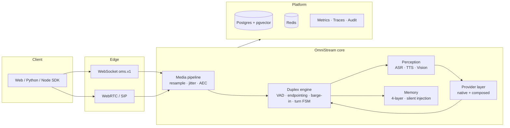

# OmniStream

**Enterprise-grade realtime full-duplex omni-modal interaction platform.**
企业级实时全双工音视频多模态交互平台。

OmniStream lets you build products where the model **watches, listens and speaks at the
same time** — the interaction model popularised by ByteDance SeedRealtime and the
OpenAI Realtime API — but fully **self-hostable**, **multi-provider** and
**observable down to every 20 ms audio frame**.

---

## Why OmniStream

| Pain point | What OmniStream does |
| --- | --- |
| Half-duplex "record → upload → wait → play" feels robotic | True full duplex: uplink and downlink audio flow concurrently; barge-in stops playback within **200 ms** |
| Vendor lock-in to a single realtime API | One `BaseRealtimeProvider` port, N adapters (Doubao / OpenAI / Gemini / Qwen / StepFun / MiniMax / composed ASR+LLM+TTS) |
| "It works on the demo, not in production" | Tenants, RBAC, quotas, rate limits, billing, recording, audit hash-chain, PII redaction — all first class |
| Realtime bugs are invisible | Per-turn metrics (TTFT / TTFA / barge-in latency), replayable recordings, structured logs with `request_id` / `session_id` |
| Can't try it without keys and GPUs | `OMS_MOCK_MODE=true` runs the **entire** pipeline with a deterministic zero-dependency mock provider |

---

## 30-second quick start

```bash
git clone https://github.com/omnistream/omnistream.git
cd omnistream
docker compose up -d          # API on :8080, console on :5173

curl -s localhost:8080/healthz
# {"status":"ok","version":"1.0.0","env":"dev"}
```

No API keys. No GPU. No model downloads. `docker compose up` starts in mock mode and
the full duplex loop — VAD → endpointing → "LLM" → "TTS" → barge-in — is exercised
end to end with synthesised audio.

Prefer bare metal?

```bash
python -m venv .venv && source .venv/bin/activate
pip install -r requirements.txt
export OMS_MOCK_MODE=true
uvicorn omnistream.api.app:app --port 8080
```

Then open <http://localhost:8080/docs>.

---

## Architecture at a glance



Read the full breakdown in [Architecture](architecture.md).

---

## Documentation map

| Document | What's inside |
| --- | --- |
| [Architecture](architecture.md) | Layering rules, package map, data flow, concurrency model |
| [Protocol spec](protocol-spec.md) | `oms.v1` WebSocket events, binary frame layout, sequencing |
| [Configuration](configuration.md) | Every `OMS_*` environment variable, defaults, profiles |
| [Error codes](error-codes.md) | The complete `OMS-XXNN` table with HTTP mapping and retry semantics |
| [ADR 0001](adr/0001-python-first-monolith.md) | Why a Python modular monolith, not Go microservices |
| [ADR 0002](adr/0002-provider-abstraction.md) | Why a single-direction event stream port |
| [ADR 0003](adr/0003-binary-ws-frame.md) | Why a custom binary frame instead of base64 JSON |

---

## Project status

| Area | State |
| --- | --- |
| Protocol `oms.v1` | Stable within major version — additive changes only |
| Kernel & contracts | Stable |
| Providers | `mock` stable; vendor adapters follow their upstream betas |
| Console UI | Beta |
| SDKs | Python & TypeScript beta |

Licensed under [Apache-2.0](https://www.apache.org/licenses/LICENSE-2.0).
