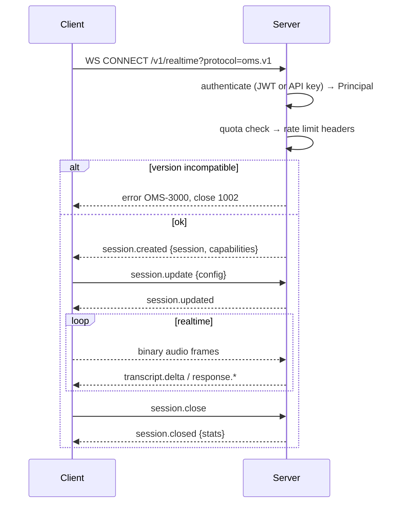

# Protocol specification — `oms.v1`

The realtime protocol runs over a single WebSocket connection carrying **two kinds of
messages**:

* **Text frames** — JSON envelopes (control, transcripts, tool calls, metrics);
* **Binary frames** — raw media (audio / video) with a compact 7-byte header.

Endpoint:

```
ws://<host>:8080/v1/realtime?session_id=<id>&protocol=oms.v1
Authorization: Bearer <jwt>      # or ?token= for browsers that can't set headers
```

---

## 1. Versioning

Version string format: `oms.v<major>`. Current: **`oms.v1`**.

Within a major version only *additive* changes are allowed:

* ✅ new optional envelope fields
* ✅ new event types
* ✅ new enum members
* ❌ removing or renaming a field
* ❌ changing the meaning of an existing field
* ❌ making an optional field required

**Clients MUST ignore unknown event types and unknown fields.** Servers reject an
incompatible major with `OMS-3000 PROTOCOL_VERSION_MISMATCH` during the handshake.

---

## 2. Envelope

Every JSON message — in both directions — is an `Envelope`:

```json
{
  "v": "oms.v1",
  "type": "response.audio.delta",
  "event_id": "evt_01J8Z9Q1M4K3T7X2A6B5C4D3E2",
  "ts": 1731412345678,
  "session_id": "ses_01J8Z9Q0ZZ5M6N7P8Q9R0S1T2U",
  "seq": 4211,
  "payload": { }
}
```

| Field | Type | Required | Meaning |
| --- | --- | --- | --- |
| `v` | string | yes | Protocol version, echoed on every message |
| `type` | string | yes | Event type (see §3, §4) |
| `event_id` | string | yes | Globally unique ULID-based ID, idempotency key |
| `ts` | int | yes | Server UTC epoch milliseconds |
| `session_id` | string | after handshake | Owning session |
| `seq` | int | server→client | Monotonic per-session sequence, used for resume |
| `payload` | object | yes | Event-specific body (may be `{}`) |

`seq` gaps are detectable by the client; requesting a resume from the last received
`seq` is the recommended recovery for a dropped connection. A server-detected gap
raises `OMS-3003 PROTOCOL_SEQ_GAP`.

---

## 3. Client → server events

| `type` | Payload | Notes |
| --- | --- | --- |
| `session.update` | `{config: SessionConfig}` | Partial update; only supplied fields change |
| `input_audio.append` | *(binary frame preferred)* | JSON form accepts base64 `{audio, sample_rate}` but costs 33 % more bytes |
| `input_audio.commit` | `{}` | Force end-of-utterance; normally endpointing does this |
| `input_audio.clear` | `{}` | Discard buffered uplink audio (e.g. user cancelled) |
| `input_video.frame` | *(binary frame preferred)* | JSON form accepts base64 JPEG |
| `input_text.send` | `{text, role="user"}` | Typed input; bypasses ASR |
| `response.create` | `{params: GenerationParams}` | Explicit trigger for manual turn-taking |
| `response.cancel` | `{reason}` | Client-initiated barge-in |
| `tool.result` | `{call_id, output, error}` | Result of a client-executed tool |
| `memory.upsert` | `{items: [MemoryItem]}` | Push facts the client already knows |
| `memory.delete` | `{ids: [string]}` | Right-to-be-forgotten support |
| `ping` | `{}` | Keepalive; server replies `pong` |
| `session.close` | `{reason}` | Graceful close; flushes recordings |

---

## 4. Server → client events

### Session & turn

| `type` | Payload highlights |
| --- | --- |
| `session.created` | `{session, capabilities, protocol_version}` |
| `session.updated` | `{session}` |
| `session.closed` | `{reason, stats}` |
| `turn.started` | `{turn_id, role}` |
| `turn.state` | `{turn_id, state}` — `idle｜listening｜thinking｜speaking｜interrupted` |
| `turn.completed` | `{turn_id, metrics: TurnMetrics, stop_reason}` |

### Speech & transcript

| `type` | Payload highlights |
| --- | --- |
| `input_audio.speech_started` | `{audio_ms, energy_dbfs}` |
| `input_audio.speech_stopped` | `{audio_ms, duration_ms}` |
| `transcript.delta` | `{turn_id, text, stable, words}` — partial ASR, may be revised |
| `transcript.done` | `{turn_id, transcript: Transcript}` — final, never revised |

### Response

| `type` | Payload highlights |
| --- | --- |
| `response.text.delta` | `{turn_id, delta}` |
| `response.text.done` | `{turn_id, text}` |
| `response.audio.delta` | *(binary frame)* pcm16 @ 24 kHz by default |
| `response.audio.done` | `{turn_id, duration_ms}` |
| `response.done` | `{turn_id, stop_reason, usage}` |
| `response.cancelled` | `{turn_id, cancelled_after_ms}` |

### Duplex control

| `type` | Payload highlights |
| --- | --- |
| `barge_in.detected` | `{turn_id, latency_ms}` — must be ≤ 200 ms |
| `playback.truncated` | `{turn_id, truncated_at_ms, discarded_ms}` |

### Vision, tools, memory, ops

| `type` | Payload highlights |
| --- | --- |
| `vision.frame_accepted` | `{frame_id, sampled, reason}` |
| `vision.observation` | `{scene: SceneDescription, entities}` |
| `tool.call` | `{call_id, name, arguments}` |
| `tool.call_done` | `{call_id, state, latency_ms}` |
| `memory.injected` | `{items, reason, relevance}` |
| `memory.silent` | `{candidates, suppressed_reason}` — retrieved but deliberately not injected |
| `metrics.tick` | `{ttft_ms, ttfa_ms, rtf, queue_depth}` |
| `rate_limit.updated` | `{remaining, reset_at}` |
| `pong` | `{}` |
| `error` | `{code, message, detail, request_id, retryable}` |

---

## 5. Binary media frames

Base64 inside JSON inflates audio by 33 % and creates avoidable GC pressure at
50 frames/second/session. Media therefore travels as WebSocket **binary** frames.

Layout — all integers little-endian:

```
offset  size  field
------  ----  -----------------------------------------------
0       4     magic       = "OMS1"  (0x4F 0x4D 0x53 0x31)
4       1     kind        1 = audio, 2 = video
5       2     header_len  uint16, JSON header length in bytes
7       H     header      UTF-8 JSON, ≤ 4096 bytes
7+H     N     payload     raw media bytes, ≤ 4 MiB
```

Audio header:

```json
{"sid":"ses_…","pts":1234,"sr":16000,"ch":1,"enc":"pcm16","seq":42}
```

Video header:

```json
{"sid":"ses_…","pts":1240,"w":768,"h":432,"enc":"jpeg","ks":0.82}
```

| Key | Meaning |
| --- | --- |
| `sid` | Session ID |
| `pts` | Presentation timestamp in milliseconds, session-relative |
| `sr` / `ch` / `enc` | Sample rate, channels, encoding (`pcm16｜opus｜mulaw`) |
| `seq` | Per-stream frame counter, for loss detection |
| `w` / `h` / `ks` | Frame width, height, keyframe-similarity score |

Malformed frames raise `OMS-3001 PROTOCOL_MALFORMED`; oversized ones are rejected before
allocation.

**Frame size discipline:** 20 ms @ 16 kHz mono pcm16 = 320 samples = 640 bytes.
This is the atomic unit of the whole platform — VAD granularity, barge-in truncation
granularity, and jitter buffer granularity are all one frame.

---

## 6. Handshake sequence



---

## 7. Error semantics

Errors always arrive as an `error` event whose payload matches the HTTP error body:

```json
{
  "code": "OMS-6003",
  "message": "provider timed out after 60s",
  "detail": {"provider": "doubao", "phase": "create_response"},
  "request_id": "req_01J8Z…",
  "retryable": true
}
```

* `retryable: true` — the client may retry the same operation, ideally with jitter.
* Fatal protocol errors are followed by WebSocket close code `1002`.
* Auth errors close with `1008`; quota errors keep the socket open so the client can
  back off and continue with reduced concurrency.

The full code table lives in [Error codes](error-codes.md).
